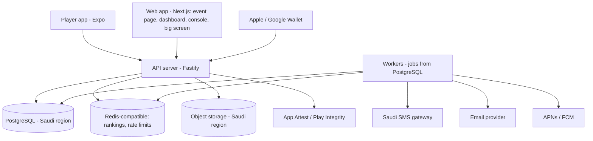
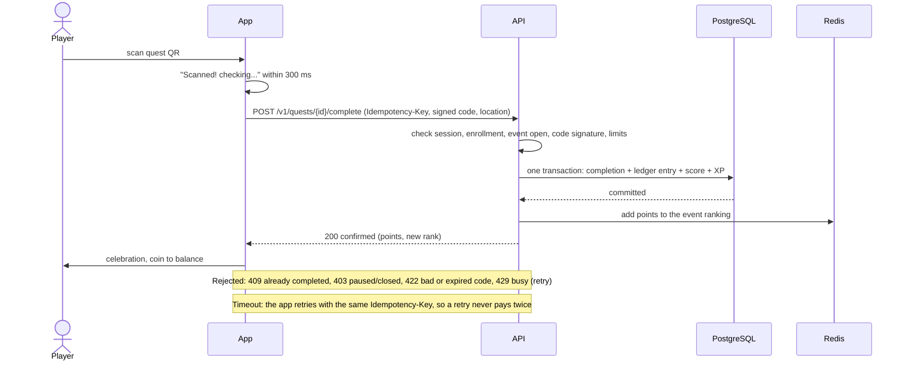

# Architecture — Questify

> How the system is structured and how data flows. Stage 6, 2026-10-17. Accepted with ADR-101 and
> ADR-102 (2026-10-17).

## Overview

Questify is a **modular monolith**: one deployable server application split into clean modules,
talking to one PostgreSQL database and one Redis-compatible store, with a thin set of worker
processes started from the same code. Three kinds of client call it: the player app (Expo, iOS,
Android and a web bonus), the web app (event page, station page, big screen, organizer dashboard,
Questify console) and wallet/push providers calling back.

Why this fits: one developer needs one thing to run and debug. The hardest load is a burst of about
330 quest completions a second, which a single well-built server with PostgreSQL absorbs. Separate
services would add network failures and deployment work for scale that may never arrive. The module
borders below are where a split would happen if the numbers ever demand it.

## Components

| Component | Responsibility | Interface | Depends on |
|---|---|---|---|
| Player app | All player and operator screens; scanning; mini-games; keeps the last working configuration | HTTPS JSON `/v1`, server-sent events for live updates | API |
| Web app | Event page, station (rotating QR) page, big screen, deletion page, organizer dashboard, Questify console | Same API; staff cookie session | API |
| API server | Authentication, authorization, all rules; the modules below | REST `/v1`, event stream | PostgreSQL, Redis, storage |
| Workers | Sends SMS, email, push; scheduled jobs (daily word, reports, reservation expiry, flag checks, nightly backup dump); wallet pass updates. **Run inside the API container in v1** (mode setting; ADR-109) and can be split out later | In-process loops over PostgreSQL tables with leases (`SKIP LOCKED`; ADR-333, ADR-345); pg-boss is not used | PostgreSQL, providers |
| PostgreSQL | The only source of truth, including the append-only points record | SQL | none |
| Redis-compatible store | Live rankings, rate limits, short-lived login/QR windows. **Rebuildable** from PostgreSQL | Redis protocol | none |
| Object storage | Photos, organizer art, exports | Signed URLs | none |
| Providers | SMS, email, push, wallet, device integrity | See `INTEGRATIONS.md` | none |

### Modules inside the API server

| Module | Owns |
|---|---|
| identity | Players, staff users, login codes, sessions, devices, bans, deletion |
| tenancy | Organizers, members, events, activation, limits, add-ons |
| config | Platform settings, event configuration, feature switches, translations (see `CONFIGURABILITY.md`) |
| quests | Categories, quests, quest types, schedules, community goals, polls, sessions (agenda) |
| verification | Quest QR codes, My QR, NFC tags, operator scans, kiosk, mini-game rounds, flags |
| ledger | The points record (event layer) and Questify XP/gems (Questify layer) |
| ranking | Scores to ranks, ties, seasons, big-screen scenes |
| rewards | Shop, reservations, uploaded codes, prize desk, handover |
| notifications | Templates, push/SMS/email, campaigns, notification center, consent checks |
| content | Announcements, maps, sponsors, surveys, daily word and bank |
| reporting | Participation analytics, exports, one-page report |
| admin | Console tools, player lookup, legal documents, health |
| audit | Append-only action logs (who, what, when) |
| wallet | Pass generation, signing, update notifications |

Rule: a module talks to another only through its exported functions, never into its tables. This
keeps the later split cheap.

**In the code (Phase 0):** identity lives in `apps/api/src/auth` (staff sign-in so far), config in `apps/api/src/settings`
and `apps/api/src/translations`, the database helpers in `apps/api/src/db`. New modules use the names in the table.

**How a request uses the database** (foundation review, 2026-10-19):
- A service owns the connection and the transaction (`withConnection` in `db/connection.ts`, then `withRequestContext`
  or, for sign-in only, `withPreIdentityContext`). The context is set in one round trip.
- Store functions take the client that is already inside that transaction and never open their own. A write that spans
  modules (a quest completion writes completion, ledger entry and score) runs in **one** transaction that the calling
  service opens and passes down.
- Every query also states its own filter (`WHERE staff_user_id = $1`, `WHERE email = $1`). Row-level security is the
  second wall, never the only one. The only queries that leave the choice to the policy are the two retention sweeps,
  which say why.
- The organizer context comes from the caller's membership row, looked up on the server; never from a header the client
  sends. Owner-only rules are enforced in the database (`app_is_owner`); event-scope limits for editors arrive with T-101.
- Every route declares who may call it (`config.access`, `route-access.ts`); a route without it stops the server from
  starting, and a test walks every route.

## Primary flow — a player scans a quest QR

1. The app shows the instant "Scanned" beat from local state (NFR-001), then sends the completion.
2. The request carries an idempotency key made on the phone. The server stores it with the
   completion, so a retry after a dropped connection returns the first result.
3. The server checks the QR's signature (a regenerated code makes old ones fail), the player's
   enrollment, the event window, the quest's limits and schedule, and raises flags without
   blocking (ADR-041).
4. One database transaction writes the completion, the append-only ledger entry and the cached
   score/balance, and the Questify XP if it is the player's first completion of that quest. Nothing is
   half-applied.
5. After commit, the ranking store is updated (T-106, ADR-118): one Redis sorted set per event, each
   player at their points and a version (the ledger entry that last changed their points, so ties go
   to who reached them first). A write never moves a player back to an older version, and a removed
   player leaves a tombstone a late write cannot undo. If the write fails, the event is marked for
   repair in PostgreSQL and a job rebuilds it within seconds; so does every change of who may be
   ranked (a ban, a status change, a new team member), through database triggers. The player still
   sees the confirmed result (with `rank: null`), and the rank catches up within the 5-second target
   (NFR-005).
6. A rejected request tells the player why; nothing is stored. Under overload the server answers
   "busy, retry" rather than losing the request (NFR-003).

Other verification paths (operator scans My QR; wallet-pass fixed code; NFC tap; mini-game round
with replay) end in the same `complete` transaction, differing only in the proof checked in step 3.

## Cross-cutting concerns

- **Errors:** one error envelope (`API.md`). Fail fast with a clear message; no silent failures; a
  failed network action is never half-applied (NFR-007, ADR-029).
- **Logging:** structured logs with request id, organizer id and event id; **no personal data in
  logs** (phone, email, free text, photos are never logged). Action logs for people go to the audit
  module, not to log files (NFR-019).
- **Configuration and secrets:** environment variables or the cloud's secret store; never in code
  or git; separate values for development, staging and production. Wallet and signing keys live in
  the secret store with restricted access.
- **Multi-tenancy:** every tenant table has `organizer_id`; row-level security is switched on in
  PostgreSQL as a second wall behind the application checks. Every table and function is closed to
  the public by default and each grant is explicit and tested from an outsider's seat (NFR-016,
  NFR-018).
- **Time:** all times stored in UTC; each event has a time zone and a "day starts at" hour (default
  4 am).
- **Visual theme (NFR-024, ADR-093):** a theme is one `Theme` value in `packages/shared/src/design/`
  (colour roles, font roles with weights, text scale, spacing, radius); `THEMES` lists them and contract tests
  (contrast, Arabic line height, order) run against each. The app reads it through `useTheme()` and
  `useThemedStyles()` (`apps/app/src/theme/theme.tsx`), mapping font roles to its font files in
  `font-faces.ts`; the web sets it as CSS variables on `<html>` (`apps/web/src/lib/theme.ts`), and a test
  refuses raw colours in style sheets. The adventure theme is the only one today; a completely different
  theme is a new value plus its fonts, with no screen rewritten.
- **Environments:** development, staging (a copy in the Saudi region), production. "Rehearsal mode"
  (ADR-080) and the review demo tenant (ADR-009) are data flags inside production, not separate
  systems.

## Consistency — the three hard cases

| Case | What happens |
|---|---|
| Two scans of the same quest at once | A unique constraint on (enrollment, quest) for one-time quests. The second request returns "already completed" |
| A request dies halfway | There is no halfway: the database transaction either commits everything or nothing. The ranking store is updated after commit and repaired by a job |
| The ranking store is lost or down | Readers get the same order straight from PostgreSQL (`ranking_top`, `ranking_position`), and the set is rebuilt from the enrollments' ledger-kept points the moment it is missing, without losing writes that land during the rebuild. A backstop rebuilds every live event every 5 minutes |
| The database is restored to 5 minutes earlier | Multi-node PostgreSQL with replicas means a node failure loses nothing; only a logical disaster needs a point-in-time restore, which can lose up to 5 minutes (ADR-082). Players confirmed in that window are told their last minutes were rolled back through a banner; the post-event report notes it. Accepted risk, rehearsed before launch (NFR-026) |
| Two editors change the same record | Last save wins (ADR-088); every change is in the audit log |
| A modified app sends a mini-game score (T-305) | The database issues the round (seed, its own clock, the level's numbers and the engine version frozen on it); the API replays the inputs with that engine version outside any transaction and hands the verdict to `finish_game_round`, which checks the clock and the window and pays once. A refusal of the request writes nothing; a refused round is written as a row, never by a raise (ADR-212). A server deploy carrying a new engine version goes out before the app release that uses it; the app keeps every engine version it may be handed |
| One request pays two players (a meeting, T-303c) | Lock order (ADR-211): the rehearsal row shared, then every enrollment the request needs in one statement in id order, then the meet code, then the quest's items in id order, then the device advisory keys in ascending key order, all before the first write; the payments then run in player id order (Questify XP rows are per player across events). Single payers keep enrollment, items, then their one device key. Lockers that run only after play ends (`reveal_results`, `confirm_results`) are left as they are |

## Observability

- Health endpoints for the API, workers and each dependency.
- Alerts (to the on-call phone and email, ADR-079) on: error rate, 95th-percentile completion time
  above 1 second, queue depth, SMS delivery rate falling, database replica lag, ranking staleness
  above 5 seconds, certificate expiry (Apple Pass Type ID, push keys).
- The platform health view in the console (F-291) reads from the same numbers.
- Error tracking must not send personal data abroad: a self-hosted tracker, or a hosted one with
  scrubbing, decided in `INTEGRATIONS.md`.

## Growth path

What changes first if usage grows tenfold: **ranking reads and live-update fan-out** (50,000 phones
asking "where am I" every few seconds). The first answer is caching the top-10 per event and
serving "around me" from Redis; the second is moving live updates into their own small service. The
ranking and notifications modules are built behind exported functions precisely so either can leave
the monolith without touching quest logic. Second bottleneck: sending 50,000 pushes in one
announcement, solved by more worker processes, not a redesign. PostgreSQL read replicas take the
dashboard and report load.

## Grill findings (2026-10-17)

- **Load plan (user: recommended).** A load test at 20,000 completions per minute per event is a
  launch gate (NFR-003). If one primary is too slow, scale the database up first and add read replicas
  for reports; the API answers `429 busy, retry` rather than losing a request. A burst queue or one
  database per event are not built unless the test proves they are needed.
- **Restore story (user: recommended).** After a rare point-in-time restore, players confirmed in the
  lost minutes are told by a banner and the report notes it. Receipt re-sending and a second durable
  log were declined. Node failures lose nothing because of replicas.
- **Riskiest dependency: the SMS gateway.** See `INTEGRATIONS.md`: one gateway at launch (the user
  declined automatic failover to a second one), with the email code as the only fallback.

## Key decisions

ADR-101 (framework, accepted), ADR-102 (technical shape, **one-way doors flagged**: PostgreSQL
with a shared schema and row-level security; TypeScript everywhere), ADR-103 (SMS shortlist),
ADR-086 (reuse), ADR-070 (residency), ADR-082 (capacity and recovery).
