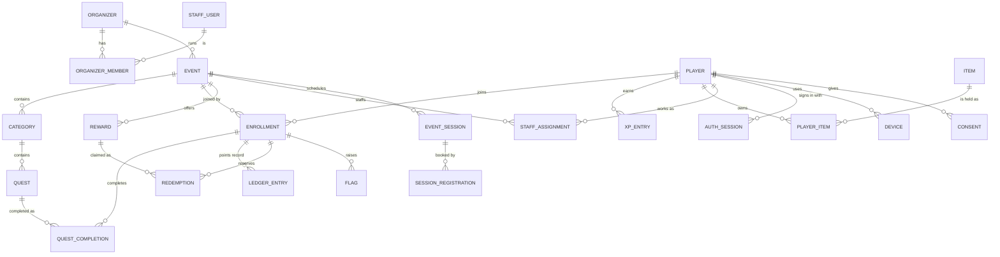

# Data Model — Questify

> What the app stores, how it relates, and what is sensitive. Stage 6 baseline, 2026-10-17. It is
> the shape to build from; exact column types and indexes are finished in the first build sprint.
> Names are in English; user-facing texts are stored per language.

## Entities

Operators are **players** with an event role (`STAFF_ASSIGNMENT`), not a separate account type
(the personal operator QR of ADR-057 identifies the player). Organizer owners, editors and Questify
admins are **staff users** with their own email-and-password accounts (ADR-078).

## Core entities

### player
| Field | Type | Constraints | PII | Notes |
|---|---|---|---|---|
| id | uuid | PK | no | |
| username | text | unique after folding (`username_fold`: case, أ/إ/آ→ا, ة→ه, ى→ي); CHECK: 3–30 Arabic letters without marks, Latin letters, digits, `_` (migration 0016) | yes (public) | The @username (gamer tag); written only by `create_player` and `rename_player` (the word lists, the change limit and the history), never by the API role directly. Every name kept in `username_history` |
| avatar | text | one of `falcon`, `fox`, `camel`, `owl`, `lantern`, `explorer-hat` (CHECK, the same list as `AVATARS`) | yes (public) | Questify's default avatars (FR-117); the player changes it freely |
| phone_e164, email | | moved to `player_contact` (migration 0005) | **yes** | Only the player and Questify admins can read them; organizers cannot (see below) |
| birth_year | smallint | nullable | yes | Age gate (13+); set only at sign-up, never changed by the API role |
| city | text | nullable | yes | Optional |
| interests | text[] | | no | Optional |
| character_id, frame_item_id, title_item_id | uuid | FK | no | Avatar parts |
| locale | text | `ar`/`en` | no | |
| xp | bigint | ≥ 0, cache of `xp_entry` | no | Lifetime |
| level | int | derived | no | |
| gems | bigint | ≥ 0, cache | no | |
| status | enum | active, banned, deleted | no | Bans stick after deletion (ADR-084) |
| created_at, deleted_at | timestamptz | | no | |

### username_history, username_word (migration 0016)
`username_history (player_id, username, reason signup|rename, changed_at)`: every name a player had, written by a
trigger on `player`; append-only for every role (deleting needs the erasure flag, T-217); no grant to the API role; the
change limit counts `rename` rows only. `username_word (word, match word|part, language)`: the lists that refuse
usernames (ADR-119), stored folded and letters only (a CHECK refuses anything else), no grant; read inside
`create_player` and `rename_player` through `username_blocked(name)`.

### player_acceptance (migration 0017)
`player_acceptance (player_id, document terms_of_use|privacy_policy|community_guidelines, version, method
signup|sign_in|reaccept|submission, accepted_at)`, primary key (player, document, version): which version of each
player document a player accepted and how (FR-1705, FR-1706). Sign-up and sign-in copy the versions the code
request carried (`player_login_challenge.terms_version` and `privacy_version`, NOT NULL, so no challenge, and so
no player, exists without them), at the challenge's time; re-acceptance and the guidelines go through
`accept_player_documents(documents jsonb, how text)` (`how` is the `method`: `reaccept` or `submission`),
bound to the calling player. Forced RLS: a player reads only their
own rows; no write grant to the API role; append-only for every role (deleting needs the erasure flag, T-217).
Players created before 0017 have no rows and are asked again.

### player_contact (migration 0005)
| Field | Type | Constraints | PII | Notes |
|---|---|---|---|---|
| player_id | uuid | PK, FK player | no | |
| phone_e164 | text | unique, +966 only (ADR-030) | **yes** | |
| email | text | unique, lowercase | **yes** | At least one of phone or email |

Kept apart from `player` so an organizer, who can see the players in its events, never sees their phone or email.
Since T-108 (migration 0020) the API's role cannot insert or update it: rows come from `create_player`, and a change
or an added identifier goes through `confirm_contact_change`.

### player_contact_challenge (migration 0020)
`player_contact_challenge (id, player_id, token_hash, channel, contact, code_hash, attempts ≤ 3, expires_at 5
minutes, created_at)`: one live challenge per player (a new request replaces it), bound to the player; the contact is
held minutes and swept an hour after expiry. No grant to the API's role: `start_contact_change` and
`confirm_contact_change` only. A confirmed change is audited as `player.contact_change` with the channel and the
kind (added or replaced), never the contact.

### Who may write what (column rules, migration 0005)
Row-level security picks rows; column grants and guard triggers close the columns that matter. For the API's role:
- `enrollment.score` and `balance`: **never written by hand.** They are copies of the points ledger; T-105 adds the ledger and the trigger that keeps them in step. A player may enroll only themselves, only in an event they can see, only as pending or active, and may only change their own status to `left`; the event's organizer or an admin changes any status.
- `player.status`: only a Questify admin, except that a player may delete their own active account. A new player is always created active.
- `organizer_member`: only the organizer's owner (or an admin) adds members or changes an editor's event limit; an editor may leave; the owner never removes or demotes themselves. Roles change only inside the invite functions (migration 0008), never through the API's role. The person who creates an organizer becomes its first owner. Owner checks run in the database (`app_is_owner`).
- `staff_user`: the API may change only `password_hash` (migration 0002).

### staff_user
| Field | Type | Constraints | PII | Notes |
|---|---|---|---|---|
| id | uuid | PK | no | |
| email | text | unique, lowercase (the API normalizes with NFKC, trim, lowercase) | **yes** | Looked up through the `app.auth_email` setting at sign-in |
| password_hash | text | argon2id | **secret** | Never logged or exported |
| platform_role | enum | none, admin | no | One admin role (ADR-079) |
| status, last_sign_in_at | | | no | |

### Staff sign-in tables (T-006, migration 0002)
| Table | Fields | Notes |
|---|---|---|
| staff_login_challenge | id, staff_user_id, token_hash (bytea, unique), code_hash (bytea), expires_at, attempts 0–5, resends 0–3, last_sent_at, consumed_at | Found only by the browser's secret token. `code_hash` is an HMAC bound to the challenge id. A new challenge deletes the user's earlier ones; rows older than a day are swept |
| staff_session | id, staff_user_id, token_hash (bytea, unique), created_at, last_seen_at, revoked_at, user_agent, ip | **IP and user agent are personal data**; they live only here and are swept 30 days after the session ends. The API may update only `last_seen_at` and `revoked_at`; a trigger refuses un-revoking |
| auth_throttle | bucket, key (HMAC), at | Sliding-window counts for failed attempts per email and per address (IPv6 as /64) and for challenges per user. Keys are keyed hashes, never readable. Rows older than a day are swept |

The API role cannot create staff accounts or change `platform_role` / `status` (column grants): accounts come from the owner connection (the `staff` CLI) and, since T-101, from the definer functions `complete_signup` and `accept_invite_new` only.

### The organizer context (T-101, migration 0008)
1. **No staff member, no tenant.** `app_organizer_id()` returns the request's organizer only when the request's staff
   user is a member of it (or the request is a platform admin's). An organizer context without a member staff user
   opens nothing, so a forged or stale organizer id reaches no row. Future non-staff tenant contexts (jobs, operators,
   screens) get their own explicit branch when they are built.
2. **The event limit comes from the membership row.** `app_event_scope()` reads the caller's `event_scope`; NULL
   means every event, and an empty limit is refused (there is no "none"). Every table that names an event checks it
   for organizer members: `event`, `enrollment`, the players reached through enrollments, and the event entries of
   `audit_log`. Organizer-level audit entries (team changes, no event) stay readable by every member: team membership
   is not secret. A limited editor cannot create events (they would fall outside their own limit).
3. A limit names only the organizer's own events (trigger). Policies call the context functions directly, never
   through a sub-select: the event and enrollment rules refer to each other, and PostgreSQL treats any sub-select in
   that cycle as infinite recursion.
4. Organizers are created only by `create_organizer` (signed-in staff) and `complete_signup`, both with the three
   acceptances and an audit entry. Members join only through `accept_invite` / `accept_invite_new`, which also move
   ownership for an owner invite.

### Organizer team tables (T-101, migration 0008)
| Table | Fields | Notes |
|---|---|---|
| organizer_acceptance | organizer_id, document (organizer_terms, organizer_dpa, organizer_content_rules), version, accepted_by, accepted_at | Append-only; written only by the creation functions; members read their organizer's rows (FR-1726) |
| organizer_invite | id, organizer_id, email, role (editor, owner), event_scope, token_hash, invited_by, expires_at | One per email per organizer; one owner invite per organizer; found by members or by the link's token; swept 30 days after expiry. Email is PII |
| staff_signup | id, token_hash, code_hash, email, password_hash (NULL when the email already had an account), organizer_name, accepted versions, attempts, resends, last_sent_at, expires_at | Found only by the browser's token; swept after a day. Email is PII |

### organizer and organizer_member
`organizer(id, name, slug, status, branding jsonb{logo, banner, accent}, dpa_accepted_at,
created_at)`. `organizer_member(organizer_id, staff_user_id, role owner|editor, event_scope null|ids)`
for optional editor event limits (ADR-077). PII: names and emails of staff (via staff_user).

### event
| Field | Type | Constraints | PII | Notes |
|---|---|---|---|---|
| id | uuid | PK | no | |
| organizer_id | uuid | FK, indexed, RLS key | no | |
| join_code, slug | text | unique | no | In QR and event page |
| status | enum | draft, scheduled, live, ended, archived | no | Matches FR-1017 and the code; activation by Questify (ADR-076); rehearsal is a mode of a draft or scheduled event (ADR-080) |
| player_limit_mode, player_limit | enum, int | hard/soft/none | no | |
| add_ons | text[] | | no | Big screen, NFC, kiosks, sponsors, branding, invitations |
| timezone, day_start_hour | text, int | default 4 | no | A real IANA zone (trigger against `pg_timezone_names`, migration 0009) |
| kind | text | physical, virtual, workplace | no | Migration 0009 |
| venue_ar, venue_en | text | ≤ 200 | no | Migration 0009 |
| join_methods | text[] | ⊆ code, qr, link, public_list; ≥ 1; public_list only when access is public | no | Migration 0009 |
| starts_at, ends_at, shop_closes_at | timestamptz | | no | Balance closes after the shop window (ADR-048) |
| config | jsonb + config_version | schema-validated | no | `features` (the event's switches) and `terms` (its words, T-117); every write bumps `config_version`. See `CONFIGURABILITY.md` |
| focus_quest_id | uuid | null, or a quest of the same event (FK `(focus_quest_id, id)` → `quest (id, event_id)`); `ON DELETE SET NULL (focus_quest_id)` | no | The quest pinned as Up next (FR-1748); migration 0021 |
| managed_by_questify | bool | | no | ADR-077 |

**The event lifecycle (T-102, migration 0009).** The API's role never writes `status`: column grants leave it out of
INSERT and UPDATE, so a new event is always a draft. Questify activates it (T-210, draft to scheduled); time moves it from
scheduled to live to ended, through `advance_event_lifecycle()`, which the API calls every 30 seconds and which audits
each move as `event.lifecycle` (actor `system`); only the owner ends a live event early (`end_event_early`, audited as
`event.end`). `event_status_now(status, starts_at, ends_at)` gives the status at this moment, so nothing waits for the
tick; it is the only place the rule lives. Out of draft an event always has both times (CHECK). The times guard, judged
on the status now: scheduled keeps a future start; live keeps its start, zone and day start and its end may only move
later; ended keeps everything. Only drafts are deleted (policy), and a deleted event leaves the editor limits that named
it, except a limit's last event, which stays so the editor sees nothing rather than everything.

**Activation and limits (T-210, migration 0027, ADR-140 to ADR-142).** `event` gains `player_limit_mode` (none, soft,
hard), `player_limit` (1 to 1,000,000; NULL exactly with none), `activated_at` and `activated_by`; none is in the API
role's grants. `event_activation_request(event_id PK, organizer_id, state pending|rejected, requested_by, requested_at,
note, decided_by, decided_at)` and `event_limit_alert(event_id, organizer_id, level 80|100, players, reached_at; PK
(event_id, level))` are read by the event's team within their limit and by admins, and written only by definers:
`request_event_activation` and `withdraw_event_activation` (the owner), `activate_event`, `reject_event_activation` and
`set_event_player_limit` (an active platform admin, confirmed by `app_admin_id()`), each audited. **Seats** are
enrollments pending, active or banned; the trigger `enrollment_player_limit` lets a move into pending or active through
only below a hard limit (`QL409` otherwise, serialized per event by a transaction lock) and records the 80% and 100%
marks once. `event_seat_count(event)` gives the count to the team and admins.

**Rehearsal (T-211, migration 0032, ADR-157 to ADR-160).** `event_rehearsal(event_id PK, organizer_id, code
XXXX-XXXX unique (capitals and digits without I, O, 0, 1), code_set_at, first_play_at, erased_at, erase_counts jsonb,
live_wiped_at)`: one row once the team opens the rehearsal card; read by the event's team within their limit and by
admins, written only by definers (`open_rehearsal`, `rotate_rehearsal_code`, `erase_rehearsal`, the wipe); deleted with
the event. A rehearsal account is an enrollment with `joined_via = 'rehearsal'` (made only by `join_rehearsal`, at
most 25 an event, no seat, no welcome; a guard keeps it one and keeps a real one real). `ledger_entry.rehearsal` and
`bulk_award.rehearsal` mark rehearsal rows. `wipe_rehearsal(event, reason, request)` deletes the rehearsal accounts with
their completions, ledger entries (with notes and keys), reservations, flags and join answers (rehearsal `bulk_award` rows stay, with no notes, so a retried key replays
instead of running live; their quest key is `ON DELETE SET NULL (quest_id)`), recomputes
each reward's `units_out` from the holds that remain, marks the ranking for repair and audits
`event.rehearsal_erased` with the counts. It runs at go-live (`ensure_rehearsal_wiped`, called first by every writer and
by the tick) or on the team's erase before go-live.

### enrollment (a player in an event)
`id`, `event_id`, `player_id`, `joined_at`, `joined_via` (code, qr, link, public_list, operator, invite, rehearsal), answers in
`join_answer` (below), `score bigint` and `balance bigint` (**caches of the
ledger**), `status` active/left/removed/banned. **Unique (event_id, player_id).** Score is points
earned and ranks; balance is earned minus spent (ADR-043).
**Ranking (T-106, migration 0015):** `score_version bigint`, the id of the ledger entry that last changed the score
(set by the ledger trigger; ties go to the lower version, FR-606); index `(event_id, score DESC, score_version)` for
active rows with points (it replaces the earlier ranking index). Who is ranked is one rule in two forms
(`ranking_eligible` for a row, `ranked_enrollments(event)` for an event, tested to agree): points above zero, an
active enrollment and player, and not on the organizer's team by email. `ranking_repair (event_id, marked_at)` holds
the events whose Redis copy may be wrong (no grants; written by definers and by triggers on enrollment and player
status, contact email and team membership; claimed by the repair job). The Redis copy holds enrollment ids, points
and versions only, never a name or contact (ADR-118).
**Joining (T-111, migration 0018):** `card_version` (the join card the player accepted, FR-121; NULL before 0018) and
`joined_via` (code, qr, link, public_list). Nobody inserts an enrollment directly but the platform admin: players
join through `join_event(code, via, card)`, which checks the event's state, its join methods and access type (a
private event makes a `pending` member) and decides under a row lock; organizers will invite through their own
definers (T-204, T-218). Anonymous reads go through `public_events`, `public_event` and `public_event_quests`, which
return named columns only (never a quest's `type_config`). An event's members read its quests through
`member_event_quests(event)` (migration 0021): an active enrollment of an active player only, visible quests by named
columns, each with how many times the calling player completed it and, since migration 0022, the points they earned
from it (`earned`, the sum of their ledger entries for the quest, so a later points change does not move it).
The activity history reads `member_activity(event, before_id, page)` (migration 0023): the calling active member's own
ledger entries in the event, newest first, a page of at most 100, each with its quest's title.
**Standing (T-208, migration 0019):** an enrollment's status changes from the organizer seat only through
`set_enrollment_ban(event, enrollment, banned, request)` (the owner; `active|pending|left → banned`, `banned →
active`, audited with statuses only); the player's own way out is `active|pending → left`; the admin keeps direct
changes. Organizers read players only through `event_players(event, after, page, prefix)`, which returns
`enrollment_id, username, avatar, status, score, joined_at` (`player_own` no longer has an organizer branch).

### event_exclusion (migration 0019)
`event_exclusion (id, organizer_id, event_id, kind phone|email_domain, value, created_by, created_at)`, unique
`(event_id, kind, value)`, at most 500 an event; phones `+9665XXXXXXXX`, domains lower case with dotted labels
(an `xn--` last label allowed), checked by the table; `(event_id, organizer_id)` references the event, deleted with
it; `created_by` set NULL when the staff account goes (the audit entry keeps who). Forced RLS: the event's team reads;
written only by `add_exclusion` and `remove_exclusion` (the owner). Both forms of the ranking rule leave listed
players unranked (a phone equal, or an email whose domain equals an entry); list changes and a player's phone or
email change mark the event's repair.

### category, quest
`category(id, event_id, title i18n, order_mode any|in_order, completion_bonus, position, collapsed)`.
`quest(id, event_id, category_id, type, title/description i18n, points, verification, caps,
opens_at/closes_at, flash, community_goal, status, qr_version, type_config jsonb, version)`.
**Built so far (T-103, migration 0010):** `category(name_ar, name_en, position)` and `quest(type, title, description,
points, repeat_cap, opens_at, closes_at, visible, position, type_config)`; each later field arrives with its task
(order mode, bonus and unlocks T-304; verification and QR version T-104; flash T-307; community goal T-306; pause as
its own field T-603). Show or hide is `visible`, not a status.
`type_config` is validated per quest type by the shared schema. Editing a live quest asks
"future only or also past" (ADR-063) and writes the audit log.

### quest_completion
**Built (T-105, migration 0012):** `id bigint, organizer_id, event_id, enrollment_id, quest_id, occurrence (1 … the
quest's cap), method (qr|code; later tasks add my_qr, nfc, manual, submission…), idempotency_key, device_id, created_at`.
**Unique (enrollment_id, quest_id, occurrence)** (one row per time a player completed a quest) and **unique
(enrollment_id, idempotency_key)** (a retry finds the first completion). Composite foreign keys keep the event, the
enrollment and the quest of one tenant; all RESTRICT. `device_id` (an app install id, personal data) lives here, not on
the ledger, so account deletion can clear it. Pending and approved states arrive with submissions (T-301).

### ledger_entry (event layer; append-only)
**Built (T-105, migration 0012):** `id bigint, organizer_id, event_id, enrollment_id, kind (quest; then welcome, redeem, redeem_return, handover; award and removal since T-207), score_delta, balance_delta,
completion_id, quest_id, actor (player, system, operator since T-205, staff since T-207), operator_id, staff_user_id,
reverses, created_at`. Two deltas so a spend moves only the balance and a removal after spending can move the score
and the balance by different amounts (FR-1601), while score and balance stay the exact sums of this table. A trigger
moves the enrollment's caches on every insert. Append-only for every role, the owner included (ALWAYS triggers on
UPDATE, DELETE, TRUNCATE; NFR-019). Only definers write it; corrections are new entries. The one exception (ADR-157,
migration 0032): a row with `rehearsal = true` (set at insert from its enrollment, never by a writer) may be deleted by
the rehearsal wipe of its own event. A partial unique
index pays a completion once.

**Manual awards (T-207, migration 0030, ADR-152):** kinds `award` (points by hand: `score_delta = balance_delta > 0`,
no completion, quest or redemption, actor `operator` or `staff`) and `removal` (`reverses` names the credit entry it
takes back, unique: once per entry; `score_delta` and `balance_delta` ≤ 0, each clamped so neither total goes below 0,
FR-1601; actor `staff`; it copies the removed entry's `completion_id` and `quest_id`, so per-quest sums net out).
Actor `staff` with `staff_user_id` (an owner or editor on the dashboard; `(actor = 'staff') = (staff_user_id IS NOT
NULL)`; staff write only `quest`, `award` and `removal`). Credit kinds that can be removed: `quest` (any method),
`award`, `welcome`. A manual quest award is a completion with method `manual`. A removed quest stays used (it counts
toward the repeat cap).

- `ledger_note (entry_id PK → ledger_entry, organizer_id, event_id, reason 1–300 \| null, bulk_id → bulk_award \| null,
  created_at)`: the staff-typed reason beside each `award`, `removal` and manual quest entry (exactly one of `reason`
  and `bulk_id`; a bulk award's reason is stored once on `bulk_award`). Kept out of the ledger because it may name a
  person: insert-only for the API role, and only the database owner may update it (T-217 clears it). Never shown to
  the player.
- `manual_award_key (id, event_id, operator_id → player \| staff_user_id → staff_user, idempotency_key, entry_id,
  enrollment_id, amount, created_at)`, unique per (event, actor, key): the idempotency record of points awards and
  removals, looked up before any other check (a quest award uses the completion's key).
- `bulk_award (id, organizer_id, event_id, staff_user_id, amount 1–100 000, reason, target list\|quest, quest_id,
  count_awarded, count_skipped, idempotency_key, created_at)`, unique per (event, staff user, key) (FR-1712).
- `event.award_cap_each` (default 200, 1 to 100 000) and `event.award_cap_day` (default 500, at least the per-award
  cap, at most 1 000 000): the per-award and per-person-per-day caps for operators and editors, the day being the
  event's day; written only by `set_award_caps` (the owner; audited).
- All written only by definers (`operator_award`, `staff_award`, `remove_award`, `bulk_award`, `set_award_caps`), with
  forced row-level security, no direct grants and nothing for PUBLIC.

**`complete_quest` (definer):** the only writer of completions and quest entries. The player is the request's
`app.player_id`, never an argument; it locks the player's enrollment, answers a repeated key with the first completion,
then checks the enrollment is active, the event live at this moment, the quest visible and open, the proof fitting the
quest's type (QR version, typed code), and the cap, and writes the completion and the entry.

### xp_entry and gem entries (Questify layer; append-only)
`xp_entry(id, player_id, delta, source (quest_first_completion|daily|level|...), ref, created_at)`;
the gem ledger has the same shape. First completion of a quest earns its fixed XP once (ADR-044).

### reward, reward_code, redemption
Built in migrations 0024 (T-201, T-202; ADR-133), 0025 (T-219, T-203; ADR-134 to ADR-136) and 0029 (T-206; ADR-150,
ADR-151):
- `reward(id, organizer_id, event_id, kind item|experience|digital, name i18n, description i18n, price, stock_total, units_out,
  per_player_limit, opens_at, closes_at, section, tag_new, tag_limited, position, status active|removed)`. Stock left is
  `stock_total − units_out`; `units_out` moves only inside the definer functions, and a CHECK keeps it between 0 and
  the total. A digital reward's `stock_total` is its uploaded codes: created at 0, raised only by `add_reward_codes`
  (a guard refuses the API role any other change).
- `redemption(id, organizer_id, event_id, enrollment_id, reward_id, price (what was paid), status
  reserved|cancelled|expired|delivered|handed_over, idempotency_key, reserved_until (null only when delivered),
  ended_at, ended_by player|timeout|delivery|handover|operator, operator_id (who handed over or cancelled at the desk),
  collect_until (the player's Collect), offer_by and offer_until (the desk's offer))`; a digital redemption is
  `delivered` at once (ADR-136); a handed-over one keeps its unit out. Collect and offer exist only on a reserved row.
  Never deleted; no role writes it but the definers.
- `event` gains `pickup_minutes` (default 120), `shop_days_after` (default 3), `shop_rules` i18n and
  `spend_lowers_rank` (default false; the owner's, locked from live on, FR-1847); the prize desk (0029):
  `desk_location` i18n, `desk_lat`/`desk_lng` (both or neither), `desk_hours tstzmultirange` (null: open the whole
  time; 1 to 14 bounded windows) and `handover_confirm collect_first|desk_offer`. `desk_state()` is the one rule for
  open, closed and finished. An item reward needs the desk's place (a guard on both tables).
- The ledger gains `redeem` (balance −price) and `redeem_return` (balance +price), both with `redemption_id`, one of
  each per reservation at most; the `system` actor writes only `redeem_return` (the timeout). `score_delta` is 0, or
  equal to `balance_delta` when the event's option was on and the event live at the spend (ADR-135); a return mirrors
  its own payment's score. A spend that moves the score marks the ranking for a rebuild. `handover` (0029): both
  deltas 0, the handing operator named, one per redemption; an operator's cancel writes `redeem_return` as the
  operator. Score ≥ balance holds for
  every enrollment (quests add both equally); a future balance-only credit would break it, so it must say so.
- `reward_code(id bigint, organizer_id, event_id, reward_id, code_cipher bytea, code_hash bytea, redemption_id unique
  null, created_at)` (**secret**, organizer-uploaded; T-203): the API's AES-256-GCM cipher bound to the reward and an
  HMAC for finding repeats, unique per event. Organizers read only `id, reward_id, redemption_id, created_at`; players
  and outsiders nothing; `add_reward_codes` writes and `reserve_reward` gives the oldest unused code.
  The desk's hold (0031, T-209): `desk_hold(enrollment, event)` answers `paused` (the owner's pause), then `held` (a
  banned player, or an open flag while `event.flag_hold` is on), and `finish_handover` and the desk's offer refuse
  either (`RH409`) **before** the status check, so the desk never learns of a ban. `desk_items` (the lookup and the
  find) shows only `active` and `hold`, never the status. `enrollment.redeem_paused_at` (0031) also refuses new
  reservations and Collect (`RP403`, after the replay check).

### submission
`id, completion_id, kind photo|text|video_later, media_key, text, review_status, reviewer, note`.
**PII:** photos and free text may show people; no AI moderation (ADR-071); reports and takedown per
PD-29.

### flag, ticket, audit_log
`flag(id bigint, organizer_id, event_id, enrollment_id, kind shared_device|burst, device_id (shared_device only),
evidence jsonb, status open|cleared|confirmed, resolution cleared|points_removed|banned, note, raised_at, last_seen_at,
resolved_at, resolved_by staff_user)` (migration 0031, T-209, ADR-153 to ADR-155): raised by a trigger on every new
`quest_completion` (not `manual`), inside its transaction. Same phone: one case per account and install id, ever, for
every account of the event seen on it (under a lock on the event and device); burst: 10 scans within 5 minutes
(`flag_tuning()`), one open case per account, counting again only after its last resolved one. No grant to the API
role: the team reads and closes cases through `event_flags`, `flag_detail` and `resolve_flag`; a ban
(`set_enrollment_ban`) closes the player's open cases. `event.flag_hold` (default on) and `enrollment.redeem_paused_at`
are written only by `set_flag_hold` and `set_redeem_pause` (owner, audited). **PII:** `device_id` and `evidence` go
with the account (T-217). `ticket(id, event_id, player_id, text, status, answers)`.
`audit_log(id bigint identity, at, actor_type admin|staff|system, actor_id, organizer_id, event_id, action,
target_type, target_id, before jsonb, after jsonb, request_id)` (migration 0006, T-004): append-only for every
role, the database owner included (triggers set to fire always). No foreign keys, so an entry outlives the event it
describes. The API may insert only in its own name and cannot set `id` or `at`; an organizer reads its own entries
(including a Questify admin's support work in its events), an admin reads all. No client address and no email: the
request id links an entry to the server log. `before`/`after` hold only the top-level keys that changed and never a
secret or contact detail (refused in code, which rolls back the change too).

## Other entities (one line each)

| Entity | Purpose | PII |
|---|---|---|
| player_session, player_refresh, player_login_challenge (built: T-105, T-107, migration 0013), device | Access tokens (1 hour, `refresh_family`), rotating refresh tokens (180 days; a family per device, at most 10 live; reuse ends the family), one-time code challenges (the phone or email, its keyed hash for lookup, the code's HMAC, 3 tries, 3 resends, 5 minutes; the signup token's hash for 15 minutes after a right code for a new contact). No grant on the challenge and refresh tables: definer functions only. Swept: challenges an hour after expiry, ended or used tokens 7 days after; device + push token + integrity result later | The challenge holds a phone or email for minutes; tokens are stored hashed |
| username_history, deletion_fingerprint | Old names; one-way hash of phone/email so bans survive deletion (ADR-084) | Hash only |
| consent, legal_document | Per-channel opt-ins with dates and text version; versioned terms/privacy/guidelines/DPA | Yes |
| staff_assignment | An operator of one event (T-204): the player, abilities (FR-908, all seven by default), `can_play` (FR-906), the invite it came from; `staff_assignment_quest` holds the quest limit (none: every quest). Written only by owner definers; removal deletes the row (audited) | Links a player |
| item, player_item, achievement, player_achievement, passport_stamp, streak | Questify layer collectibles and progress | Linked to player |
| minigame_round | Seed, issue time, replayed inputs, result | Linked to player |
| daily_word, word_bank | Daily word and valid guesses per language (ADR-097) | No |
| announcement, notification, notification_delivery, campaign | Messages, per-player delivery state, scheduled sends | Delivery rows yes |
| event_session, session_registration | Agenda sessions and bookings, door check-in (ADR-095) | Registrations yes |
| venue_map, map_pin, sponsor, survey, survey_answer | Maps, sponsor profiles, surveys | Answers yes |
| translation | One row per key an admin changed: `key`, `ar`, `en` (each null when that language uses the shipped text), who and when. A row with neither language is deleted. Anyone using the app may read; only a Questify admin writes | No |
| platform_setting | One row per block: `features` (per feature: enabled, message, minAppVersion) and `tuning` (numbers). Anyone using the app may read; only a Questify admin writes; never deleted. Records who changed it | No |
| event_entitlement | Add-ons Questify unlocked for an event (`event_id`, `feature`, `granted_by`). Kept apart from `event.config` because the organizer can edit that column and must not unlock anything for themselves (FR-1729). Visible to whoever can see the event; written only by an admin | No |
| event_activation_request | The owner's activation request: pending, or rejected with the admin's note (T-210). Written only by definers | No |
| event_rehearsal | The event's rehearsal: its code, when it was first played, the last erase and its counts (T-211). Written only by definers | No |
| event_limit_alert | The 80% and 100% player-limit marks reached, once per limit (T-210). Written only by the limit trigger and `set_event_player_limit` | No |
| wallet_pass, wallet_registration | Serial, auth token, device registrations for pass updates | Linked to player |
| word_list, deletion_request, data_request | Username filter lists; legal requests and what was done | Requests yes |
| usage_counter | Per-event SMS, push and player counts for the usage view (ADR-076) | No |
| event_join_field, join_answer, event_guest (built, T-212, migration 0028) | Up to 5 join fields per event; each member's answers (**PII**, written only by the join definers, read by the event's team, the player and admins; a deleted field takes its answers); guest-list phones and emails (at most 10 000, unique per event). `event` gains `join_fields_version`, `guest_list_only`, `email_domains` (≤ 10) and `welcome_points`; the `welcome` ledger kind (one per enrollment, actor `system`) | Yes (answers, guest list) |
| poll, poll_vote, survey_question, quest_rating | Live polls and their options, one vote per player, survey questions, optional quest ratings | Votes and answers yes |
| community_quest, milestone | Shared goals with measure, milestones, rewards | No |
| rank_prize, souvenir_grant | Prizes attached to final ranks with claim deadline; souvenir rules and grants | Grants link to players |
| questify_quest, daily_question | Quests not tied to an event, in their own table (ADR-114, Proposed; `quest.event_id` is never null); the daily challenge question bank | No |
| ranking_season | Monthly Questify-wide seasons and archives | No |
| report, block, ban_appeal | Player reports and blocks, platform-ban appeals | Yes |
| device_pairing | Paired stations, kiosks and big screens, with pairing codes | Device tokens |
| operator_invite | Personal QRs, batches with a preset and email invites (T-204): label, abilities, expiry, claimed by, cancelled. The token is the API's signature over the id, never stored; the email is cleared once claimed, cancelled or expired | Claimed person |
| invitation_campaign | Questify invitations by interest and city, with counts | No (counts only) |
| organizer_acceptance | Versioned acceptance of organizer terms, DPA and policy with time | Staff user |
| event_template | Template structures used to start an event | No |
| photo_consent | Per-photo permission for the photo wall | Linked to submission |

## Relationships

- An organizer has many events; an event has many categories, each with many quests.
- A player joins many events through one enrollment per event; an enrollment has many completions
  and many ledger entries.
- A completion belongs to exactly one enrollment and one quest.
- A reward has many redemptions; a redemption belongs to one enrollment.
- XP, gems, items, achievements and passport stamps belong to the **player**, not the enrollment, so
  they follow the player across events (ADR-044).
- Staff users belong to organizers through memberships; operators are players with an assignment.

## Indexes and keys

Derived from the primary flows:
- `quest_completion`: unique (enrollment_id, quest_id) and unique (idempotency_key); index
  (quest_id, created_at) for the dashboard.
- `ledger_entry`: index (enrollment_id, id) to sum a player; (event_id, created_at) for reports.
- `enrollment`: unique (event_id, player_id); index (event_id, score desc) as the fallback ranking
  when the cache is rebuilding.
- `player`: unique (username), unique (phone_e164), unique (email); trigram index for admin search.
- `event`: unique (join_code); index (organizer_id, status).
- `redemption`: index (reward_id, status), (reserved_until) for the expiry job.
- `notification_delivery`: index (status, scheduled_at) for the sender.
- Every tenant table: index starting with `organizer_id` or `event_id`, and a row-level-security
  policy on the same key.

## Sensitive data

| Data | Why collected | Protection | Retention | Who may read |
|---|---|---|---|---|
| Phone, email | Sign-in, prize contact, consented messages | Encrypted at rest by the managed database; column access limited to the identity module; never in logs or push text | Until deletion; Q-075 | Player; support/admin (read-only, logged, ADR-094) |
| Birth year, city, interests | Age gate, optional personalization | Same | Until deletion | Player; admin |
| Join answers | Organizer's disclosed fields (PD-17) | Visible only to that organizer's team; listed on the join card | Event data retention (Q-075) | Organizer team of that event |
| Location readings | Fair-play flags only while the app is open (ADR-072) | Stored with the flag only; no tracking history | Short; Q-075 | Admin; the event's staff for flags |
| Photos, free text | Photo and text quests | Private storage, signed URLs; PD-29 report and unpublish | Event retention; Q-075 | Organizer team; reviewers |
| Password hashes | Staff sign-in | argon2id; never exported | Until account removal | Nobody |
| Uploaded prize codes | Digital prizes | Encrypted column, shown only at handover | Until used or event end | Prize desk at handover |
| Login codes | One-time sign-in | Stored hashed; 5-minute expiry; attempt limit | Minutes | Nobody |
| Device and push tokens | Notifications, device-integrity flags | Revoked on sign-out | Until sign-out or deletion | System |
| Audit logs | Accountability (NFR-019) | Append-only; on deletion the player's entries are anonymized | Q-075 | Admin |
| Deletion fingerprint | Keep bans after deletion (ADR-084) | One-way hash only | Q-075; counsel Q-051 | System |
| Wallet pass data | Logo, name, dates, @username, score, balance, level, rank, last-updated on a pass (ADR-091; data abroad, Q-043) | Minimal fields; counsel review | As the pass exists | Apple/Google, the player |
