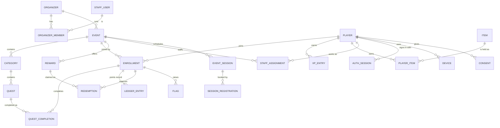

# Data Model — Questify

> What the app stores, how it relates, and what is sensitive. Stage 6 baseline, 2026-10-17. It is
> the shape to build from; exact column types and indexes are finished in the first build sprint.
> Names are in English; user-facing texts are stored per language.

## Entities

Operators are **players** with an event role (`STAFF_ASSIGNMENT`), not a separate account type
(the personal operator QR of ADR-057 identifies the player). Organizer owners, editors and Questify
admins are **staff users** with their own email-and-password accounts (ADR-078).

## Core entities

### player
| Field | Type | Constraints | PII | Notes |
|---|---|---|---|---|
| id | uuid | PK | no | |
| username | citext | unique, required | yes (public) | The @username (gamer tag); changeable by the Questify team, old names kept in `username_history` |
| phone_e164 | text | unique, nullable | **yes** | +966 only (ADR-030); at least one of phone or email |
| email | citext | unique, nullable | **yes** | |
| birth_year | smallint | nullable | yes | Age gate (13+) |
| city | text | nullable | yes | Optional |
| interests | text[] | | no | Optional |
| character_id, frame_item_id, title_item_id | uuid | FK | no | Avatar parts |
| locale | text | `ar`/`en` | no | |
| xp | bigint | ≥ 0, cache of `xp_entry` | no | Lifetime |
| level | int | derived | no | |
| gems | bigint | ≥ 0, cache | no | |
| status | enum | active, banned, deleted | no | Bans stick after deletion (ADR-084) |
| created_at, deleted_at | timestamptz | | no | |

### staff_user
| Field | Type | Constraints | PII | Notes |
|---|---|---|---|---|
| id | uuid | PK | no | |
| email | text | unique, lowercase (the API normalizes with NFKC, trim, lowercase) | **yes** | Looked up through the `app.auth_email` setting at sign-in |
| password_hash | text | argon2id | **secret** | Never logged or exported |
| platform_role | enum | none, admin | no | One admin role (ADR-079) |
| status, last_sign_in_at | | | no | |

### Staff sign-in tables (T-006, migration 0002)
| Table | Fields | Notes |
|---|---|---|
| staff_login_challenge | id, staff_user_id, token_hash (bytea, unique), code_hash (bytea), expires_at, attempts 0–5, resends 0–3, last_sent_at, consumed_at | Found only by the browser's secret token. `code_hash` is an HMAC bound to the challenge id. A new challenge deletes the user's earlier ones; rows older than a day are swept |
| staff_session | id, staff_user_id, token_hash (bytea, unique), created_at, last_seen_at, revoked_at, user_agent, ip | **IP and user agent are personal data**; they live only here and are swept 30 days after the session ends. The API may update only `last_seen_at` and `revoked_at`; a trigger refuses un-revoking |
| auth_throttle | bucket, key (HMAC), at | Sliding-window counts for failed attempts per email and per address (IPv6 as /64) and for challenges per user. Keys are keyed hashes, never readable. Rows older than a day are swept |

The API role cannot create staff accounts or change `platform_role` / `status` (column grants): accounts come from the owner connection (the `staff` CLI) until T-101 and T-701.

### organizer and organizer_member
`organizer(id, name, slug, status, branding jsonb{logo, banner, accent}, dpa_accepted_at,
created_at)`. `organizer_member(organizer_id, staff_user_id, role owner|editor, event_scope null|ids)`
for optional editor event limits (ADR-077). PII: names and emails of staff (via staff_user).

### event
| Field | Type | Constraints | PII | Notes |
|---|---|---|---|---|
| id | uuid | PK | no | |
| organizer_id | uuid | FK, indexed, RLS key | no | |
| join_code, slug | text | unique | no | In QR and event page |
| status | enum | draft, rehearsal, active, closed, archived | no | Activation by Questify (ADR-076) |
| player_limit_mode, player_limit | enum, int | hard/soft/none | no | |
| add_ons | text[] | | no | Big screen, NFC, kiosks, sponsors, branding, invitations |
| timezone, day_start_hour | text, int | default 4 | no | |
| starts_at, ends_at, shop_closes_at | timestamptz | | no | Balance closes after the shop window (ADR-048) |
| config | jsonb + config_version | schema-validated | no | See `CONFIGURABILITY.md` |
| managed_by_questify | bool | | no | ADR-077 |

### enrollment (a player in an event)
`id`, `event_id`, `player_id`, `joined_at`, `join_source`, `join_answers jsonb` (**PII**, only
fields disclosed on the join card, PD-17), `score bigint` and `balance bigint` (**caches of the
ledger**), `status` active/left/removed/banned. **Unique (event_id, player_id).** Score is points
earned and ranks; balance is earned minus spent (ADR-043).

### category, quest
`category(id, event_id, title i18n, order_mode any|in_order, completion_bonus, position, collapsed)`.
`quest(id, event_id, category_id, type, title/description i18n, points, verification, caps,
opens_at/closes_at, flash, community_goal, status, qr_version, type_config jsonb, version)`.
`type_config` is validated per quest type by the shared schema. Editing a live quest asks
"future only or also past" (ADR-063) and writes the audit log.

### quest_completion
`id, enrollment_id, quest_id, status pending|approved|rejected, idempotency_key, verified_by (player
id of the operator, if any), method (qr|my_qr|nfc|manual|auto|wallet_code|minigame|submission|vote),
created_at, decided_at`. **Unique (enrollment_id, quest_id)** for one-time quests and
**unique (idempotency_key)**. Repeatable quests add `occurrence`.

### ledger_entry (event layer; append-only)
`id bigserial, event_id, enrollment_id, delta, kind (quest|bonus|manual_award|spend|reversal|...),
ref_type, ref_id, actor (system|operator|staff), reason, created_at`. Updates and deletes are
revoked in the database, not just in code (NFR-019). Corrections are new entries. Score and balance
are sums of this table.

### xp_entry and gem entries (Questify layer; append-only)
`xp_entry(id, player_id, delta, source (quest_first_completion|daily|level|...), ref, created_at)`;
the gem ledger has the same shape. First completion of a quest earns its fixed XP once (ADR-044).

### reward, reward_code, redemption
`reward(id, event_id, name i18n, price, stock, kind, window, status)`;
`reward_code(reward_id, code_ciphertext, state free|reserved|used)` (**secret**, organizer-uploaded);
`redemption(id, enrollment_id, reward_id, status reserved→picked_up|expired|cancelled,
reserved_until, handed_by, handed_at)`. A player with an open flag cannot be handed items (ADR-100).

### submission
`id, completion_id, kind photo|text|video_later, media_key, text, review_status, reviewer, note`.
**PII:** photos and free text may show people; no AI moderation (ADR-071); reports and takedown per
PD-29.

### flag, ticket, audit_log
`flag(id, event_id, enrollment_id, type, evidence jsonb, status open|cleared|confirmed, raised_by,
cleared_by)`. `ticket(id, event_id, player_id, text, status, answers)`.
`audit_log(id bigserial, actor_type, actor_id, action, target_type, target_id, before jsonb, after
jsonb, ip, at)`: append-only, never edited.

## Other entities (one line each)

| Entity | Purpose | PII |
|---|---|---|
| auth_session, login_challenge, device | Sign-in sessions; hashed one-time codes with expiry and attempt count; device + push token + integrity result | Device ids, tokens (yes) |
| username_history, deletion_fingerprint | Old names; one-way hash of phone/email so bans survive deletion (ADR-084) | Hash only |
| consent, legal_document | Per-channel opt-ins with dates and text version; versioned terms/privacy/guidelines/DPA | Yes |
| staff_assignment | Operator role, station, abilities, booth limits per event | Links a player |
| item, player_item, achievement, player_achievement, passport_stamp, streak | Questify layer collectibles and progress | Linked to player |
| minigame_round | Seed, issue time, replayed inputs, result | Linked to player |
| daily_word, word_bank | Daily word and valid guesses per language (ADR-097) | No |
| announcement, notification, notification_delivery, campaign | Messages, per-player delivery state, scheduled sends | Delivery rows yes |
| event_session, session_registration | Agenda sessions and bookings, door check-in (ADR-095) | Registrations yes |
| venue_map, map_pin, sponsor, survey, survey_answer | Maps, sponsor profiles, surveys | Answers yes |
| translation | One row per key an admin changed: `key`, `ar`, `en` (each null when that language uses the shipped text), who and when. A row with neither language is deleted. Anyone using the app may read; only a Questify admin writes | No |
| platform_setting | One row per block: `features` (per feature: enabled, message, minAppVersion) and `tuning` (numbers). Anyone using the app may read; only a Questify admin writes; never deleted. Records who changed it | No |
| event_entitlement | Add-ons Questify unlocked for an event (`event_id`, `feature`, `granted_by`). Kept apart from `event.config` because the organizer can edit that column and must not unlock anything for themselves (FR-1729). Visible to whoever can see the event; written only by an admin | No |
| wallet_pass, wallet_registration | Serial, auth token, device registrations for pass updates | Linked to player |
| word_list, deletion_request, data_request | Username filter lists; legal requests and what was done | Requests yes |
| usage_counter | Per-event SMS, push and player counts for the usage view (ADR-076) | No |
| guest_list_entry, join_field | Guest-list phones/emails and company-domain locks per event (F-79); the organizer's join-field definitions | Yes (guest list) |
| poll, poll_vote, survey_question, quest_rating | Live polls and their options, one vote per player, survey questions, optional quest ratings | Votes and answers yes |
| community_quest, milestone | Shared goals with measure, milestones, rewards | No |
| rank_prize, souvenir_grant | Prizes attached to final ranks with claim deadline; souvenir rules and grants | Grants link to players |
| questify_quest, daily_question | Quests not tied to an event (`quest.event_id` is null for these); the daily challenge question bank | No |
| ranking_season | Monthly Questify-wide seasons and archives | No |
| report, block, ban_appeal | Player reports and blocks, platform-ban appeals | Yes |
| device_pairing | Paired stations, kiosks and big screens, with pairing codes | Device tokens |
| operator_invite | Personal and batch operator QRs, claim state, ability presets | Claimed person |
| invitation_campaign | Questify invitations by interest and city, with counts | No (counts only) |
| organizer_acceptance | Versioned acceptance of organizer terms, DPA and policy with time | Staff user |
| event_template | Template structures used to start an event | No |
| photo_consent | Per-photo permission for the photo wall | Linked to submission |

## Relationships

- An organizer has many events; an event has many categories, each with many quests.
- A player joins many events through one enrollment per event; an enrollment has many completions
  and many ledger entries.
- A completion belongs to exactly one enrollment and one quest.
- A reward has many redemptions; a redemption belongs to one enrollment.
- XP, gems, items, achievements and passport stamps belong to the **player**, not the enrollment, so
  they follow the player across events (ADR-044).
- Staff users belong to organizers through memberships; operators are players with an assignment.

## Indexes and keys

Derived from the primary flows:
- `quest_completion`: unique (enrollment_id, quest_id) and unique (idempotency_key); index
  (quest_id, created_at) for the dashboard.
- `ledger_entry`: index (enrollment_id, id) to sum a player; (event_id, created_at) for reports.
- `enrollment`: unique (event_id, player_id); index (event_id, score desc) as the fallback ranking
  when the cache is rebuilding.
- `player`: unique (username), unique (phone_e164), unique (email); trigram index for admin search.
- `event`: unique (join_code); index (organizer_id, status).
- `redemption`: index (reward_id, status), (reserved_until) for the expiry job.
- `notification_delivery`: index (status, scheduled_at) for the sender.
- Every tenant table: index starting with `organizer_id` or `event_id`, and a row-level-security
  policy on the same key.

## Sensitive data

| Data | Why collected | Protection | Retention | Who may read |
|---|---|---|---|---|
| Phone, email | Sign-in, prize contact, consented messages | Encrypted at rest by the managed database; column access limited to the identity module; never in logs or push text | Until deletion; Q-075 | Player; support/admin (read-only, logged, ADR-094) |
| Birth year, city, interests | Age gate, optional personalization | Same | Until deletion | Player; admin |
| Join answers | Organizer's disclosed fields (PD-17) | Visible only to that organizer's team; listed on the join card | Event data retention (Q-075) | Organizer team of that event |
| Location readings | Fair-play flags only while the app is open (ADR-072) | Stored with the flag only; no tracking history | Short; Q-075 | Admin; the event's staff for flags |
| Photos, free text | Photo and text quests | Private storage, signed URLs; PD-29 report and unpublish | Event retention; Q-075 | Organizer team; reviewers |
| Password hashes | Staff sign-in | argon2id; never exported | Until account removal | Nobody |
| Uploaded prize codes | Digital prizes | Encrypted column, shown only at handover | Until used or event end | Prize desk at handover |
| Login codes | One-time sign-in | Stored hashed; 5-minute expiry; attempt limit | Minutes | Nobody |
| Device and push tokens | Notifications, device-integrity flags | Revoked on sign-out | Until sign-out or deletion | System |
| Audit logs | Accountability (NFR-019) | Append-only; on deletion the player's entries are anonymized | Q-075 | Admin |
| Deletion fingerprint | Keep bans after deletion (ADR-084) | One-way hash only | Q-075; counsel Q-051 | System |
| Wallet pass data | Logo, name, dates, @username, score, balance, level, rank, last-updated on a pass (ADR-091; data abroad, Q-043) | Minimal fields; counsel review | As the pass exists | Apple/Google, the player |
