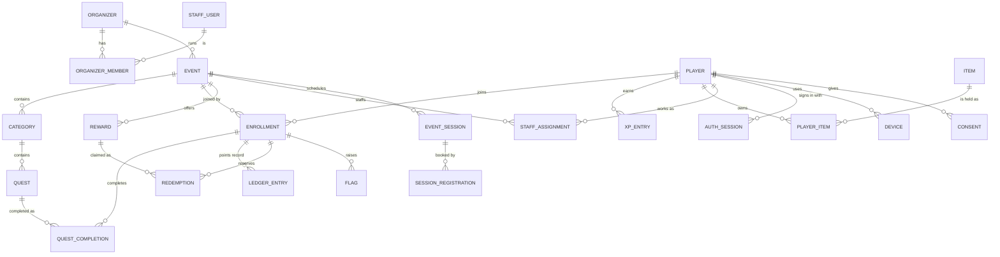

# Data Model — Questify

> What the app stores, how it relates, and what is sensitive. Stage 6 baseline, 2026-10-17. It is
> the shape to build from; exact column types and indexes are finished in the first build sprint.
> Names are in English; user-facing texts are stored per language.

## Entities

Operators are **players** with an event role (`STAFF_ASSIGNMENT`), not a separate account type
(the personal operator QR of ADR-057 identifies the player). Organizer owners, editors and Questify
admins are **staff users** with their own email-and-password accounts (ADR-078).

## Core entities

### player
| Field | Type | Constraints | PII | Notes |
|---|---|---|---|---|
| id | uuid | PK | no | |
| username | text | unique after folding (`username_fold`: case, أ/إ/آ→ا, ة→ه, ى→ي); CHECK: 3–30 Arabic letters without marks, Latin letters, digits, `_` (migration 0016) | yes (public) | The @username (gamer tag); written only by `create_player` and `rename_player` (the word lists, the change limit and the history), never by the API role directly. Every name kept in `username_history`. NULL exactly when the account is deleted (`player_tombstone` CHECK, T-217) |
| avatar | text | one of `falcon`, `fox`, `camel`, `owl`, `lantern`, `explorer-hat` (CHECK, the same list as `AVATARS`) | yes (public) | Questify's default avatars (FR-117); the player changes it freely |
| phone_e164, email | | moved to `player_contact` (migration 0005) | **yes** | Only the player and Questify admins can read them; organizers cannot (see below) |
| birth_year | smallint | nullable | yes | Age gate (13+); set only at sign-up, never changed by the API role |
| city, interests | | moved to `player_preference` (migration 0070, T-407) | yes | Private to the player; see "Marketing consent, interests and city" below |
| character_id, frame_item_id, title_item_id | uuid | FK | no | Avatar parts |
| locale | text | `ar`/`en` | no | |
| xp, level | | moved to `player_xp` (migration 0039, T-401) | no | Lifetime; see "Questify XP" below |
| gems | bigint | ≥ 0, cache | no | |
| status | enum | active, banned, deleted | no | Bans stick after deletion (ADR-084). `deleted` is a tombstone: only `erase_player` makes it (T-217) |
| created_at, deleted_at | timestamptz | | no | |

### username_history, username_word (migration 0016)
`username_history (player_id, username, reason signup|rename, changed_at)`: every name a player had, written by a
trigger on `player`; append-only for every role (`erase_rows` deletes a deleted player's rows under the erasure flag, T-217); no grant to the API role; the
change limit counts `rename` rows only. `username_word (word, match word|part, language)`: the lists that refuse
usernames (ADR-119), stored folded and letters only (a CHECK refuses anything else), no grant; read inside
`create_player` and `rename_player` through `username_blocked(name)`.

### player_acceptance (migration 0017)
`player_acceptance (player_id, document terms_of_use|privacy_policy|community_guidelines, version, method
signup|sign_in|reaccept|submission, accepted_at)`, primary key (player, document, version): which version of each
player document a player accepted and how (FR-1705, FR-1706). Sign-up and sign-in copy the versions the code
request carried (`player_login_challenge.terms_version` and `privacy_version`, NOT NULL, so no challenge, and so
no player, exists without them), at the challenge's time; re-acceptance and the guidelines go through
`accept_player_documents(documents jsonb, how text)` (`how` is the `method`: `reaccept` or `submission`),
bound to the calling player. Forced RLS: a player reads only their
own rows; no write grant to the API role; append-only for every role (`erase_rows` deletes them under the erasure flag, T-217).
Players created before 0017 have no rows and are asked again.

### Account deletion (migration 0038, T-217, ADR-175 to ADR-178)
- **Tombstone:** a deleted player keeps `id`, `status = 'deleted'`, `deleted_at`; `username` and `birth_year` NULL,
  `avatar` the default. Enrollments stay (active and pending ones become `left`, a ban stays), with the ledger,
  completions (`device_id` cleared), frozen `result_place` and `final_rank` rows, `achievement_earned` tiers (T-403),
  `questify_award` rows and their XP entries (T-403b), `gem_entry` and `gem_purchase` rows (T-404), the streak rows
  (`event_streak_day`, `questify_streak_day`, `questify_streak_reward`, T-405), the ranking boards (`xp_board`, T-408)
  and handed-over redemptions; they name no one.
  Deleted: contacts, sessions, refresh tokens, username history, acceptances, fingerprints, join answers, the
  player's flags, operator assignments; `ledger_note.reason` of their entries cleared. `bulk_award.reason` stays (Q-144).
- `player_fingerprint (player_id, fingerprint, created_at)`: the keyed fingerprint (`deletionFingerprint`, an HMAC
  under a key only the API holds) of every contact the account ever held, written by `sign_in_player`, `create_player`
  and `confirm_contact_change` from the challenge's `contact_fp`. No grant; definers only.
- `erased_mark (fingerprint, event_id NULL, kind banned|welcomed, expires_at, created_at)`: what a deleted account
  leaves, no player id. `banned` per event it was banned from (until the event's data goes) and with `event_id` NULL
  for a platform ban; `welcomed` per event whose welcome it got, until the event ends. Read by `erased_marked` in the
  join definers (`not_allowed`), `grant_welcome` (no second welcome) and `platform_marked` in sign-in, sign-up and the
  contact change. No grant.
- `player_deletion_challenge (id, token_hash, player_id NULL, contact_key, code_hash, attempts ≤ 3, expires_at,
  deletion_hash, deletion_expires_at, erased_at, created_at)`: the deletion code (never a sign-in), then the 10-minute
  deletion token; `player_id` NULL when no account uses the contact. Once used (`erased_at`), `player_id` and
  `contact_key` are cleared, so it names neither the tombstone nor the contact. Swept an hour after it ends. No grant.
- `erase_player(deletion, forfeit, request)`: player `FOR UPDATE` → enrollments by id `FOR NO KEY UPDATE` →
  `end_reservation(…, 'erasure', 'system', NULL)` per pending item (`redemption.ended_by` gains `erasure`) → the
  writes; audited `player.delete` with counts. The join definers read the caller `FOR KEY SHARE` first, so a join in
  flight waits for a deletion and then refuses.

### player_contact (migration 0005)
| Field | Type | Constraints | PII | Notes |
|---|---|---|---|---|
| player_id | uuid | PK, FK player | no | |
| phone_e164 | text | unique, +966 only (ADR-030) | **yes** | |
| email | text | unique, lowercase | **yes** | At least one of phone or email |

Kept apart from `player` so an organizer, who can see the players in its events, never sees their phone or email.
Since T-108 (migration 0020) the API's role cannot insert or update it: rows come from `create_player`, and a change
or an added identifier goes through `confirm_contact_change`.

### player_contact_challenge (migration 0020)
`player_contact_challenge (id, player_id, token_hash, channel, contact, code_hash, attempts ≤ 3, expires_at 5
minutes, created_at)`: one live challenge per player (a new request replaces it), bound to the player; the contact is
held minutes and swept an hour after expiry. No grant to the API's role: `start_contact_change` and
`confirm_contact_change` only. A confirmed change is audited as `player.contact_change` with the channel and the
kind (added or replaced), never the contact.

### Who may write what (column rules, migration 0005)
Row-level security picks rows; column grants and guard triggers close the columns that matter. For the API's role:
- `enrollment.score` and `balance`: **never written by hand.** They are copies of the points ledger; T-105 adds the ledger and the trigger that keeps them in step. A player may enroll only themselves, only in an event they can see, only as pending or active, and may only change their own status to `left`; the event's organizer or an admin changes any status.
- `player.status`: only a Questify admin (since T-217 a player no longer sets their own `deleted`: `erase_player` does, and the tombstone CHECK stops anyone making or reviving one by hand). A new player is always created active.
- `organizer_member`: only the organizer's owner (or an admin) adds members or changes an editor's event limit; an editor may leave; the owner never removes or demotes themselves. Roles change only inside the invite functions (migration 0008), never through the API's role. The person who creates an organizer becomes its first owner. Owner checks run in the database (`app_is_owner`).
- `staff_user`: the API may change only `password_hash` (migration 0002).

### staff_user
| Field | Type | Constraints | PII | Notes |
|---|---|---|---|---|
| id | uuid | PK | no | |
| email | text | unique, lowercase (the API normalizes with NFKC, trim, lowercase) | **yes** | Looked up through the `app.auth_email` setting at sign-in |
| password_hash | text | argon2id | **secret** | Never logged or exported |
| platform_role | enum | none, admin | no | One admin role (ADR-079) |
| status, last_sign_in_at | | | no | |

### Staff sign-in tables (T-006, migration 0002)
| Table | Fields | Notes |
|---|---|---|
| staff_login_challenge | id, staff_user_id, token_hash (bytea, unique), code_hash (bytea), expires_at, attempts 0–5, resends 0–3, last_sent_at, consumed_at | Found only by the browser's secret token. `code_hash` is an HMAC bound to the challenge id. A new challenge deletes the user's earlier ones; rows older than a day are swept |
| staff_session | id, staff_user_id, token_hash (bytea, unique), created_at, last_seen_at, revoked_at, user_agent, ip | **IP and user agent are personal data**; they live only here and are swept 30 days after the session ends. The API may update only `last_seen_at` and `revoked_at`; a trigger refuses un-revoking |
| auth_throttle | bucket, key (HMAC), at | Sliding-window counts for failed attempts per email and per address (IPv6 as /64) and for challenges per user. Keys are keyed hashes, never readable. Rows older than a day are swept |

The API role cannot create staff accounts or change `platform_role` / `status` (column grants): accounts come from the owner connection (the `staff` CLI) and, since T-101, from the definer functions `complete_signup` and `accept_invite_new` only.

### The organizer context (T-101, migration 0008)
1. **No staff member, no tenant.** `app_organizer_id()` returns the request's organizer only when the request's staff
   user is a member of it (or the request is a platform admin's). An organizer context without a member staff user
   opens nothing, so a forged or stale organizer id reaches no row. Future non-staff tenant contexts (jobs, operators,
   screens) get their own explicit branch when they are built.
2. **The event limit comes from the membership row.** `app_event_scope()` reads the caller's `event_scope`; NULL
   means every event, and an empty limit is refused (there is no "none"). Every table that names an event checks it
   for organizer members: `event`, `enrollment`, the players reached through enrollments, and the event entries of
   `audit_log`. Organizer-level audit entries (team changes, no event) stay readable by every member: team membership
   is not secret. A limited editor cannot create events (they would fall outside their own limit).
3. A limit names only the organizer's own events (trigger). Policies call the context functions directly, never
   through a sub-select: the event and enrollment rules refer to each other, and PostgreSQL treats any sub-select in
   that cycle as infinite recursion.
4. Organizers are created only by `create_organizer` (signed-in staff) and `complete_signup`, both with the three
   acceptances and an audit entry. Members join only through `accept_invite` / `accept_invite_new`, which also move
   ownership for an owner invite.

### Organizer team tables (T-101, migration 0008)
| Table | Fields | Notes |
|---|---|---|
| organizer_acceptance | organizer_id, document (organizer_terms, organizer_dpa, organizer_content_rules), version, accepted_by, accepted_at | Append-only; written only by the creation functions; members read their organizer's rows (FR-1726) |
| organizer_invite | id, organizer_id, email, role (editor, owner), event_scope, token_hash, invited_by, expires_at | One per email per organizer; one owner invite per organizer; found by members or by the link's token; swept 30 days after expiry. Email is PII |
| staff_signup | id, token_hash, code_hash, email, password_hash (NULL when the email already had an account), organizer_name, accepted versions, attempts, resends, last_sent_at, expires_at | Found only by the browser's token; swept after a day. Email is PII |

### organizer and organizer_member
`organizer(id, name, slug, status, branding jsonb{logo, banner, accent}, dpa_accepted_at,
created_at)`. `organizer_member(organizer_id, staff_user_id, role owner|editor, event_scope null|ids)`
for optional editor event limits (ADR-077). PII: names and emails of staff (via staff_user).

### event
| Field | Type | Constraints | PII | Notes |
|---|---|---|---|---|
| id | uuid | PK | no | |
| organizer_id | uuid | FK, indexed, RLS key | no | |
| join_code, slug | text | unique | no | In QR and event page |
| status | enum | draft, scheduled, live, ended, archived | no | Matches FR-1017 and the code; activation by Questify (ADR-076); rehearsal is a mode of a draft or scheduled event (ADR-080) |
| player_limit_mode, player_limit | enum, int | hard/soft/none | no | |
| add_ons | text[] | | no | Big screen, NFC, kiosks, sponsors, branding, invitations |
| timezone, day_start_hour | text, int | default 4 | no | A real IANA zone (trigger against `pg_timezone_names`, migration 0009) |
| kind | text | physical, virtual, workplace | no | Migration 0009 |
| venue_ar, venue_en | text | ≤ 200 | no | Migration 0009 |
| join_methods | text[] | ⊆ code, qr, link, public_list; ≥ 1; public_list only when access is public | no | Migration 0009 |
| starts_at, ends_at, shop_closes_at | timestamptz | | no | Balance closes after the shop window (ADR-048) |
| config | jsonb + config_version | schema-validated | no | `features` (the event's switches) and `terms` (its words, T-117); every write bumps `config_version`. See `CONFIGURABILITY.md` |
| focus_quest_id | uuid | null, or a quest of the same event (FK `(focus_quest_id, id)` → `quest (id, event_id)`); `ON DELETE SET NULL (focus_quest_id)` | no | The quest pinned as Up next (FR-1748); migration 0021 |
| managed_by_questify | bool | | no | ADR-077 |

**The event lifecycle (T-102, migration 0009).** The API's role never writes `status`: column grants leave it out of
INSERT and UPDATE, so a new event is always a draft. Questify activates it (T-210, draft to scheduled); time moves it from
scheduled to live to ended, through `advance_event_lifecycle()`, which the API calls every 30 seconds and which audits
each move as `event.lifecycle` (actor `system`); only the owner ends a live event early (`end_event_early`, audited as
`event.end`). `event_status_now(status, starts_at, ends_at)` gives the status at this moment, so nothing waits for the
tick; it is the only place the rule lives. Out of draft an event always has both times (CHECK). The times guard, judged
on the status now: scheduled keeps a future start; live keeps its start, zone and day start and its end may only move
later; ended keeps everything. Only drafts are deleted (policy), and a deleted event leaves the editor limits that named
it, except a limit's last event, which stays so the editor sees nothing rather than everything.

**Archiving (T-411, migration 0075, ADR-337 (5), ADR-341 Accepted; undeployed).** The lifecycle tick's last step,
`archive_ended_events()` (definer, the API's role only, no argument), moves an `ended` event to `archived` when
`archive_due(event)` holds: the shop is closed (`shop_state`), 30 days have passed since the end (`open_ticket`'s
sending window, ADR-248, so archiving never cuts it short), no `redemption` of the event is `reserved` (shop holds,
rank prizes, quest items), `event_result.revealed_at` is set or `ends_at + 60 days <= now()`, and no `ticket` of the
event is `open` (either queue). Up to 100 a run, oldest end first, `FOR UPDATE SKIP LOCKED`, the rule checked again by
the UPDATE after the lock; audited as `event.lifecycle` (`system`, `{status: ended}` → `{status: archived}`). Indexes
`event_due_to_archive (ends_at) WHERE status = 'ended'` and `redemption_reserved_event (event_id) WHERE status =
'reserved'`. Two BEFORE INSERT guards, `redemption_event_open` and `ticket_event_open` (an event ticket only), read the
event `FOR KEY SHARE` and refuse an archived one with the door's own refusal (`RS403 closed`, `RF409 not_ended`,
`QN403 ended`, `HT403 sending_closed`): a door in flight either makes the step skip the event or waits and is refused.
`event_archived_final` (BEFORE UPDATE OF `status`) refuses leaving `archived` for every role (`QE409 archived`).
Archived is read-only for organizers (`event_archived`) and closed to joining and new tickets; the player still reads
the event list, Home, the recap, the passport, the public stamp, results, the points record, My rewards and tickets.

**Activation and limits (T-210, migration 0027, ADR-140 to ADR-142).** `event` gains `player_limit_mode` (none, soft,
hard), `player_limit` (1 to 1,000,000; NULL exactly with none), `activated_at` and `activated_by`; none is in the API
role's grants. `event_activation_request(event_id PK, organizer_id, state pending|rejected, requested_by, requested_at,
note, decided_by, decided_at)` and `event_limit_alert(event_id, organizer_id, level 80|100, players, reached_at; PK
(event_id, level))` are read by the event's team within their limit and by admins, and written only by definers:
`request_event_activation` and `withdraw_event_activation` (the owner), `activate_event`, `reject_event_activation` and
`set_event_player_limit` (an active platform admin, confirmed by `app_admin_id()`), each audited. **Seats** are
accepted players, enrollments active or banned (T-218, ADR-168: pending and declined take none); the trigger
`enrollment_player_limit` lets a move into active through only below a hard limit (`QL409` otherwise, serialized per event by a transaction lock) and records the 80% and 100%
marks once. `event_seat_count(event)` gives the count to the team and admins.
**Join requests (T-218, migration 0036).** The join definers, `decide_join_request`, `accept_all_join_requests` and
`enroll_operator` take the event's seat lock through `free_seats(event)` before the enrollment row and decide on the
free seats counted under it (`full` is an answer, never a raised error). `join_requests(event, after, page)` lists the
pending rows, then the declined ones, each oldest first, for the team in scope (cursor over `(declined, joined_at, id)`);
`pending_join_requests(event)` counts the pending ones; index `(event_id, joined_at, id) WHERE status = 'pending'`.

**Targeting (T-220, migration 0037, ADR-170 to ADR-173).** `event_join_field.options` (jsonb, custom fields only,
2 to 20 `{id, ar, en}` with ids `^[a-z0-9]{1,12}$`, checked by `join_options_valid`) makes a choice field: its answer
is an option id (`check_join_answers`). A trigger refuses options on a field that already has answers, and removing an
option (or clearing them) that an answer or a rule names (`QT409` answers or rules). `event_guest.tag` (1 to 30
characters, optional, matched case-insensitively). `category` and `reward` gain `audience_kind` (`answer` or `tag`),
`audience_field_id` and `audience_values` (1 to 20; tags kept lower case), written only by `set_audience(event, kind,
item, rule kind, field, values, request)` (owner or editor in scope, event row `FOR NO KEY UPDATE` like the field save,
audited with ids and counts); the field key is NO ACTION, so a targeted field cannot be deleted while a draft event's
delete still cascades. `in_audience(enrollment, kind, field, values)` (internal: no rule, a rehearsal enrollment, the
matching answer, or a tag on a guest entry matching the player's phone or email) filters `member_event_quests`,
`shop_rewards` and `set_goal`, and refuses in `record_completion` (`QN403 not_for_you`, every completion path) and
`reserve_reward` (`RN404`); `public_event_quests` leaves targeted categories out. `audience_counts(event)` gives the
team the reach of each rule as counts. `join_write` keeps a returning player's earlier answers.

**Goal (T-213, migration 0033, ADR-161).** `enrollment.goal_reward_id` is the reward a member pinned as their goal
(FK with the event to `reward`, `ON DELETE SET NULL (goal_reward_id)`); written only by `set_goal(event, reward)`
(the caller's active enrollment, a reward active in that event's shop; RN404 otherwise), in no API write grant. A
view preference: it touches no points, stock or reservation; a rehearsal account's pin goes with its enrollment.

**Rehearsal (T-211, migration 0032, ADR-157 to ADR-160).** `event_rehearsal(event_id PK, organizer_id, code
XXXX-XXXX unique (capitals and digits without I, O, 0, 1), code_set_at, first_play_at, erased_at, erase_counts jsonb,
live_wiped_at)`: one row once the team opens the rehearsal card; read by the event's team within their limit and by
admins, written only by definers (`open_rehearsal`, `rotate_rehearsal_code`, `erase_rehearsal`, the wipe); deleted with
the event. A rehearsal account is an enrollment with `joined_via = 'rehearsal'` (made only by `join_rehearsal`, at
most 25 an event, no seat, no welcome; a guard keeps it one and keeps a real one real). `ledger_entry.rehearsal` and
`bulk_award.rehearsal` mark rehearsal rows. `wipe_rehearsal(event, reason, request)` deletes the rehearsal accounts with
their completions, ledger entries (with notes and keys), reservations, flags and join answers (rehearsal `bulk_award` rows stay, with no notes, so a retried key replays
instead of running live; their quest key is `ON DELETE SET NULL (quest_id)`), recomputes
each reward's `units_out` from the holds that remain, marks the ranking for repair and audits
`event.rehearsal_erased` with the counts. It runs at go-live (`ensure_rehearsal_wiped`, called first by every writer and
by the tick) or on the team's erase before go-live.

### enrollment (a player in an event)
`id`, `event_id`, `player_id`, `joined_at`, `joined_via` (code, qr, link, public_list, operator, invite, rehearsal), answers in
`join_answer` (below), `score bigint` and `balance bigint` (**caches of the
ledger**), `status` pending/active/left/removed/banned/declined (`declined`: the team declined the request, ADR-167),
`waitlisted boolean` (a pending row from a full event's waiting list, FR-1821; cleared by a trigger on any move out of
pending; written by the join definers only). **Unique (event_id, player_id).** Score is points
earned and ranks; balance is earned minus spent (ADR-043).
**Ranking (T-106, migration 0015):** `score_version bigint`, the id of the ledger entry that last changed the score
(set by the ledger trigger; ties go to the lower version, FR-606); index `(event_id, score DESC, score_version)` for
active rows with points (it replaces the earlier ranking index). Who is ranked is one rule in two forms
(`ranking_eligible` for a row, `ranked_enrollments(event)` for an event, tested to agree): points above zero, an
active enrollment and player, and not on the organizer's team by email. `ranking_repair (event_id, marked_at)` holds
the events whose Redis copy may be wrong (no grants; written by definers and by triggers on enrollment and player
status, contact email and team membership; claimed by the repair job). The Redis copy holds enrollment ids, points
and versions only, never a name or contact (ADR-118).
**Today's ranking (T-216, migration 0035, ADR-166):** no table and no ledger change. Today's points are the sum of an
enrollment's `score_delta` over ledger entries created inside the current event day (`event_day_start(event, day)` to
the next day's start, FR-1714); the version is the last such entry's id. `ranked_day(event, day)` (internal) applies
`ranked_enrollments` and today's points above 0. Definers: `ranking_today` (the day now, `multi_day`, `live`, the
reader's own points today; the system or an active player), `ranking_day_entries` (system), `ranking_day_entry_of`
(the caller's own completion, multi-day events only), `ranking_day_top`, `ranking_day_position`. The Redis copy of a
day sits under the key `{event}/{YYYY-MM-DD}`, so a new day starts empty; old days expire with the 30-day lifetime.
**Joining (T-111, migration 0018):** `card_version` (the join card the player accepted, FR-121; NULL before 0018) and
`joined_via` (code, qr, link, public_list). Nobody inserts an enrollment directly but the platform admin: players
join through `join_event(code, via, card)`, which checks the event's state, its join methods and access type (a
private event makes a `pending` member) and decides under a row lock; organizers will invite through their own
definers (T-204, T-218). Anonymous reads go through `public_events`, `public_event` and `public_event_quests`, which
return named columns only (never a quest's `type_config`). An event's members read its quests through
`member_event_quests(event)` (migration 0021): an active enrollment of an active player only, visible quests by named
columns, each with how many times the calling player completed it and, since migration 0022, the points they earned
from it (`earned`, the sum of their ledger entries for the quest, so a later points change does not move it).
The activity history reads `member_activity(event, before_id, page)` (migration 0023): the calling active member's own
ledger entries in the event, newest first, a page of at most 100, each with its quest's title.
**Standing (T-208, migration 0019):** an enrollment's status changes from the organizer seat only through
`set_enrollment_ban(event, enrollment, banned, request)` (the owner; `active|pending|left → banned`, `banned →
active`, audited with statuses only); the player's own way out is `active|pending → left`; the admin keeps direct
changes. Organizers read players only through `event_players(event, after, page, prefix)`, which returns
`enrollment_id, username, avatar, status, score, joined_at` (`player_own` no longer has an organizer branch).

### event_exclusion (migration 0019)
`event_exclusion (id, organizer_id, event_id, kind phone|email_domain, value, created_by, created_at)`, unique
`(event_id, kind, value)`, at most 500 an event; phones `+9665XXXXXXXX`, domains lower case with dotted labels
(an `xn--` last label allowed), checked by the table; `(event_id, organizer_id)` references the event, deleted with
it; `created_by` set NULL when the staff account goes (the audit entry keeps who). Forced RLS: the event's team reads;
written only by `add_exclusion` and `remove_exclusion` (the owner). Both forms of the ranking rule leave listed
players unranked (a phone equal, or an email whose domain equals an entry); list changes and a player's phone or
email change mark the event's repair.

### category, quest
`category(id, event_id, title i18n, order_mode any|in_order, completion_bonus, position, collapsed)`.
`quest(id, event_id, category_id, type, title/description i18n, points, verification, caps,
opens_at/closes_at, flash, community_goal, status, qr_version, type_config jsonb, version)`.
**Built so far (T-103, migration 0010):** `category(name_ar, name_en, position)` and `quest(type, title, description,
points, repeat_cap, opens_at, closes_at, visible, position, type_config)`; each later field arrives with its task
(order mode, bonus and unlocks T-304; verification and QR version T-104; flash T-307; community goal T-306; pause as
its own field T-603). Show or hide is `visible`, not a status.
**Category rules (T-304, migration 0044, ADR-201, ADR-202):** `category.order_mode (any|in_order)`, `opens_at`,
`unlock_after → category (id, event_id)` (NO ACTION; no self and no circle, a trigger walks the chain under the event's
lock, at most 30 steps; CU422), `completion_bonus` 0 to 100 000 (0 = none); column grants for the API. The gates live in
`quest_open_check(quest, enrollment, skip_category)` (skipped only for a manual award) through `category_lock`:
`category_not_started`, `category_locked` (the unlock category is in the member's audience and not cleared: something
visible and not closed is undone) and `order_locked` (an earlier visible, not closed quest is not done; a pending
submission is not done). A quest is done with a completion or a quiz finished with no right answers; `category_done`
(strict, for the bonus) needs a visible quest and every visible quest done.
`category_bonus (organizer_id, event_id, enrollment_id, category_id, completion_id → quest_completion | null,
entry_id → ledger_entry, created_at)`, PK (enrollment_id, category_id): one per player and category, written by
`pay_category_bonus` (ON CONFLICT DO NOTHING, under the enrollment lock of the paying definer), never deleted by a
removal; deleted by the rehearsal wipe and on account erasure. No grant.
**First-N bonus (T-313, migration 0062, ADR-260 to ADR-263):** `quest_first_bonus (quest_id PK → quest (id, event_id)
CASCADE, organizer_id, event_id, points 1..100000, slots 1..1000, updated_at)` and `quest_bonus_slot (quest_id →
quest_first_bonus CASCADE, place, organizer_id, event_id, completion_id → quest_completion RESTRICT UNIQUE, entry_id →
ledger_entry RESTRICT UNIQUE, enrollment_id → enrollment (id, event_id) RESTRICT, rehearsal, claimed_at)`, PK (quest_id,
place), UNIQUE (quest_id, enrollment_id), the four claim columns all set or all NULL; a partial index on the free slots.
The ledger kind `first_bonus` (completion and quest set, actor system, never boosted, no XP, balance 0 while the shop is
closed; one per completion and per player and quest). The place shown is the claim's rank by (claimed_at, place). A
removal never frees a slot; erasure keeps it; the rehearsal wipe frees rehearsal slots first; a draft event's delete
takes the bonus. No grant.
**Refresh and hidden categories (T-304c, migration 0046, ADR-204):** `category.refresh (none|daily|weekly)`,
`hidden`, `reveal_version` (column grants). `category_period_start(category, event)` is `-infinity` for none, today's
event-day start for daily, the start of the 7-day block counted from the event's first day for weekly
(`category_resets_at` the next one). `period_count` counts a member's completions of a quest from that start: the
repeat cap, `quest_done` (so the gates and the bonus) and the player's `done` read it; the occurrence stays lifetime
(`quest_completion.occurrence >= 1`, no upper bound). `category_bonus` gains `period_start` (PK now (enrollment_id,
category_id, period_start); a bonus ledger entry names its `bonus_period`, unique per player, category and period): paid once per period, never while a row of this or
a later period exists (a switch back to none never repays). A refreshing category holds only `scan_qr`, `enter_code`,
`challenge` (triggers on both tables, QT422 `refresh`). `category_reveal (organizer_id, event_id, enrollment_id,
category_id, created_at)`, PK (enrollment_id, category_id): written by `reveal_category` (the secret code, format 0x05)
and by a staff manual award of one of its quests (fresh payment only); `sees_category` (audience and, if hidden,
revealed) gates every player reader and `quest_open_check`; an unfound hidden unlock category never locks. Deleted
with its category, by the rehearsal wipe (counted as `reveals`) and on account erasure. No grant.
Passport quests (T-304b, migration 0045, ADR-203): `type = 'passport'`, `type_config = {needed: 1..30}`,
`repeat_cap = 1`. `passport_step (id, organizer_id, event_id, quest_id, name_ar, name_en, position, qr_version,
created_at)`: 1 to 30 per passport, written by the team under row-level security (column grants as quests; the
organizer comes from the event), each with its own signed code (format 0x04). A deferred check keeps at least `needed`
steps; once stamped, `needed` never falls and a stamped step stays (`quest_lock_passport`, the stamp's RESTRICT key).
`passport_stamp (organizer_id, event_id, enrollment_id, quest_id, step_id, idempotency_key, device_id, completion_id,
created_at)`, PK (enrollment_id, step_id): written only by `stamp_step`; `completion_id` is set on the stamp that paid
the passport (`pay_completion` with the key `pass:{quest id}`, method `passport`). Deleted by the rehearsal wipe and on
account erasure. No grant.
`type_config` is validated per quest type by the shared schema. Editing a live quest asks
"future only or also past" (ADR-063) and writes the audit log.

### quest_completion
**Built (T-105, migration 0012):** `id bigint, organizer_id, event_id, enrollment_id, quest_id, occurrence (1 … the
quest's cap), method (qr|code|my_qr|manual|submission|vote|quiz; later tasks add nfc…), idempotency_key, device_id, created_at`.
**Unique (enrollment_id, quest_id, occurrence)** (one row per time a player completed a quest) and **unique
(enrollment_id, idempotency_key)** (a retry finds the first completion). Composite foreign keys keep the event, the
enrollment and the quest of one tenant; all RESTRICT. `device_id` (an app install id, personal data) lives here, not on
the ledger, so account deletion can clear it. Pending submissions live on `submission`, outside this table, until approved (T-301).

### ledger_entry (event layer; append-only)
**Built (T-105, migration 0012):** `id bigint, organizer_id, event_id, enrollment_id, kind (quest; then welcome, redeem, redeem_return, handover; award and removal since T-207), score_delta, balance_delta,
completion_id, quest_id, actor (player, system, operator since T-205, staff since T-207), operator_id, staff_user_id,
reverses, created_at`. Two deltas so a spend moves only the balance and a removal after spending can move the score
and the balance by different amounts (FR-1601), while score and balance stay the exact sums of this table. A trigger
moves the enrollment's caches on every insert. Append-only for every role, the owner included (ALWAYS triggers on
UPDATE, DELETE, TRUNCATE; NFR-019). Only definers write it; corrections are new entries. The one exception (ADR-157,
migration 0032): a row with `rehearsal = true` (set at insert from its enrollment, never by a writer) may be deleted by
the rehearsal wipe of its own event. A partial unique
index pays a completion once.

**Manual awards (T-207, migration 0030, ADR-152):** kinds `award` (points by hand: `score_delta = balance_delta > 0`,
no completion, quest or redemption, actor `operator` or `staff`) and `removal` (`reverses` names the credit entry it
takes back, unique: once per entry; `score_delta` and `balance_delta` ≤ 0, each clamped so neither total goes below 0,
FR-1601; actor `staff`; it copies the removed entry's `completion_id` and `quest_id`, so per-quest sums net out).
Actor `staff` with `staff_user_id` (an owner or editor on the dashboard; `(actor = 'staff') = (staff_user_id IS NOT
NULL)`; staff write only `quest`, `award` and `removal`). Credit kinds that can be removed: `quest` (any method),
`award`, `welcome`. A manual quest award is a completion with method `manual`. A removed quest stays used (it counts
toward the repeat cap).

**Completion bonus (T-304, migration 0044, ADR-202):** kind `bonus` (actor `system`, `category_id` set, no completion,
quest or redemption; `score_delta > 0`, `balance_delta` the same while the shop is open, else 0); one per enrollment and
category (a partial unique index). `category_id` is set only on `bonus` and its `removal`. A bonus is its own removable
credit and earns no XP; removing a quest leaves it.

- `ledger_note (entry_id PK → ledger_entry, organizer_id, event_id, reason 1–300 \| null, bulk_id → bulk_award \| null,
  created_at)`: the staff-typed reason beside each `award`, `removal` and manual quest entry (exactly one of `reason`
  and `bulk_id`; a bulk award's reason is stored once on `bulk_award`). Kept out of the ledger because it may name a
  person: insert-only for the API role, and only the database owner may update it (T-217 clears it). Never shown to
  the player.
- `manual_award_key (id, event_id, operator_id → player \| staff_user_id → staff_user, idempotency_key, entry_id,
  enrollment_id, amount, created_at)`, unique per (event, actor, key): the idempotency record of points awards and
  removals, looked up before any other check (a quest award uses the completion's key).
- `bulk_award (id, organizer_id, event_id, staff_user_id, amount 1–100 000, reason, target list\|quest, quest_id,
  count_awarded, count_skipped, idempotency_key, created_at)`, unique per (event, staff user, key) (FR-1712).
- `event.award_cap_each` (default 200, 1 to 100 000) and `event.award_cap_day` (default 500, at least the per-award
  cap, at most 1 000 000): the per-award and per-person-per-day caps for operators and editors, the day being the
  event's day; written only by `set_award_caps` (the owner; audited).
- All written only by definers (`operator_award`, `staff_award`, `remove_award`, `bulk_award`, `set_award_caps`), with
  forced row-level security, no direct grants and nothing for PUBLIC.

**`complete_quest` (definer):** the only writer of completions and quest entries. The player is the request's
`app.player_id`, never an argument; it locks the player's enrollment, answers a repeated key with the first completion,
then checks the enrollment is active, the event live at this moment, the quest visible and open, the proof fitting the
quest's type (QR version, typed code), and the cap, and writes the completion and the entry.

### Questify XP (built: T-401, migration 0039, ADR-179 to ADR-182; append-only)
- `player_xp (player_id PK → player, xp ≥ 0, level ≥ 1, updated_at)`: the running total and its level, a cache of
  `xp_entry`; made for every player by a trigger on `player`. The XP rows point here, not at `player`, so they never
  wait on `erase_player`'s player lock. A deleted account keeps its rows on the tombstone (no personal data).
- `xp_entry (id, player_id → player_xp, delta ≠ 0, source quest|removal, ledger_entry_id → ledger_entry RESTRICT,
  quest_id, reverses → xp_entry, created_at)`: written only by the `ledger_xp` trigger on `ledger_entry` (`xp_credit`
  for a non-rehearsal `quest` entry, `xp_reverse` for a `removal` of the credited entry). Unique (player_id, quest_id)
  and (ledger_entry_id) for credits, (reverses) for reversals: one credit per quest ever, one reversal per credit.
- `level_reached (player_id, level ≥ 2, xp_entry_id, reached_at; PK player_id, level)`: the first time each level was
  reached; a drop never removes it and climbing back writes nothing (T-402 grants an item per row, FR-721).
- `xp_level (level 1–100, xp_from)` (seeded 30 levels, `50·(n−1)·(n+2)`) and `level_title (level_from, name_ar,
  name_en)` (six titles): data for T-709 to edit. The amount per quest is `platform_setting` key `xp` `{questXp}`
  (1–99999, CHECKed on write; server-only, never in the public config; read with a fallback of 100).
- No grant on any of them; `own_level(completion)` is the detailed owner XP read (the caller's xp, level, range, title
  and the level a completion reached first). The gem ledger (T-404) will have the same shape.

### Questify cosmetics (T-402, migration 0063 undeployed; core GO95, final integration gate pending)
- `item(id text PK, kind character|frame|title, name_ar, name_en, visual_key, created_at)`: global catalog; stable
  identity/kind, bounded bilingual names and allowlisted shipped visuals. Six starters remain `player.avatar`.
- `level_item(level PK/FK xp_level, item_id UNIQUE FK item, UNIQUE level/item_id)`: one distinct guaranteed item for
  each level above 1; seeded levels 2–30, level 4 chest character, other even levels frames, odd levels titles.
- `player_item(player_id → player_xp, item_id → item, source level, source_level, earned_at, seen_at;
  PK player/item, UNIQUE player/source_level)`: immutable grant provenance with composite FKs to reached level
  and reward mapping. Only seen_at changes; deletion only inside erasure, truncate refused. Earned_at copies reached_at.
- `player_equipment(player_id PK → player_xp, character_id?, frame_id?, title_id?, updated_at)`: each non-null slot
  has an owned-item composite FK and kind validation in the setter. Starter changes clear earned character; NULL
  frame/title clears it. API direct avatar UPDATE is revoked; username/equipment changes share one transaction.
- All four tables force RLS with no direct API rights. Own reads, equip and seen marks use active caller-bound
  definers; public reads return a separate DTO, not the owner's profile. Ranking readers expose selected cosmetics only.
- `grant_level_item` runs after each reached insert in the XP transaction; replay/backfill is idempotent, reversals
  retain items. Migration drains player EXCLUSIVE, XP then reached SHARE ROW EXCLUSIVE before DDL/erasure replacement/
  backfill; historical deleted tombstones are excluded. Erasure deletes equipment then grants under the XP lock,
  preserving retained XP/reached. Tests cross old/new upgrade order, XP in flight, equip/seen and erasure both ways.
- Future curve editing (T-709) must maintain complete distinct reward mappings atomically; grant FKs freeze used
  mapping pairs. T-402b extends typed provenance for event souvenirs; T-404 for gem purchases, no speculative columns.
- Account/locker/public-profile data remains in memory on the app, never persisted. Passport, achievements and owner
  event history are T-403 (server, below) and T-403c (screens, built; the app reads them through `GET /v1/me/event-history` and `GET /v1/me/achievements`). Source event history is never public.

### Organizer souvenir ownership (T-402b, migration0064; code review pending)

- `souvenir_rule` binds organizer/event, one opaque item and typed audience/category/range; draft→active→stopped,
 100-rule cap. `souvenir_target` freezes nonempty same-event finisher quest IDs. Active names/art/identity cannot change.
- `souvenir_receipt` proves rule/event/item and enrollment/event/player; unique rule/player and player/item. No redundant
  direct event FK after enrollment (confirmation locks event→enrollment). Immutable, erasure-only deletion/no truncate.
  player_item gains an exact level/souvenir source union and composite receipt FK, retaining every existing level FK.
  Both source-map writers serialize on the shared item identity.
- `souvenir_work` stores real event/member generation, lease/token and retry metadata. Claim/ack are separate transactions
  from grants; a re-enqueue keeps the earlier ready_at; a worker releases claims its time budget left unevaluated.
  `souvenir_scan` holds one finite pass (ADR-272): created by a non-rank activation or a /process request, it enqueues
  500 real members per batch behind a cursor, waits until the event is live, and deletes itself at the end. Every later
  change reaches the queue through a trigger on the fact the evaluator reads: enrollment join/status/waitlist,
  quest_completion, finished quiz_attempt, terminal game_round (lifecycle expiry included), result_place, staff_assignment
  can_play true or removal, and player reinstated to active. A new qualification source must add its trigger here.
  The evaluator pre-checks without locks and takes no player/enrollment/XP lock for a member owed nothing.
  Private `souvenir_command` records
  actor/event/operation-body fingerprint/result for durable request replay. All6 tables force RLS, no direct API/PUBLIC
  rights; only narrow organizer/system doors. System excludes player/staff/organizer/admin/device contexts.
- Grant order: active player FOR SHARE→enrollment FOR NO KEY UPDATE→rules FOR SHARE→XP FOR UPDATE→receipt/item. SHARE
  serializes normal admin ban UPDATEs. No event/wipe lock after enrollment. Erasure extends0063 cleanup: equipment/items
  before receipts, member work last (after the staff_assignment delete that can enqueue), preserving ticket/other
  erasure steps. No rehearsal lifetime grants or work. Public cosmetic names refuse control and bidi characters in SQL.
  souvenir_rule's event/category references and souvenir_target's quest reference do not cascade: deleting a draft event
  a rule names answers 409 souvenir_data; a category a rule names or a quest frozen as a target answers 409
  souvenir_in_use. The enqueue triggers are named `enqueue_souvenir_on_*` so they fire before `mark_ranking_on_*`.
- Only own locker joins source event names. T-708 must integrate earned provenance into future authorized exports and
  decide transient-work disclosure/retention; no export assembly is built here. T-507 later attaches sponsor metadata.

### reward, reward_code, redemption
Built in migrations 0024 (T-201, T-202; ADR-133), 0025 (T-219, T-203; ADR-134 to ADR-136) and 0029 (T-206; ADR-150,
ADR-151):
- `reward(id, organizer_id, event_id, kind item|experience|digital, name i18n, description i18n, price, stock_total, units_out,
  per_player_limit, opens_at, closes_at, section, tag_new, tag_limited, position, status active|removed)`. Stock left is
  `stock_total − units_out`; `units_out` moves only inside the definer functions, and a CHECK keeps it between 0 and
  the total. A digital reward's `stock_total` is its uploaded codes: created at 0, raised only by `add_reward_codes`
  (a guard refuses the API role any other change).
- `redemption(id, organizer_id, event_id, enrollment_id, reward_id, price (what was paid), status
  reserved|cancelled|expired|delivered|handed_over, idempotency_key, reserved_until (null only when delivered),
  ended_at, ended_by player|timeout|delivery|handover|operator, operator_id (who handed over or cancelled at the desk),
  collect_until (the player's Collect), offer_by and offer_until (the desk's offer))`; a digital redemption is
  `delivered` at once (ADR-136); a handed-over one keeps its unit out. Collect and offer exist only on a reserved row.
  Never deleted; no role writes it but the definers.
- `event` gains `pickup_minutes` (default 120), `shop_days_after` (default 3), `shop_rules` i18n and
  `spend_lowers_rank` (default false; the owner's, locked from live on, FR-1847); the prize desk (0029):
  `desk_location` i18n, `desk_lat`/`desk_lng` (both or neither), `desk_hours tstzmultirange` (null: open the whole
  time; 1 to 14 bounded windows) and `handover_confirm collect_first|desk_offer`. `desk_state()` is the one rule for
  open, closed and finished. An item reward needs the desk's place (a guard on both tables).
- The ledger gains `redeem` (balance −price) and `redeem_return` (balance +price), both with `redemption_id`, one of
  each per reservation at most; the `system` actor writes only `redeem_return` (the timeout). `score_delta` is 0, or
  equal to `balance_delta` when the event's option was on and the event live at the spend (ADR-135); a return mirrors
  its own payment's score. A spend that moves the score marks the ranking for a rebuild. `handover` (0029): both
  deltas 0, the handing operator named, one per redemption; an operator's cancel writes `redeem_return` as the
  operator. Score ≥ balance holds for
  every enrollment (quests add both equally); a future balance-only credit would break it, so it must say so.
- `reward_code(id bigint, organizer_id, event_id, reward_id, code_cipher bytea, code_hash bytea, redemption_id unique
  null, created_at)` (**secret**, organizer-uploaded; T-203): the API's AES-256-GCM cipher bound to the reward and an
  HMAC for finding repeats, unique per event. Organizers read only `id, reward_id, redemption_id, created_at`; players
  and outsiders nothing; `add_reward_codes` writes and `reserve_reward` gives the oldest unused code.
  The desk's hold (0031, T-209): `desk_hold(enrollment, event)` answers `paused` (the owner's pause), then `held` (a
  banned player, or an open flag while `event.flag_hold` is on), and `finish_handover` and the desk's offer refuse
  either (`RH409`) **before** the status check, so the desk never learns of a ban. `desk_items` (the lookup and the
  find) shows only `active` and `hold`, never the status. `enrollment.redeem_paused_at` (0031) also refuses new
  reservations and Collect (`RP403`, after the replay check).
- **After the event (migration 0074, T-410, ADR-336, ADR-337; undeployed, core code review pending).** The shop's
  window is `ends_at + shop_days_after` days, and `shop_state()` stays the one definition of open and closed (0 to 30
  days; 0 closes the shop at the end). `event_shop_window_guard` (BEFORE UPDATE OF `shop_days_after`, the API's role
  only, as `event_times_guard`): after the end the days only grow (`SW409 shorter`); once closed, or archived, they
  never change, lengthening included (`SW409 closed`). It judges on `clock_timestamp()`, so an edit whose transaction
  began before the close cannot reopen it; the API's rule (`rewards/shop-window.ts`) reads the same state in SQL and
  maps the guard's DETAIL. With the end frozen by `event_times_guard` and no door writing `status`, the close is
  permanent. **The close is a rule, not a write:** no ledger entry, flag or job; `enrollment.balance` still equals the
  sum of `balance_delta` and is spendable nowhere (only `reserve_reward` spends it and refuses `RS403 closed`); new
  points move the score only (FR-1710). Holds made before the close keep their own `reserved_until` and are handed
  over at the desk; a timeout or cancel returns the points into the closed balance. Unassigned digital codes stay in
  their reward (event-data retention, Q-075). Nothing at the close touches score, `final_rank`, the stamp,
  `player_item`, XP or achievements (FR-751). The event stays Ended until T-411's archive step (above). `reserve_reward` is restated
  in 0074: 0054's rehearsal flag was NULL once the event had ended, so in the days after the end a digital reward was
  delivered with no code and no unit counted, and items skipped the desk's hours; the flag is now never NULL.
- `event_recap(event)` (0074, T-410, ADR-339): the caller's recap, one row while their membership counts as played for
  the passport (not pending, declined, banned or removed; not a rehearsal account; `left` included; `joined_via` NULL
  before 0018), none otherwise: the event's name, local start date and city, the rank by `own_events`' rule, the
  distinct quests of the membership's `quest` entries no removal reverses, and the event's souvenirs in earned order.
  Definer, pinned, granted to the API role only; no table.

### Marketing consent, interests and city (T-407, migration 0070 undeployed)

- `interest(id ^[a-z][a-z0-9-]{1,29}$, name_ar, name_en, position unique)`: 12 seeded; read through `interest_list()`
  (`GET /v1/interests`); no direct API rights; the console edits it with T-703/T-709.
- `player_preference(player_id PK → player, city_id → city NULL, interests text[] ≤ 8, updated_at)`: written by
  `set_preferences`, read by `own_preferences` and, as ids only, by `marketing_audience`. No public, organizer or console read.
- `event.interests text[] NOT NULL DEFAULT '{}'` (≤ 3): in the API role's INSERT/UPDATE column grants; trigger
  `event_interests_guard` (BEFORE INSERT OR UPDATE OF interests) keeps catalog ids, distinct, in catalog order (`EI422`).
- `marketing_consent(id, player_id → player, channel push|sms|email, granted, method signup|settings|opt_out_link,
  text_version (required when granted), created_at)`: append-only for every role (the erasure flag lets `erase_rows`
  delete); `marketing_state(player_id, channel, opted_in, changed_at)` is written only by the AFTER INSERT trigger
  `marketing_state_apply`; partial index on `(channel, player_id) WHERE opted_in`. Both: RLS forced, no policy, no grant.
- Doors (granted to `questify_app`): `own_marketing`, `set_marketing` (MK422, MK403), `marketing_opt_out` (for the signed
  link), `marketing_audience` (the only door a promotion chooses recipients through), `marketing_consent_history` (admin,
  audited), `own_preferences`, `set_preferences` (PF422), `interest_list`, `own_for_you`. Internal: `marketing_player`
  (row held FOR NO KEY UPDATE), `marketing_adult` (the 19-year gap, ADR-317), `interests_clean`.
- `erase_rows` (restated from 0064) deletes the preference, state and consent rows with the account (Q-289).
- Migration 0073 (T-409): `marketing_consent.language` and `marketing_state.language` (`ar`/`en`, NULL read as Arabic)
  record the language a consent was given in; `set_marketing(channels, how, version, lang DEFAULT NULL)`. The consent rule
  is one plain SQL function, `promo_pool(ch, city, any_of) → (player_id, phone, language)` (active, `marketing_adult`,
  opted in on the channel now, a phone for SMS; no definer, no SET, no grant); `marketing_audience` is restated over it and
  refuses any caller but the system context (MK403). `marketing_adult` lost its SET clause so it inlines.

### Questify invitations (T-409, migration 0073 undeployed; core code review pending)

- `invitation_campaign(id, organizer_id, event_id → event (with organizer) CASCADE, request_id UNIQUE, fingerprint,
  requested_by → staff_user, requested_at, city_id → city, interests text[] ≤ 3, history none|recent|own, size 50–100,000,
  send_after, state requested|approved|sending|sent|cancelled|refused, channels ⊆ {push, sms} (T-501f, 0079), cap
  50–100,000, send_at, name_ar, name_en (copied at approval; every SMS and push is rendered from them), admin_note 1–500, decided_by, decided_at,
  started_at, finished_at, final_at, end_reason owner|admin|too_small|event_changed|event_over, planned, sent, unknown,
  failed, skipped, cancelled, opened, joined ≥ 0, published_sent, published_opened, published_joined, published_at)`:
  shape checks per state; one open campaign per event (partial unique index); counters only grow. Organizers read only the
  `published_*` copies, rounded in SQL (`invitation_bucket`).
- `invitation_recipient(id bigint identity, link uuid UNIQUE (the bearer token in the message's fragment), campaign_id,
  player_id, channel, state queued|sending|sent|unknown|failed|skipped|cancelled, lease_token, lease_until, error_code
  (a provider code only), skip_reason opted_out|member|event_over|event_changed, created_at, sent_at, opened_at,
  joined_at)`: **personal data** (who was invited); no contact or text stored (the claim reads them fresh through
  `promo_pool`); deleted 90 days after its campaign finished (whatever its state) and at once by erasure. No foreign keys
  (ADR-334): a trigger deletes a deleted campaign's rows. Indexes: queued rows by campaign, leases by expiry, rows by
  player and `sent_at` (the 7-day limit). T-501f (0079): each row's `channel` is fixed at the fill, `push` when the
  campaign has push and the player is opted in on push with a pushable device, else `sms`; never two rows or two
  channels for one player. A push row is handed to the push store by `invitation_push_hand` (one `invitation`
  notice, marker `invitation:{row}`, then `sent`; `failed` with `no_kind` when the notice could not be written), and
  its `opened_at` is set when the player opens the notice's center row.
- `invitation_channel_hold(channel PK, hold_until, code)`: one 15-minute hold per channel after an account refusal.
- All three: RLS forced, no policy, no grant. Doors (granted to `questify_app`): `invitation_request`,
  `invitation_cancel`, `invitation_list` (team), `invitation_admin_queue`, `invitation_admin_get`, `invitation_approve`,
  `invitation_refuse`, `invitation_admin_cancel` (admin), `invitation_start_due`, `invitation_claim`, `invitation_ack`,
  `invitation_settle`, `invitation_push_hand` (T-501f) (system context only), `invitation_open` (anonymous, by link). Codes `IV403`, `IV404`, `IV409`
  (reason in DETAIL), `IV422` (field in DETAIL). Lock order: `docs/rules.md`.

### Push notifications and the notification center (T-501, migration 0076 undeployed; core code review pending)

- `notice_kind(kind PK [a-z_], class personal|event|promo, topic announcements|rank|community|reminders NULL (not
  mutable), membership active|decided|none, before_start, priority 0|1|2 by class, ttl 1 minute–7 days)`: one row per
  kind, seeded by the slice that wires it (0076 seeds none; 0077, T-501d, seeds the ten personal kinds:
  `join_accepted`, `join_declined`, `help_answered`, `help_answered_questify`, `help_solved`, `rank_prize`,
  `submission_approved`, `submission_rejected`, `reward_ready`, `reward_ending`; 0078, T-501e, the six event kinds:
  `flash_quest`, `boost_start`, `poll_sent`, `community_step`, `category_open`, `event_soon`; 0079, T-501f,
  `streak_reminder` (personal, topic reminders), `shop_closing` (event, reminders) and `invitation` (promo)); every
  row must have a template in
  `packages/shared/src/push/templates.ts` and a route in `packages/shared/src/push/routes.ts` (a database test checks).
- **Producers (T-501d, migration 0077):** row triggers with a `WHEN` on `enrollment` (a join decision), `ticket`
  (closed) and `submission` (a reviewer's decision), a statement trigger with transition tables on `event_result` (the
  reveal), and the system door `push_due()` (reservations ready at the desk or ending), each calling only
  `notice_create`; the once-only markers are the notices' `dedupe` keys (`join:{enrollment}:{status}:{time}`,
  `ticket:{id}`, `rank_prize:{event}:{rank}`, `submission:{id}:{status}`, `reward_ready:{redemption}`,
  `reward_ending:{redemption}`). No new column.
- **Event producers (T-501e, migration 0078):** row triggers with a `WHEN` on `quest` (`flash_launched_at` set by
  Launch, `poll_sent_at` set by Send) and `boost` (a boost saved to start at once), a statement trigger with a transition
  table on `community_reach` (one notice per goal per statement, for the highest step reached), and four more scans in
  `push_due()` (a scheduled flash quest's opening, a boost's start, a category's opening after a live event's start, a
  scheduled event's start within the hour); markers `flash:{quest}:{opens_at µs}`, `boost:{id}`,
  `poll:{quest}:{sent µs}`, `community_step:{step}`, `category_open:{category}:{opens_at µs}`,
  `event_soon:{event}:{starts_at µs}`. Indexes for the scans: `quest (opens_at) WHERE flash AND visible AND
  flash_launched_at IS NULL`, `boost (starts_at)`, `category (opens_at) WHERE opens_at IS NOT NULL`, and `notice
  (event_id, kind) WHERE audience = 'event'` (a moved start or opening is pushed again only when moved 15 minutes or
  more, at most twice: `push_repush_ok`). No opening push for a category that unlocks after another. The event
  fan-out takes 1,000 enrollments a call (ADR-354 (9)). No new column.
  `notice_status_ok` now leaves rehearsal accounts out of a live or ended event's notices.
  `sees_category`, `flash_shown`, `member_sees_quest` and `notice_audience_ok` are PL/pgSQL from 0078 with the same
  rules, so the per-member checks keep their plans (ADR-354 (5)).
- **Reminders and promotion (T-501f, migration 0079):** two more scans in `push_due()`: the daily streak reminder
  (`push_due_streak`, 18:00 to midnight Riyadh, players with streak days yesterday and the day before and none today,
  a pushable device and `reminders` not muted; marker `streak:{player}:{Questify day}`) and the shop's closing
  (`push_due_shop`, an ended event whose shop is open and on and closes within 24 hours; marker
  `shop_closing:{event}`, the closing date frozen in `params.date`); the invitation hand-off writes the `invitation`
  notices. Index `questify_streak_day (day, player_id)` for the streak scan. `notice_audience_ok` is now asked for
  every notice at the claim (`push_skip_reason` restated): a streak played since, an invitation's player who joined,
  a shop window extended or a balance gone are skipped. No new column.
- **The hidden-category hint (T-501g, migration 0080, ADR-357):** the kind `category_hint` (event class, topic
  `announcements`, active members, 2 hours) and the team's door `send_category_hint` (calls only `notice_create`; marker
  `hint:{category}:{sha256 of the Idempotency-Key}`, refs the category's id, params the event's name). The reveal is the
  fan-out's: `push_fan_out_batch` (restated, 500 enrollments a call for this kind) writes a `category_reveal` row for each
  member it writes a center row for, in the same statement; `notice_visible` waives `sees_category` for this kind and
  `push_hint_ok` (inside `notice_audience_ok`) decides the recipients: joined at or before the press (`enrollment.joined_at
  <= notice.created_at`), the category still hidden, the member in its audience, not told by an earlier hint of the category
  since they joined. `category_hint_preview` is the count behind the confirmation (the event's exclusion list as an inline
  anti-join, not `excluded_from_event` per row), and `send_category_hint` refuses a press when it is 0 (`PT409`
  `hint_nobody`). No new table or column; `category_reveal` keeps no grant.
- `notice(id bigint identity, kind → notice_kind, organizer_id, event_id → event (with organizer) CASCADE, player_id
  (the one recipient of a personal or promotional notice), audience player|event, refs jsonb (ids only), params jsonb
  (frozen public names `{ar, en}` cut to 40 and dates), dedupe UNIQUE (the once-only marker), fan_cursor (an enrollment
  id), fanned_at, fan_failures (consecutive failed fan-out tries), retry_after (the back-off: 1, 4, 16 minutes, then
  hourly), expires_at, created_at)`: one row per thing that happened, written only by `notice_create` (one
  insert; a mismatch inserts nothing). Indexes: unfanned by audience and id; by player.
- `notification(id bigint identity, notice_id → notice CASCADE, player_id (no foreign key: the fan-out never locks
  players), event_id, created_at, read_at, UNIQUE (notice_id, player_id))`: **the center**, one row per recipient, the
  record of every message whether pushed or not. Indexes: (player_id, id DESC); unread by player.
- `push_device(id, player_id → player, family UNIQUE (the sign-in's refresh family), platform ios|android, token
  (iOS hex lower-case 64–200; Android 20–2048 of `[A-Za-z0-9_:-]`), environment sandbox|production (iOS only),
  language ar|en, app_version, token_set_at, token_version (bumped with each new token or environment), seen_at,
  invalid_at, invalid_code, UNIQUE (platform, token))`: one per
  sign-in on a phone; pushable only while its family holds a live refresh token, it is not marked invalid and it was
  seen in the last 60 days.
- `push_topic_mute(player_id → player, topic, muted_at, PK (player_id, topic))`.
- `push_send(id bigint identity, notification_id → notification CASCADE, device_id → push_device CASCADE, notice_id,
  target apns:production|apns:sandbox|fcm, priority, expires_at, state queued|sending|sent|unknown|failed|expired|skipped,
  attempts 0–8 (requests written), lease_token, lease_until, token_version (the device's at lease time; an invalid
  answer marks the device only while it still matches), code (a provider code or a skip reason only), created_at,
  sent_at, finished_at)`: the outbox. Indexes: (target, priority, notice_id, id) and (expires_at) where queued, leases by
  expiry, by device.
- `player (deleted_at) WHERE status = 'deleted'`: settle's bounded scan of recent erasures.
- All six: RLS forced, no policy, no grant. Doors (granted to `questify_app`): `push_device_register`,
  `push_device_remove`, `own_notifications`, `own_unread_notifications`, `mark_notifications_read`, `own_push_topics`,
  `set_push_topics` (the calling player), `push_fan_out`, `push_claim`, `push_ack`, `push_settle` (system context only).
  Codes `PN401`, `PN403` (`system_only`), `PN422` (field in DETAIL). Retention: center rows 180 days, outbox rows 7 days
  after their end, a notice once it is 180 days old with no center row, devices 7 days after an invalid mark, 60 days
  unseen or once their sign-in ended; erasure deletes the player's personal notices, center rows, sends, devices and
  mutes, and settle removes what a racing fan-out wrote for a player erased in the last 24 hours. Lock order:
  `docs/rules.md`.

### Achievements, Event Passport, event city, final ranks (T-403, migration 0065 undeployed; core code review pending)

- `city(id ^sa-[a-z0-9-]{2,30}$, name_ar, name_en (1–60, no control/bidi), position unique)`: 20 seeded Saudi cities,
  no `active` flag until the console edits the list (T-703/T-709). Read through `city_list()` (`GET /v1/cities`).
- `event.city_id NULL → city`: in the API role's INSERT/UPDATE column grants (owner/editor under the event policy);
  CHECK `event_virtual_no_city` (`kind <> 'virtual' OR city_id IS NULL`); its own trigger `event_city_guard` (BEFORE
  UPDATE OF city_id, WHEN changed, every role) refuses any change once the event is live, ended or archived (`CY409`).
  Older events stay NULL and count no city.
- `final_rank(event_id → event_result, enrollment_id, rank ≥ 1)`: PK (event_id, enrollment_id), UNIQUE (event_id, rank),
  composite FK to `enrollment (id, event_id)`, index (enrollment_id). Every ranked member's place, written once by
  `confirm_results` with `result_place` in one statement reading `all_places(ev)` once (`current_places` is now its first
  `result_depth` rows). Append-only for every role (`history_append_only`, ENABLE ALWAYS); kept on erasure tombstones.
  `backfill_final_ranks()` (internal, idempotent per event) filled events confirmed before 0065: `result_place` first,
  then the other ranked members after them, under `LOCK TABLE event_result IN SHARE ROW EXCLUSIVE MODE`.
- `achievement(id, metric unique events|quests|cities|top10|goals, bronze < silver < gold (1–100000), name_ar/en,
  visual_key ^ach-(first-steps|collector|swift|summit|social|power-up)$, position)`: seeded five (ADR-279: events 1/5/15,
  quests 10/50/200, cities 2/4/8, top10 1/3/10, goals 1/5/15); data T-709 edits, a change never removes an earned row.
- `achievement_earned(player_id → player_xp, achievement_id → achievement RESTRICT, tier bronze|silver|gold, earned_at)`:
  PK (player, achievement, tier); append-only for every role; kept on the tombstone (no personal data). Written only by
  `questify_sync()`; a jump writes every tier passed. T-404 pays gems once per row.
- Played (ADR-274): a standing quest XP credit (`xp_entry` source `quest`, never reversed) through `ledger_entry →
  enrollment` on a membership passing `played_enrollment(status, joined_via)` (not banned, not removed, not rehearsal),
  the one rule all five metrics use (`standing_credits(player)`, `player_metrics(player)`; lifetime; T-403b added the
  campaign window on `ledger_entry.created_at`, below). `top10`: revealed `final_rank` ≤ 10 on a membership with a standing credit (welcome
  points alone rank a member who never played; that place never counts); `goals`: distinct reached
  `community_goal` with the membership in `community_contributor`.
- `questify_sync()`: unlocked pre-check (`achievements_due`), then player FOR KEY SHARE → `player_xp` FOR UPDATE →
  fresh reads → `INSERT … ON CONFLICT DO NOTHING RETURNING`. Erasure (player FOR UPDATE → enrollments → player_xp) and
  completions (enrollment → player_xp, no player lock after it) form no cycle with it.
- Reads (definers, caller-bound through `profile_player()`): `own_achievements()`, `own_events(played, before_at,
  before_event, page)` (passport and history, (start, id) cursor), `public_player_profile` (adds `achievements` tiers and
  `passport` from `public_passport`, at most 50 stamps where `public_stamp(event)`: public, not workplace, ended or
  archived now). Internal helpers hold no grant: `played_enrollment`, `standing_credits`, `player_metrics`,
  `achievements_due`, `earned_tier`, `public_stamp`, `public_achievements`, `public_passport`, `all_places`.

### Questify quests and campaigns (T-403b, migration 0066 undeployed; core code review pending)

- `questify_campaign(id, name_ar/en (1–80, no control/bidi), starts_at < ends_at (instants; the console enters Saudi
  time), status draft|published|retired, created_by → staff_user SET NULL, created_at, updated_at)`: a seasonal window.
  Published only while `starts_at >= now()` (MINOR-6). Once published: the start moves only before it starts and never
  into the past, then is fixed; the end moves only later while running; an ended window is fixed; retired is final
  (ADR-280). Offered while `starts_at <= now() < ends_at`.
- `questify_quest(id, campaign_id NULL → questify_campaign (NULL = always-on; set at creation, never moves), metric
  events|cities|quests|interests_set (T-407c, 0071: CHECK `questify_quest_interests_shape` keeps `interests_set`
  always-on with target 1), target 1–1000, title_ar/en (1–80, no control/bidi), xp 1–10000, position 1–1000, status
  draft|active|retired, created_by, created_at, updated_at)`, index (campaign_id). At most 20 not retired per campaign
  and 50 always-on, a count inside `questify_quest_save` (cut 3; the campaign row lock makes the campaign cap exact, the
  always-on one is admin-only). Metric and target are fixed once the quest can pay (active always-on, or its campaign
  published; MINOR-7); active is one-way until retired; a changed `xp` pays later awards only. A draft is retired,
  never deleted (no delete door). Seeded active: attend 3 events and play in 2 cities, 300 XP each (ADR-279).
- `questify_award(id bigint identity, player_id → player_xp, quest_id → questify_quest RESTRICT, earned_at)`: UNIQUE
  (player_id, quest_id); append-only for every role (`history_append_only`, ENABLE ALWAYS); kept on the tombstone.
- `xp_entry` (altered): `source` gains `questify`; `ledger_entry_id` and `quest_id` drop NOT NULL; `questify_award_id
  bigint UNIQUE → questify_award`. CHECK `xp_entry_shape`: `quest` and `removal` exactly as 0039 (both ledger ids set,
  no award); `questify` has `delta > 0`, no ledger entry, no event quest, no `reverses`, the award set. `xp_reverse`
  follows `ledger_entry_id` only, so a removal never takes a Questify award back. T-408's monthly sum includes it.
- Window (MINOR-6): `standing_credits(player, since, until)` and `player_metrics(player, since, until)` bound the
  credits to `ledger_entry.created_at` in `[since, until)` (NULL: unbounded; the one-argument versions call them with
  NULL). A bounded call answers events, quests and cities only (top10 and goals are lifetime).
- `player_metrics(player, since, until)` gains `interests_set` (0071, lifetime only): 1 when the player's
  `player_preference` row holds at least one interest, else 0; the city is never read. Seeded quest "Set your
  interests" (100 XP, 10 gems, position 3; ADR-320). Clearing interests never takes the award back.
- Evaluator: `questify_due(player)` lists active always-on quests met on lifetime metrics and active quests of a
  published campaign met inside its window, from its start until `ends_at + 3 days`, not yet awarded. `questify_sync()`
  pays each after the tiers under the same locks: one award (`ON CONFLICT DO NOTHING`), one `xp_entry` (xp read under
  the lock) and `xp_apply`, so the total, the level, `level_reached` and the level items follow. Its answer gains
  `quests` and `levelUp` (`questify_level_up`: the highest level those entries reached, its title and items).
- Doors: `own_questify_quests()` (player, caller-bound); `questify_admin_list`, `questify_campaign_save | publish |
  retire`, `questify_quest_save | retire` (console, each re-reads `app_admin_id()` through `questify_admin()`, audits
  `questify.campaign_*` / `questify.quest_*` with ids and changed field names). Internal, no grant: `questify_due`,
  `questify_level_up`, `questify_admin`, `questify_home` (locks a quest's campaign before the quest, refuses a closed
  one), `questify_window_check`, `questify_audit`, `questify_campaign_json`, `questify_quest_json`.
- Migration lock order: `xp_entry` ACCESS EXCLUSIVE then `player_xp` SHARE ROW EXCLUSIVE up front, the order a scan
  takes them, under `lock_timeout = 10s`.

### Gems and the gem shop (migration 0067, T-404, ADR-285 to ADR-291)
- `player_xp.gems bigint NOT NULL DEFAULT 0 CHECK (gems >= 0)`: the balance, a cache of `gem_entry` like `xp`, on the
  row every sync and purchase already locks FOR UPDATE. Invariant: `gems = sum(gem_entry.delta)` per player.
- `gem_entry(id bigint identity, player_id → player_xp, delta ≠ 0, source level|achievement|questify|purchase,
  source_level, achievement_id, tier, questify_award_id, purchase_id, created_at)`: CHECK `gem_entry_shape` (exactly the
  key of its source; credits `delta > 0`, a purchase `delta < 0`); composite FKs to the same player's row: (player_id,
  source_level) → `level_reached`, (player_id, achievement_id, tier) → `achievement_earned`, (questify_award_id,
  player_id) → `questify_award (id, player_id)` (new UNIQUE `questify_award_owner_key`), (purchase_id, player_id) →
  `gem_purchase (id, player_id)`; UNIQUE (player_id, source_level), (player_id, achievement_id, tier),
  (questify_award_id), (purchase_id). Append-only for every role (`gem_append_only`, ENABLE ALWAYS). No transfer, gift,
  adjustment or expiry source; never shown to anyone but its player.
- `gem_shop_item(item_id pk → item, price 1–100000, status active|retired, position 1–1000, created_at)`: the seeded
  catalog (six titles at 40–80, six frames at 80–150 on `frame-15`…`frame-20`, ADR-290); T-709 edits it. A retired item
  stays owned and equippable.
- `gem_purchase(id bigint identity, player_id → player_xp, item_id → gem_shop_item, price, request_key uuid, created_at)`:
  UNIQUE (player_id, item_id) (one copy), (player_id, request_key) (the replay), (id, player_id), (player_id, item_id,
  id); append-only.
- `player_item` (altered): `source` gains `shop` with `source_purchase_id` (CHECK rewritten: level, souvenir as 0064,
  shop has only `source_purchase_id`); FK (player_id, item_id, source_purchase_id) → `gem_purchase (player_id, item_id,
  id)`; `owned_item_guard` freezes the new column too. `item`'s frame key allowlist widens to `frame-01`…`frame-20`.
- Exclusive sources: `souvenir_catalog_guard` (replaced) refuses an item named by two of `level_item`, `souvenir_rule`,
  `gem_shop_item`, each write taking the item FOR UPDATE first; an item the shop names is frozen (`GS409
  shop_item_locked`), as an active souvenir's.
- Amounts: `gem_amounts()` reads `platform_setting` key `gems` `{levelUp, bronze, silver, gold}`, each field only when an
  integer 1–1000, else 20/10/25/50 (no row is written by 0067; T-709 adds it with its CHECK). `questify_quest.gems
  integer 0–1000` (the two seeded quests 25), frozen with metric and target once the quest can pay.
- Earning: `questify_sync()` (replaced) pays, after the tiers and the Questify quests under the same locks, every
  `level_reached`, `achievement_earned` and paying `questify_award` row of the caller with no entry yet (retroactive for
  rows before 0067), then moves the balance once; the unlocked pre-check gains `gems_due(player)`. Nothing is added to
  the completion transaction. It is the only credit writer; `gem_buy` the only spend writer.
- Doors: `gem_shop()`, `gem_buy(item, seen_price, request)`, `own_gems()` (player, caller-bound); `own_locker` gains
  `source`. Internal, no grant: `gems_due`, `gem_amounts`, `gem_amount`, `questify_gems_of`. Kept on the erasure
  tombstone: `gem_entry`, `gem_purchase` (no personal data); the shop's `player_item` rows are erased with the locker.
- Migration lock order (plan review MAJOR-1, ADR-291): player EXCLUSIVE, player_xp ACCESS EXCLUSIVE, level_reached and
  achievement_earned SHARE ROW EXCLUSIVE, questify_quest, questify_award, item, player_item ACCESS EXCLUSIVE, level_item
  and souvenir_rule SHARE ROW EXCLUSIVE, under `lock_timeout = 10s`; `platform_setting` is never touched.

### Streaks (migration 0068, T-405, ADR-294 to ADR-303)
- `event_streak(event_id PK, organizer_id, (event_id, organizer_id) → event CASCADE, enabled bool default false,
  bonus_points 1..100000 NULL, closed_weekdays smallint[] ⊆ 1..7 (≤ 6), closed_days date[] (≤ 366), updated_at)`: the
  organizer's settings, one row or none (none: off, nothing closed). Written only by `set_event_streak`.
- `event_streak_day(enrollment_id, day, organizer_id, event_id, days ≥ 1, completion_id NOT NULL UNIQUE →
  quest_completion RESTRICT, entry_id UNIQUE NULL → ledger_entry RESTRICT, created_at; PK (enrollment_id, day);
  (enrollment_id, event_id) → enrollment, (event_id, organizer_id) → event)`: one row per open event day a player
  completed a quest; `days` the streak length that day, `entry_id` the bonus paid with it. Append-only for every role.
  Written for every multi-day event, on or off; never for a rehearsal entry.
- The ledger kind `streak` (CHECK `ledger_entry_streak_shape`: completion and quest of the paying entry, `score_delta > 0`,
  balance 0 or the score, no category, community step, redemption or boost, actor system; UNIQUE (completion_id) WHERE
  kind = 'streak'): never boosted, no XP, removable on its own (`remove_award`); counted by the ranking, today's ranking
  and community points goals; a quest's `earned` (member_event_quests) leaves it and its removal out.
- `questify_day(at)` = `((at AT TIME ZONE 'Asia/Riyadh') − 4 hours)::date`, one day for everyone (T-406 reuses it).
- `questify_streak_day(player_id, day, created_at; PK (player_id, day))`: one row per Questify day with activity. No
  foreign key by design (no player or player_xp lock in the scan path). Append-only.
- `questify_streak_milestone(days PK 2..1000, xp 1..1000)`: seeded 3→50, 7→100, 14→150, 30→250, 60→300, 100→400,
  200→500, 365→750. Append-only (a migration edits it until T-703/T-709).
- `questify_streak_reward(id identity, player_id → player_xp, days → questify_streak_milestone, xp, created_at; UNIQUE
  (player_id, days), UNIQUE (id, player_id))`: a milestone paid, once ever per player. Append-only.
- `xp_entry` gains source `streak` and `streak_reward_id bigint UNIQUE`, (streak_reward_id, player_id) →
  `questify_streak_reward (id, player_id)`; the shape CHECK's `streak` branch: `delta > 0`, only `streak_reward_id` set.
  No `gem_entry` source exists for a streak (FR-421).
- Writer: the `ledger_streak` trigger (AFTER INSERT ON ledger_entry WHEN kind = 'quest', after `apply_ledger_entry`,
  before `ledger_xp`) calls `streak_record`: on a live multi-day event's open day, one probe ends it when today or a
  later day is counted; else the length from the previous open day's row (`prev_open_day` skips closed weekdays and
  dates), the bonus entry first (enabled, an amount, day ≥ 2), then the day row by a plain INSERT. While
  `daily_streak_on()` (`platform_setting` features.dailyStreak.enabled, on when absent), one Questify day row per player
  and day (`ON CONFLICT DO NOTHING`). Takes no row lock of its own.
- Reads and doors: `set_event_streak` (owner, `ST409`/`ST422`/`RF409`, audited `event.streak_set`),
  `event_streak_settings` (owners and editors), `own_event_streak`, `own_streak_bonus`, `own_daily_streak` (the caller
  only). `questify_sync` pays the milestones (`questify_streak_reward` + `xp_entry streak` + `xp_apply`) after the
  Questify quests and before the gems; its pre-check gains `streak_due`. Internal: `streak_record`, `streak_day_closed`,
  `prev_open_day`, `daily_streak_on`, `daily_streak_length`, `daily_streak_of`, `streak_due`, `questify_day`.
- Migration lock order: enrollment EXCLUSIVE, event, quest_completion SHARE ROW EXCLUSIVE, xp_entry, ledger_entry ACCESS
  EXCLUSIVE, player_xp SHARE ROW EXCLUSIVE, under `lock_timeout = 10s`; never `platform_setting` or `player`.

### The Questify-wide ranking (migration 0072, T-408, ADR-322, ADR-323; undeployed, core code review pending)

- `xp_board(board, player_id, xp ≥ 0, xp_version > 0)`, PK (board, player_id); `board` is `all` (lifetime, equal to
  `player_xp.xp`) or a Questify month `YYYY-MM` (`questify_month(at)`: the month of `questify_day(at)`, so a month starts
  at 04:00 Riyadh time on the 1st). A month holds the XP credited in it less the removals of those credits: an entry
  counts on `xp_month_of(entry)`, its own month, or for a removal the month of the credit it reverses, so a month row
  is never negative and a past month changes only when one of its own credits is removed. `xp_version` is the highest
  entry id applied to the row (`greatest`); the lower ranks first on a tie (FR-606). Index `(board, xp DESC,
  xp_version) WHERE xp > 0`. No foreign key (checking one would take KEY SHARE on `player_xp` rows that the daily finish
  and the sync hold FOR UPDATE); rows come only from `xp_apply` and the 0072 backfill. RLS forced, no grant; kept on
  the tombstone. This is the baseline's `ranking_season`: each month board is a season and its archive.
- `xp_apply` (restated) writes both boards after its `player_xp` UPDATE, under that row lock (an UPDATE, or an INSERT
  for a new row). `xp_backfill` (0039, a one-time backfill that bypassed `xp_apply`) is dropped. The backfill fills
  both boards under `xp_entry` ACCESS EXCLUSIVE and aborts unless they equal the ledger.
- `player_inactive_idx` on `player (id) WHERE status <> 'active'`: a reader's place counts the rows ahead from the board
  index alone, then takes off the inactive players among them.
- Doors: `questify_ranking(scope)` (player, caller-bound through `profile_player()`; `PI401`, `QW404` while
  `features.questifyRanking.enabled` is false, `22023` for another scope); `questify_seasons()` and
  `questify_season_top(month)` (admin, `questify_admin()`, `QY403`). Internal: `questify_month`, `xp_month_of`,
  `questify_ranking_on`, `questify_board_of`, `xp_board_row`, `xp_board_json`, `questify_season_board`,
  `xp_board_count`. Ranked: an active player with XP above 0 on that board.

### Daily games (migration 0069, T-406, ADR-306 to ADR-313)
- Periods: `daily_period(kind, day)` (internal) answers `(starts_on, ends_on)`: the day itself under `daily`, Sunday to
  Saturday under `weekly`, cut by the governing cadence row's first day and the next row's (a switch mid-week ends the
  running week the day before, or gives a short first week). The day is T-405's `questify_day` (04:00 to 04:00 Riyadh).
- `daily_cadence(kind challenge|word, from_day, cadence daily|weekly, set_by, created_at; PK (kind, from_day))`: seeded
  weekly for both kinds from 2026-01-04 (a Sunday); a change is written for tomorrow only; a trigger (created after the
  seed) refuses any INSERT, UPDATE or DELETE of a row whose `from_day` ≤ `questify_day(clock_timestamp())`, the owner
  included, and every TRUNCATE.
- `daily_question(id uuid, prompt_ar, prompt_en (trimmed 1–300, no control/bidi), options_ar[], options_en[] (2–4, same
  count, each 1–120), answer 1-based within the options, status ready|retired, created_by, created_at, updated_at)`:
  frozen by trigger once a challenge holding it has started.
- `daily_challenge(id identity, starts_on UNIQUE, sponsor_ar, sponsor_en (both or neither, 1–60), set_by, created_at,
  updated_at)` and `daily_challenge_question(challenge_id → daily_challenge CASCADE, position 1–3, question_id UNIQUE →
  daily_question RESTRICT; PK (challenge_id, position))`: exactly three questions at commit (a deferred constraint
  trigger); a question is used once ever; rows are replaced, never updated; frozen once `starts_on` has come.
- `daily_word(id identity, language ar|en, starts_on, word (normalized), display (as written, hamza kept), set_by,
  created_at; UNIQUE (language, starts_on), UNIQUE (language, word); CHECK word_norm(language, display) = word)`: never
  updated (a replacement deletes and inserts, so a new id), frozen once started. `word_guess_list(language, word; PK)`:
  the valid guesses, CHECK normalized.
- `daily_play(id identity, player_id → player, kind, starts_on, challenge_id → daily_challenge | word_id → daily_word
  (exactly the kind's), created_at; UNIQUE (player_id, kind, starts_on), UNIQUE (id, player_id))`: one play a period,
  one word game whatever the language; no key to `player_xp` by design. `daily_answer(play_id, position 1–3, choice
  1–4, correct; PK (play_id, position))`, `daily_guess(play_id, attempt 1–6, guess, marks 5 of 0/1/2; PK (play_id,
  attempt))`, `daily_finish(id identity, play_id UNIQUE, player_id → player_xp, kind, solved (word), correct 0–3
  (challenge), xp 0–1000; (play_id, player_id) → daily_play (id, player_id); UNIQUE (id, player_id))`. All four
  append-only for every role, kept on the erasure tombstone (no personal data).
- `xp_entry` gains source `daily` and `daily_finish_id bigint UNIQUE`, (daily_finish_id, player_id) → `daily_finish (id,
  player_id)`; every shape branch gains `daily_finish_id IS NULL`, and the `daily` branch has `delta > 0` with only
  `daily_finish_id` set. A 0-XP finish writes no entry. No `gem_entry` source and no ledger entry exist for the games.
- Every table forces row-level security with no API or PUBLIC right. Doors (granted): `own_daily`,
  `daily_answer_submit`, `daily_guess_submit`; console: `daily_question_save`, `daily_question_retire`,
  `daily_challenge_set`, `daily_challenge_clear`, `daily_word_set`, `daily_word_clear`, `word_list_change`,
  `daily_cadence_set`, `daily_console`, `daily_question_list`, `word_list_page`. Internal: `word_norm`, `daily_fold`,
  `daily_display`, `daily_letters`, `daily_marks`, `daily_period`, `daily_coverage`, `daily_feature_on`, `daily_xp`
  and the rest (`apps/api/test/security/outsider.int.test.ts` lists them all).
- Amounts: `platform_setting` key `xp` fields `dailyFinishXp` 0–400 (20), `dailyRightXp` 0–200 (10), `dailyWordXp`
  0–1000 (50), each falling back to its default when absent or out of range.
- Migration lock order: `xp_entry` ACCESS EXCLUSIVE, `player` SHARE ROW EXCLUSIVE, `player_xp` SHARE ROW EXCLUSIVE, under
  `lock_timeout = 10s`; nothing else (no foreign key to `staff_user`, so `set_by` and `created_by` are plain ids).

### rank_prize, event_result, result_place (migration 0034, T-214)
- `rank_prize(id, organizer_id, event_id, rank_from, rank_to (1–100), kind item|experience, name i18n, description
  i18n, status active|removed)`: organizers write under row-level security with column grants (`kind` fixed at
  creation; no DELETE). A guard (`rank_prize_guard`) refuses overlapping active ranges for every writer under the
  advisory lock `hashtextextended('rank_prize:' || event_id, 0)`; for the API role it also refuses any write once the
  results are confirmed (`RF409 results_final`), new prizes and range or status changes once the event is live
  (`prizes_locked`), edits of a removed prize, and an item without the desk's place (`DL409`).
- `event` gains `rank_prizes boolean` (default true; locked once live) and `rules_ar`/`rules_en` (plain text, 1–10 000).
- `event_result(event_id pk, organizer_id, confirmed_at, confirmed_by, revealed_at, revealed_by, claim_until)` and
  `result_place(event_id, rank, enrollment_id, score, score_version, open_flags, rank_prize_id, redemption_id)`: no
  API grant at all; written by `confirm_results` (owner, ended events, against the ids the owner saw, under the event's
  FOR UPDATE lock) and `reveal_results`; read through `results_state`, `results_places` (team) and `event_results`
  (members, after the reveal). A row in `event_result` is the freeze: `remove_award` takes the event FOR KEY SHARE
  before the enrollment and refuses then (`results_final`).
- `redemption` gains `rank_prize_id` (exactly one of `reward_id` and `rank_prize_id`; price 0 for a rank prize, never
  `delivered`; unique per prize and enrollment). Its key is `rank prize <its own id>`: a space, which the API's
  Idempotency-Key format refuses, so no player request can name it; replays compare `reward_id` with IS DISTINCT FROM.
  `end_reservation` writes no `redeem_return` and moves no stock for a rank prize; `cancel_redemption` refuses it
  (`RZ409`). Every reader of a redemption's reward reads the rank prize too: `desk_items` (lookup, find; gains `rank`),
  `my_desk_items`, `my_redemptions` (gains `rank`), `flag_detail`, `member_activity`.
- Official rules: `rules_of(event)` (internal), `public_event_rules(code)` (the join card's visibility) and
  `event_rules(event)` (active members) return the data the API's fixed block is written from (ADR-165).

### quest_item, quest_item_miss (migration 0047, T-304d, ADR-205)
- `quest_item(id, organizer_id, event_id, name i18n, description i18n, stock_total 0–100 000, units_out, status
  active|removed)`: organizers write under row-level security with column grants (no grant on `units_out`, no DELETE).
  `quest_item_guard` refuses a new item without the desk's place (`DL409`, the API role only), a removed item coming
  back (`QI409 removed`) and removing one a quest or category still names (`QI409 item_in_use`); `event_desk_guard`
  keeps the desk's place while an active item exists. `quest.item_id` and `category.item_id` (FK `(item_id, event_id)`,
  NO ACTION so a draft's delete cascades) name it; `item_link_guard` (triggers `quest_item_link`, `category_item_link`,
  named to fire before `*_refresh_type`) refuses a removed or other event's item (`QI422 invalid_item`). A link and a
  removal of one event serialize on `pg_advisory_xact_lock(hashtextextended('quest_item:' || event_id, 0))`.
- `redemption` gains `quest_item_id` (exactly one of `reward_id`, `rank_prize_id`, `quest_item_id`; price 0 unless a
  shop reward; never `delivered` unless a shop reward) and its source: `source_completion_id` (a quest's item) or
  `source_category_id` + `source_period` (a category bonus's item, T-304c's period). Unique once per source
  (`redemption_item_completion_once`, `redemption_item_category_once`). Key `quest item <its own id>` (a space: no
  player request can name it). `ended_by` gains `removal`.
- `quest_item_miss(id, organizer_id, event_id, enrollment_id, quest_item_id, source…, reason out_of_stock|claim_closed,
  created_at)`: the same source shape and unique keys; no API grant; written by `give_item` only, read through
  `own_quest_item`, `own_bonus`, `own_category_bonus` (player) and `quest_items`, `quest_item_misses` (team).
- `give_item(enrollment, item, completion, category, period)` (internal): out of stock or removed → a miss; the desk's
  hours over (`default_claim_until`, else the desk's last window while still ahead) → a miss; else a price-0
  reservation and `units_out + 1` after the insert. `record_completion` and `pay_completion` lock the quest's and the
  category's items in id order (`lock_quest_items`) before the completion, on every completion, and give the quest's
  item when the lifetime occurrence is 1; `pay_category_bonus` writes the bonus row for points, an item or both, the
  ledger entry only for points, then the item. `end_reservation` locks the item before the redemption and returns its
  unit with no ledger entry; `cancel_redemption` refuses any price-0 item (`RZ409`); `remove_award` cancels the
  credit's pending item through `end_reservation` and counts only priced reservations for `AO409`. The rehearsal wipe
  deletes misses before the completions and recounts `units_out`; erasure deletes the account's misses.

### submission
**Built (T-301, migration 0040, ADR-184):** `id bigint, organizer_id, event_id, enrollment_id, quest_id, kind (text;
photo is T-301b), body (1–1000 characters, NFC, trimmed), points (fixed when sent), status
pending|approved|rejected|removed, auto, marked (word-list hit, FR-1628), reason, reason_system (closed by the system:
the player left, code `left_event`), reviewed_by_staff | reviewed_by_operator, review_key, reviewed_at, seen_at,
removed_at, completion_id → quest_completion, idempotency_key, erased_at, created_at`. One pending per (enrollment,
quest); unique (enrollment, idempotency_key); a reviewer's `review_key` unique per reviewer and event. A pending
submission is **not** in the ledger: approval writes the ordinary `quest_completion` (method `submission`, key
`sub:<id>`, reserved: no caller can use the prefix) and `quest` entry, so score, balance (only while the shop is open,
FR-1710), ranking and XP follow; rejection writes nothing. A member who stops being active has their pending ones
rejected by a trigger on `enrollment`; account deletion clears `body` and reviewer reasons (`erased_at`); the rehearsal
wipe deletes them. A reviewer's approval neither raises nor counts toward a burst flag (an auto-approved one does).
`remove_award` on a submission's quest entry marks it removed (one removal path). No grant: `submit_quest`,
`own_submissions`, `event_submissions`, `operator_submissions`, `staff_review_submission`,
`operator_review_submission`, `remove_submission`, `mark_submissions_seen` and `submitters_of` (the quest builder's
delete guard). Quest `type` gains `submission` with `type_config {accepts: ["text"], autoApprove, resubmit}` (CHECKed:
text only).
**PII:** free text may name people; no AI moderation (ADR-071); visible only to the player and the event's team
(FR-205).

### quest_vote, quiz_attempt, quiz_answer (migration 0041, T-302, ADR-190 to ADR-195)
**Built:** `quest_vote (organizer_id, event_id, enrollment_id, quest_id, option_id, completion_id unique, created_at)`,
primary key (enrollment, quest): one vote per player, paid as an ordinary completion (method `vote`).
`quiz_attempt (id bigint, organizer_id, event_id, enrollment_id, quest_id, status open|finished|void, points_each,
question_count, timer_seconds, right_count, swept, completion_id, started_at, finished_at)`, unique (enrollment, quest):
one attempt per player; points per right answer, the question count and the timer frozen at start; a finished attempt
has a completion exactly when it got a right answer (key `quiz:<id>`, reserved like `sub:`). `quiz_answer (attempt_id,
position, question_id, choice_id, correct, closed, served_at, answered_at)`, primary key (attempt, position): a row per
question served, `served_at` written once. Quest `type` gains `vote` (`type_config {options: [{id, text}]}`, 2 to 10)
and `quiz` (`{questions: [{id, text, choices: [{id, text}], right}], timerSeconds}`, 1 to 20 questions, 2 to 6
choices, timer null or 5 to 300 s); both have `repeat_cap = 1` (CHECKed with the counts). Once anyone voted or
started, a trigger refuses changes to ids, counts, order, right answers and the timer (`QL409`, ADR-194). A member who
stops being active has their open attempts voided; the lifecycle tick (`finish_one_due_quiz`) and `confirm_results`
finish open attempts that are due, with an approval's re-checks; an attempt whose finishing fails is voided with a
system audit entry `event.quiz_voided` (its error code only), so the sweep moves on. Account deletion deletes the votes and quiz answers
(attempts stay for the ledger); the rehearsal wipe deletes all three. No grant on the tables: `vote_quest`,
`member_vote`, `quest_vote_counts`, `quiz_start`, `quiz_next`, `quiz_answer`, `member_quiz`, `finish_one_due_quiz`.
**PII:** a player's choices (store forms: "quiz answers, votes"); counts only for the team.

### Live polls (migration 0052, T-306, ADR-220)
**Built:** a live poll is a vote quest whose `type_config` has `live {choices: one|several, results:
after_vote|at_close|never, minutes 1..1440}` (`quest_vote_shape`; `several` exists only inside `live`). `quest.poll_sent_at`
(no column grant; `quest_poll_sent_live`: only a live poll has one). `quest_vote` is now one row per chosen option:
primary key (enrollment, quest, option), `completion_id` indexed, not unique (the rows of one vote share its one
completion). The window is the quest's own `visible`/`opens_at`/`closes_at`, written by `send_poll` and `close_poll`
(owners and editors, audited `quest.poll_send` / `quest.poll_close`) to the millisecond; `quest_live_poll_guard` keeps
the API's seat from showing a draft poll, giving it a window, changing a sent poll's window or adding `live` to a
visible vote (`PL409`); `quest_lock_played` keeps `live` on a sent or voted vote and its choices and minutes once
sent. Live polls are left out of `category_done`, `category_cleared` and `category_lock`'s in-order check (a
category of only live polls is cleared, never done). Readers: `member_poll`, `poll_results` (`PR403` by policy),
`quest_vote_counts` (with `voters`), `live_state` (the live read; empty for anyone not an active member),
`event_has_live` (the API's 3 s cache; T-306b replaced `event_has_open_poll`). Index `quest_live_idx ON quest (event_id) WHERE type = 'vote' AND
type_config ? 'live'`. The rehearsal wipe puts sent polls back to draft and counts `votes` per player and quest.

### community_goal, community_step, community_reach, community_contributor, community_payout (migration 0053, T-306b, ADR-222 to ADR-226)
**Built:** `community_goal (id, organizer_id, event_id, title_ar/en 1..80, measure points|completions|players,
quest_id | category_id (not both; only for completions and players; RESTRICT), target (1..1e9 points, 1..1e6
otherwise), starts_at, ends_at (at least 1 minute), paid_to contributors|everyone, status scheduled|running|reached|
missed, settled_until, settled_value, progress, progress_at, final_at, created_at)`, cascading with its event;
`community_step (id, event_id, goal_id, threshold, is_goal, reward points|moment|nothing, points 1..100000,
moment_ar/en 1..280)`, unique `(goal_id, threshold)` and one goal step, cascading with its goal;
`community_reach (step_id PK, event_id, reached_at, progress)`; `community_contributor (goal_id, enrollment_id PK,
event_id, first_at)`; `community_payout (step_id, enrollment_id PK, event_id, status due|paid|skipped, skip_reason
inactive|no_play|results_final, entry_id, created_at, done_at)` with partial indexes on due rows. The children carry
`event_id` through composite keys to their goal or step and enrollment (the organizer comes through the goal);
reach, contributor and payout rows are RESTRICT. Row-level security forced, PUBLIC revoked, no grant on all five.
`ledger_entry.community_step_id` (RESTRICT), kind `community` (actor `system`, `score_delta > 0`, `balance_delta IN
(0, score_delta)`, nothing else named; a removal copies the step), `ledger_entry_community_key UNIQUE
(community_step_id, enrollment_id) WHERE kind = 'community'`. The tick's doors (system context, `CS403` otherwise):
`community_tick_goals`, `settle_goal` (READ COMMITTED only, `CI500`; VOLATILE), `pay_community_batch`,
`community_health`; the settle point `community_settle_point` reads `pg_stat_activity` for the API role's and the
owner's sessions (`CV500 settle_blind` when one is unreadable). Team doors: `save_community_goal`,
`delete_community_goal`, `community_goals`, `community_paying`, the owner's `settle_community` (`CS409
community_settling`). `confirm_results` answers `RF409 community_paying` (HINT `{goals, due}`); `remove_award`,
`member_ledger` and `member_activity` know the kind; `live_state.community` comes from `member_community`; the
trigger `event_community_off` finishes running goals when the event's `features.community` turns false. No community
row names a rehearsal account (rehearsal rows never count; `everyone` leaves them out), so the wipe is not restated.
**PII:** who took part in a goal and was paid (rows stay as the enrollment's tombstone after erasure; an erased
player's due row is skipped `inactive`).
**Unlocks (migration 0054, T-306c, ADR-227 to ADR-229):** `community_step.reward` takes `unlock`, with exactly one of
`unlock_quest_id`, `unlock_category_id`, `unlock_reward_id` (composite keys to the step's own event, NO ACTION; none on
another kind), each under a partial unique index across every step (a target is locked once). A target is locked while
a step names it and that step has no reach row. Internal gate: `quest_community_lock` (the quest's own step, then its
category's), `category_community_lock`, `reward_community_lock`, `community_lock_missed` (no reach and the goal final
or missed), `quest_lock_missed`, `community_lock_note` (what a player is told, never the target), `category_rule_lock`
(the category rules without the community check). `category_lock` checks the community lock first, so
`quest_open_check` refuses it at every door (an owner's or editor's manual award skips it; `record_completion` refuses
an operator's); `category_done`, `category_cleared` and the in-order rule leave missed-locked quests out;
`reserve_reward` answers `RW403 community_locked`; `send_poll` `PL409 community_locked`; the member sheets serve
nothing (`member_game` QN403); `member_event_quests` and `shop_rewards` carry `community_lock` notes;
`public_event_quests` and `operator_award_quests` leave locked quests out; `member_community` names a step's target only
to a member who sees it. A `BEFORE DELETE` trigger on `event` deletes its goals first, so a draft event holding goals
can be deleted. `event_community_off` (restated) ends scheduled goals missed too. No new table, no grant change.

### Flash quests and boost (migration 0055, T-307, ADR-231 to ADR-233)
**Built:** `quest.flash` (builder's column grant) and `quest.flash_launched_at` (no grant: `launch_flash` and the wipe):
a flash quest is never a live poll, a shown one has both times at most 1,440 minutes apart, only a flash quest has a
launch time (`quest_flash_not_live_poll`, `quest_flash_window`, `quest_flash_launched`; the 1-minute minimum is launch's
and the builder's), index `quest_flash_idx (event_id) WHERE flash`; `quest_flash_guard` keeps the API's seat from moving a
launched or started flash quest's window (`FL409 window`). `boost (id, organizer_id, event_id, category_id, multiplier
= 2, starts_at, ends_at (after the start, at most 1,440 minutes), rehearsal, created_by → staff_user SET NULL,
created_at)`, cascading with its event, RESTRICT on its category; indexes `(category_id, starts_at)` and
`(event_id, starts_at)`; row-level security forced, PUBLIC revoked, no grant. `ledger_entry.boost_id` → boost RESTRICT,
only on `quest` and `removal` entries (`ledger_entry_boost_kinds`), indexed where set; `ledger_stamp_rehearsal` refuses a
real entry naming a rehearsal boost (`LB500`). Internal: `flash_on` (the event's and the platform's switch),
`boosts_on`, `flash_shown`, `boost_in_force` (the one rule for payers and readers), `quest_boost`, `team_flash`,
`boost_editable`. Doors: `launch_flash`, `end_flash`, `save_boost`, `delete_boost`, `end_boost`, `event_boosts` (team),
`completion_boost` (player). `pay_completion` takes `device` and `fixed_at` with no default; `record_completion` (now, never
for `manual`), `pay_submission` (`created_at`), `finish_quiz` (`started_at`), `finish_game_round` (`issued_at`),
`stamp_step` and `pay_meeting` (now) write the doubled amount and the boost. Readers restated with `flash_shown`; the
category rules leave flash quests out; `member_event_quests` (`flash_closes_at`, `boost`), `member_activity` and
`member_ledger` (`multiplier`) are dropped and created; `live_state` has `flash` and `boosts`; `event_has_live` a 15-minute
tail. The wipe deletes rehearsal boosts after the rehearsal entries and puts rehearsal launches back to draft; the
event's `BEFORE DELETE` trigger deletes its boosts too.

### nfc_tag and nfc_tap (migration 0056, T-308, ADR-234)
**Built:** `nfc_tag (id, organizer_id, event_id, quest_id, uid bytea (4 to 10), label (0 to 40), locked,
status active|revoked, written_by → staff_assignment SET NULL, written_at, revoked_at)`, `(quest_id, event_id)` →
quest RESTRICT (the builder answers `tags_in_use` while an active tag remains; `quest_delete_nfc_tags` deletes the
revoked tapless tags and detaches the revoked tapped ones, `quest_id` NULL only when revoked), unique `(event_id, uid) WHERE status = 'active'`. `nfc_tap
(completion_id PK → quest_completion CASCADE, organizer_id, event_id, tag_id → nfc_tag RESTRICT, uid_ok (NULL: not
checked), created_at)`. Both: row-level security forced, PUBLIC revoked, no grant. `quest_verification_known` takes
`nfc` on scan quests only and only with `quest_qr`; `quest_completion.method` takes `nfc`; `flag.kind` takes `nfc_copy`
(`flag_nfc_open`, evidence `{completions}`). `record_completion` restated with `nfc`; doors `tap_quest` (player),
`prepare_nfc_tag`, `register_nfc_tag`, `operator_nfc_tags` (operator), `quest_nfc_tags`, `move_nfc_tag`,
`revoke_nfc_tag`, `revoke_quest_nfc_tags` (team); internal `nfc_writer`, `raise_nfc_flag`, `team_nfc_tag`. Tags are
not touched by the rehearsal wipe (their taps go with the completions); the event's `BEFORE DELETE` trigger deletes
its taps and tags first.

### device_request and paired_device (migration 0057, T-309, ADR-239, ADR-240)
**Built:** `device_request (id, secret_hash bytea 32 unique, code_hash bytea 32 unique, kind station|kiosk|screen,
client (0 to 60: a browser and system name only), expires_at (10 minutes), created_at)`: a browser waiting to be paired;
no tenant columns. `paired_device (id, organizer_id, event_id, kind, quest_id (null only for a big screen), label (1 to
40), client, secret_hash unique, previous_hash unique (the secret replaced at activation, accepted only while
previous_until is ahead), previous_until, activated_at, status active|revoked, paired_by_operator → staff_assignment SET
NULL, paired_by_staff → staff_user SET NULL, paired_at, revoked_at, last_seen_at)`; an active device names exactly one
who paired it; `(event_id, organizer_id)` → event CASCADE, `(quest_id, event_id)` → quest CASCADE (setup, not
evidence). Both: row-level security forced, PUBLIC revoked, no grant. `BEFORE DELETE` triggers on `staff_assignment`,
`organizer_member` and `staff_user` revoke what that person paired (audited `device.revoke`, reason `operator_removed` /
`member_removed`), do nothing when there is nothing, and delete instead when the device's event is already gone (an
event delete cascading). `quest_verification_known` takes `screen_qr` on scan quests only and never with `quest_qr`;
`quest_completion.method` takes `screen_qr` (index `quest_completion_screen_idx` for the one-pay-per-window rule).
`record_completion` and `complete_quest` restated. Doors: `open_device_request`, `renew_device_request`,
`device_session`, `activate_device`, `device_view`, `screen_code_for_device` (the device), `operator_claim_device`,
`operator_devices`, `screen_code_for_operator` (operator), `team_claim_device`, `event_devices`, `revoke_devices` (team),
`preview_device`, `revoke_device` (either); internal `screen_window_of`, `screen_window`, `screen_window_ok`,
`device_alive`, `current_device`, `screen_quest_state`, `device_paused`, `device_operator`, `device_request_of`,
`device_claim_check`, `make_device`, `device_json`, `revoke_devices_of`. `app_device_id()` reads `app.device_id`, set only
by the API's device guard. Devices are kept by the rehearsal wipe.

### kiosk_scan; the kiosk method (migration 0058, T-309b, ADR-242, ADR-244)
**Built:** `kiosk_scan (completion_id → quest_completion CASCADE primary key, device_id → paired_device SET NULL,
organizer_id, event_id, created_at)`, index `(device_id, created_at)`: which kiosk paid a completion. No personal data.
Row-level security forced, PUBLIC revoked, no grant; written only by `kiosk_complete_quest`. It goes with its completion
(the rehearsal wipe); erasure keeps completions and so keeps it; a deleted device (its quest's or event's delete) leaves
it with no device. `quest_verification_known` takes `kiosk` on scan quests only, with any other scan method;
`quest_completion.method` takes `kiosk`; `quest_completion_screen_idx` is replaced by `quest_completion_window_idx`
(`method IN ('screen_qr', 'kiosk')`). `record_completion` restated: a `kiosk:` key only with the kiosk method and the
kiosk method only with one (QK422, null-safe), the kiosk method on a scan quest that offers it, its live code's window
judged as the screen QR's, one pay per player per method within 45 s. A kiosk completion has no install id
(`device_id` NULL) and the ledger's actor `player`. Doors: `kiosk_complete_quest`, `kiosk_scan_subject` (the kiosk),
`live_code_window` (player); internal `device_quest_state` (`screen_quest_state` now reads it for a station);
`device_view`, `device_json` (`scans`) and `operator_devices` (`kioskQuests`) restated.

### survey_response; challenge and share quests (migration 0042, T-303, ADR-196 to ADR-199)
**Built:** `survey_response (organizer_id, event_id, enrollment_id, quest_id, answers jsonb, completion_id unique,
created_at)`, primary key (enrollment, quest): one response per player, paid as an ordinary completion (method
`survey`); `answers` holds only the answered questions (`{questionId: choice id | rating | text}`), each checked by
`submit_survey` against the quest's config. Quest `type` gains `challenge` (`type_config {}`, `verification` always
`['my_qr']`: only an operator's station scan or a manual award completes it), `survey` (`{questions: [{id, text, kind
choice|rating|text, required, choices}]}`, 1 to 20) and `share` (`{message: {ar, en}, link?}`, an https link);
`survey` and `share` have `repeat_cap = 1`. `quest_completion.method` gains `survey` and `share`. A survey's structure
locks after its first response (`QL409`). Share quests follow the event's `config.features.shareQuests` (on unless
false): `share_quest` refuses (`QF403`) and `member_share` hides while it is off; the API also applies the platform's
switch. Account deletion and the rehearsal wipe delete the responses (completions stay). No grant on the table:
`submit_survey`, `member_survey`, `survey_summary` (owners and editors: counts, averages, newest 50 texts, names not
shown), `share_quest`, `member_share`.
**PII:** a player's survey answers (deleted with the account); the team never sees who answered.

### completion_position; quest places and the venue pin (migration 0048, T-303b, ADR-206 to ADR-208)
**Built:** `quest.place_lat`, `place_lng` (`numeric(9,6)`) and `place_radius_m` (20 to 2000): all three or none, on
`scan_qr`, `challenge` and `location` only, required for `location`. `event.venue_lat`, `venue_lng` and
`venue_radius_m` (100 to 20000, default 1000), optional. Quest `type` gains `location` (verification always
`['quest_qr']`: its QR is printed and rotated as a scan quest's; it may sit in a refreshing category);
`quest_completion.method` gains `location`. `completion_position(completion_id PK → quest_completion ON DELETE
CASCADE, organizer_id, event_id, enrollment_id, accuracy_m, mocked, venue_distance_m, created_at)`: one row per
completion that came with a usable reading (well formed, at most 2 minutes old), written by `record_completion`
(`keep_position`). **No coordinate is stored anywhere**: the reading reaches the database only as an argument and
leaves as the venue distance rounded to 10 m (NULL without a pin), the reported accuracy and the mocked mark
(nothing at all in a virtual event, whose app never sends a scan's reading either); distances live only here and in what `flag_detail` computes, never on `quest_completion`. No grant
and no policy: only the definers write and read it. Erasure deletes the account's rows; the rehearsal wipe's
completion deletes cascade to them. Helpers: `position_of`, `distance_m` (haversine, 6371008 m), `check_in_check`,
`location_tuning()` (far margin 1000 m, 15 m/s, minimum gap 300 m, beside 0031's `flag_tuning`).
**PII:** the accuracy, mocked mark and rounded venue distance of a player's scans (deleted with the account).

### meet_pass and meeting (migration 0049, T-303c, ADR-209 to ADR-211)
**Built:** quest `type` gains `meet` (no verification: no quest QR, no My QR; `type_config.dailyCap` 1 to 50 by the
check `quest_meet_cap`; the builder also refuses a daily cap above the repeat cap); `quest_completion.method` gains
`meet_scan` (the scanner) and `meet_shown` (the shown player). `meet_pass(id, organizer_id, event_id, quest_id,
enrollment_id, device_id, token_hash bytea(32) UNIQUE, created_at, expires_at = +60 s, ended_at)`: one shown code, kept
only as the SHA-256 of its 128-bit token; at most one open per player and quest (a new one ends the old); used or
replaced sets `ended_at`; a player's codes older than a day that no meeting names are deleted at their next issue; the
quest FK cascades (a deleted quest takes its unused codes). `meeting(id, organizer_id, event_id, quest_id,
scanner_enrollment, shown_enrollment, pass_id UNIQUE, request_key, scanner_completion, shown_completion, created_at)`:
unique per unordered pair and quest (expression index), unique `(scanner_enrollment, request_key)` (the replay), both
completion FKs `ON DELETE CASCADE`; written after both payments. Both completions are keyed `meet:<pass id>`
(`record_completion` reserves `meet:`). `pay_completion` takes an 8th argument, the device. The daily cap counts the
player's own `meet_scan`/`meet_shown` completions since the event day's start (`meet_today`). Definers:
`issue_meet_pass`, `meet_pass_state` (the code's own player only), `meet_player` (both payments, ADR-211's lock order).
No grant and no policy on either table. `member_event_quests` adds `daily_cap` and `met_today` for meet quests.
Erasure deletes every meeting with the player on either side and their codes (the other player's completion stays and
still counts towards their caps); the rehearsal wipe deletes the rehearsal accounts' codes, and their meetings go with
their completions. The shown side counts for the shared-device flag but not the burst.
**PII:** who met whom (deleted with either account); a code's device id (deleted with the account).

### game_round (migration 0050, T-305, ADR-212 to ADR-215)
**Built:** quest `type` gains `game` (no verification); `type_config {game memory_match|slide_puzzle|catch|tap_rush
(catch and tap rush added by migration 0051, T-305c, with their six `game_level` rows), level
easy|medium|hard, attempts 1..10 | null, cooldownMinutes 1..1440 exactly when attempts is null}` by the check
`quest_game_shape`, `repeat_cap = 1` by `quest_game_once`; `quest_completion.method` gains `game`; `flag.kind` gains
`minigame` (one open case per account, evidence `{rounds: [{round, game, level, reason, at}]}`, the newest 50).
`game_round(id, organizer_id, event_id, enrollment_id, quest_id, game, level, seed integer, params jsonb, points,
device_id, issue_key, engine_version, status open|passed|short|refused|abandoned|expired, issued_at, deadline_at,
finished_at, result_key, result jsonb, reason, unlikely, completion_id UNIQUE)`: one issued round, everything a replay
needs frozen at issue (the level's numbers from the database's own `game_level`, equal to `levels.ts`); `deadline_at` is
the time limit plus 10 minutes; at most one open per player and quest; unique `(enrollment_id, issue_key)` and
`(enrollment_id, result_key)` (the replays). The inputs are never kept; `result` holds the replayed numbers only. A
passing round's completion is keyed `game:<round id>` (`record_completion` reserves `game:`). Definers:
`start_game_round`, `game_round_for_replay` (the caller's own round), `finish_game_round` (the verdict, the clock check,
one payment), `member_game`, `close_one_due_round` (the sweep); a status trigger on `enrollment` abandons open rounds.
`quest_done` counts a game quest whose attempts are all used without a pass (an open round past its deadline counts as
closed); its config is locked once a round exists (`quest_lock_played`). `member_event_quests` adds `game_left` and
`game_passed`. No grant and no policy. Erasure deletes the account's rounds; the rehearsal wipe deletes the rehearsal
accounts' rounds (counted as `games`).
**PII:** the rounds a player played and their results (deleted with the account); a round's device id.

### Operator tools: practice scans and station today (migration 0060, T-311, ADR-249 to ADR-251)
No table. `operator_practice_scan(quest, player, version)` (`SECURITY INVOKER`, granted) runs `operator_complete_quest`
with a fresh `practice:` key inside a PL/pgSQL block that then always raises, so the subtransaction undoes every row
and lock the door took; it returns `(outcome, points, occurrence, refusal, refusal_detail)` and writes nothing of its
own. `practice_wipe_owed(quest)` (definer, granted) is true only for an operator of the quest's event whose go-live
wipe is owed; the practice then answers `PW409` instead of running and discarding the wipe. Identity numbers a
practice used are skipped (gaps). `operator_station_today(event, quest)` (definer, granted) counts `quest_completion`
rows of one station quest in the event's day and the last hour on `quest_completion_quest_idx`; OP403, OQ404, OS403.

### flag, ticket, audit_log
`flag(id bigint, organizer_id, event_id, enrollment_id, kind shared_device|burst|far_from_venue|impossible_speed|minigame, device_id (shared_device only),
evidence jsonb, status open|cleared|confirmed, resolution cleared|points_removed|banned, note, raised_at, last_seen_at,
resolved_at, resolved_by staff_user)` (migration 0031, T-209, ADR-153 to ADR-155): raised by a trigger on every new
`quest_completion` (not `manual`), inside its transaction. Same phone: one case per account and install id, ever, for
every account of the event seen on it (under a lock on the event and device); burst: 10 scans within 5 minutes
(`flag_tuning()`), one open case per account, counting again only after its last resolved one. Location kinds (migration 0048, T-303b): `far_from_venue` from a kept reading (mocked, or less its accuracy beyond the venue radius plus 1 km; never in a virtual event), `impossible_speed` from quest places (two counted scans at placed quests at least 300 m apart edge to edge, faster than 15 m/s); one open case per account and kind, evidence `{completions}`. No grant to the API
role: the team reads and closes cases through `event_flags`, `flag_detail` and `resolve_flag`; a ban
(`set_enrollment_ban`) closes the player's open cases. `event.flag_hold` (default on) and `enrollment.redeem_paused_at`
are written only by `set_flag_hold` and `set_redeem_pause` (owner, audited). **PII:** `device_id` and `evidence` go
with the account (T-217).
`ticket(id bigint, player_id, organizer_id, event_id, enrollment_id, quest_id (SET NULL when the quest is deleted), kind
question|problem, queue event, body (1 to 1,000), marked, status open|closed, outcome answered|solved, reply,
answered_by_staff | answered_by_operator, answer_key, closed_at, player_seen_at, idempotency_key, created_at)`
(migration 0059, T-310, ADR-246 to ADR-248): one request and at most one answer (ADR-105); `queue` and the nullable
event columns are laid out for T-312's Questify queue. Sent by `open_ticket` (an active member; 3 open and 10 in 24
hours per player and event, under the enrollment lock; closed 30 days after the event's end), answered by
`staff_answer_ticket` (audited, no text) and `operator_answer_ticket` (recorded on the row), read by the sender through
`own_tickets` / `own_unread_tickets` (never who answered), by the team through `event_tickets` and by operators through
`operator_ticket` and `operator_inbox` (inside their quest limit, never their own). RLS forced, no grant and no policy.
**PII:** the text and the reply. Deleted with the sender's account (`erase_rows`), by the rehearsal wipe (counted as
`tickets`), and 90 days after the later of the event's end and the sending (`purge_ended_tickets`, the lifecycle tick,
1,000 a run; Q-210).
`audit_log(id bigint identity, at, actor_type admin|staff|system, actor_id, organizer_id, event_id, action,
target_type, target_id, before jsonb, after jsonb, request_id)` (migration 0006, T-004): append-only for every
role, the database owner included (triggers set to fire always). No foreign keys, so an entry outlives the event it
describes. The API may insert only in its own name and cannot set `id` or `at`; an organizer reads its own entries
(including a Questify admin's support work in its events), an admin reads all. No client address and no email: the
request id links an entry to the server log. `before`/`after` hold only the top-level keys that changed and never a
secret or contact detail (refused in code, which rolls back the change too).
T-312 (migration 0061): kinds `question, problem, prize, report_player` (the event team's, with the event) and
`app_problem, suggestion` (Questify's, never an event); `queue` `event | questify`; `reported_enrollment_id` (→ the
reported member of the same event, SET NULL when a rehearsal wipe deletes it); the device facts of an app problem
(`app_version`, `platform`, `os_version`, `device_model`: no identifier); the latest escalation (`escalated_at`,
`escalated_by_staff`, `escalation_note`) and send-back (`returned_at`, `returned_by_admin`, `return_note`);
`answered_by_admin`. CHECKs: the kind fixes the event columns and Questify's kinds stay in its queue; an event ticket
is in Questify's queue only while its latest hop is an escalation; a return only after an escalation; one answerer;
Questify answers only in its queue and the team only in the event's. One open report per reporter and reported
(partial unique index). Retention: 90 days after the latest of the event's end, the sending, the escalation, the
send-back and the closing; an event-less ticket 90 days after its closing, never by age while open (Q-220). New
personal data: the reported member, the device facts, the notes (staff writing about a player): never in logs, audit
rows or push text.

## Other entities (one line each)

| Entity | Purpose | PII |
|---|---|---|
| player_session, player_refresh, player_login_challenge (built: T-105, T-107, migration 0013), device | Access tokens (1 hour, `refresh_family`), rotating refresh tokens (180 days; a family per device, at most 10 live; reuse ends the family), one-time code challenges (the phone or email, its keyed hash for lookup, the code's HMAC, 3 tries, 3 resends, 5 minutes; the signup token's hash for 15 minutes after a right code for a new contact). No grant on the challenge and refresh tables: definer functions only. Swept: challenges an hour after expiry, ended or used tokens 7 days after; device + push token + integrity result later | The challenge holds a phone or email for minutes; tokens are stored hashed |
| username_history, deletion_fingerprint | Old names; one-way hash of phone/email so bans survive deletion (ADR-084) | Hash only |
| marketing_consent, marketing_state (built, T-407, migration 0070) | Per-channel promotional opt-ins: an append-only dated log (channel, yes or no, method, wording version, time) and the state it writes; see below | Yes (erased with the account) |
| legal_document | Versioned terms/privacy/guidelines/DPA | Yes |
| staff_assignment | An operator of one event (T-204): the player, abilities (FR-908, all seven by default), `can_play` (FR-906), the invite it came from; `staff_assignment_quest` holds the quest limit (none: every quest). Written only by owner definers; removal deletes the row (audited) | Links a player |
| item, level_item, player_item, player_equipment | Built T-402 (0063): catalog, distinct level rewards, ownership and equipped slots; see above | Ownership/equipment linked to player; erased with account |
| achievement, player_achievement, event_stamp, streak | Questify layer progress (later tasks) | Linked to player |
| daily_word, word_guess_list (built, T-406, migration 0069) | Daily word per language and period, valid guesses per language (ADR-097, ADR-310); see above | No |
| notice_kind, notice, notification, push_send, push_device, push_topic_mute (built, T-501, migration 0076) | Push kinds, one notice per thing that happened, the center (one row per recipient), the outbox, one device per sign-in, muted topics; see above. `announcement` and `campaign` stay T-502's and later | Center rows, devices and mutes yes (erased with the account) |
| event_session, session_registration | Agenda sessions and bookings, door check-in (ADR-095) | Registrations yes |
| venue_map, map_pin, sponsor, survey, survey_answer | Maps, sponsor profiles, surveys | Answers yes |
| translation | One row per key an admin changed: `key`, `ar`, `en` (each null when that language uses the shipped text), who and when. A row with neither language is deleted. Anyone using the app may read; only a Questify admin writes | No |
| platform_setting | One row per block: `features` (per feature: enabled, message, minAppVersion) and `tuning` (numbers). Anyone using the app may read; only a Questify admin writes; never deleted. Records who changed it | No |
| event_entitlement | Add-ons Questify unlocked for an event (`event_id`, `feature`, `granted_by`). Kept apart from `event.config` because the organizer can edit that column and must not unlock anything for themselves (FR-1729). Visible to whoever can see the event; written only by an admin | No |
| event_activation_request | The owner's activation request: pending, or rejected with the admin's note (T-210). Written only by definers | No |
| event_rehearsal | The event's rehearsal: its code, when it was first played, the last erase and its counts (T-211). Written only by definers | No |
| event_limit_alert | The 80% and 100% player-limit marks reached, once per limit (T-210). Written only by the limit trigger and `set_event_player_limit` | No |
| wallet_pass, wallet_registration | Serial, auth token, device registrations for pass updates | Linked to player |
| word_list, deletion_request, data_request | Username filter lists; legal requests and what was done | Requests yes |
| usage_counter | Per-event SMS, push and player counts for the usage view (ADR-076) | No |
| event_join_field, join_answer, event_guest (built, T-212, migration 0028) | Up to 5 join fields per event; each member's answers (**PII**, written only by the join definers, read by the event's team, the player and admins; a deleted field takes its answers); guest-list phones and emails (at most 10 000, unique per event). `event` gains `join_fields_version`, `guest_list_only`, `email_domains` (≤ 10) and `welcome_points`; the `welcome` ledger kind (one per enrollment, actor `system`) | Yes (answers, guest list) |
| poll, poll_vote, survey_question, quest_rating | Live polls and their options, one vote per player, survey questions, optional quest ratings | Votes and answers yes |
| community_quest, milestone | Shared goals with measure, milestones, rewards | Built (T-306b: `community_goal`, `community_step`) |
| rank_prize, souvenir_grant | Prizes attached to final ranks with claim deadline; souvenir rules and grants | Grants link to players |
| questify_quest, daily_question | Quests not tied to an event, in their own table (ADR-114, Proposed; `quest.event_id` is never null); the daily challenge question bank (built, T-406, migration 0069: see Daily games above) | No |
| ranking_season | Monthly Questify-wide seasons and archives: built as the month boards of `xp_board` (T-408, migration 0072) | No |
| report, block, ban_appeal | Player reports and blocks, platform-ban appeals | Yes |
| device_request, paired_device (built, T-309, migration 0057) | Pairing requests and paired stations, kiosks and big screens (see above); secrets and codes only as hashes | No (a device row names no person; who paired it is staff) |
| operator_invite | Personal QRs, batches with a preset and email invites (T-204): label, abilities, expiry, claimed by, cancelled. The token is the API's signature over the id, never stored; the email is cleared once claimed, cancelled or expired | Claimed person |
| invitation_campaign (built, T-409, migration 0073) | Questify invitations to opted-in players by city, interests and history: the request, the admin's approval with the frozen names, exact counters and their rounded daily copies (see above) | No (counts only) |
| invitation_recipient (built, T-409, migration 0073) | One row per invited player: the state of the message, its link token and when it was sent, opened and joined | Yes (deleted 90 days after the campaign finished, and at erasure) |
| organizer_acceptance | Versioned acceptance of organizer terms, DPA and policy with time | Staff user |
| event_template | Template structures used to start an event | No |
| photo_consent | Per-photo permission for the photo wall | Linked to submission |

## Relationships

- An organizer has many events; an event has many categories, each with many quests.
- A player joins many events through one enrollment per event; an enrollment has many completions
  and many ledger entries.
- A completion belongs to exactly one enrollment and one quest.
- A reward has many redemptions; a redemption belongs to one enrollment.
- XP, gems, items, achievements and Event Passport stamps (`event_stamp`; a passport quest's step stamp is
  `passport_stamp`, T-304b) belong to the **player**, not the enrollment, so
  they follow the player across events (ADR-044).
- Staff users belong to organizers through memberships; operators are players with an assignment.

## Indexes and keys

Derived from the primary flows:
- `quest_completion`: unique (enrollment_id, quest_id) and unique (idempotency_key); index
  (quest_id, created_at) for the dashboard.
- `ledger_entry`: index (enrollment_id, id) to sum a player; (event_id, created_at) for reports.
- `enrollment`: unique (event_id, player_id); index (event_id, score desc) as the fallback ranking
  when the cache is rebuilding.
- `player`: unique (username), unique (phone_e164), unique (email); trigram index for admin search.
- `event`: unique (join_code); index (organizer_id, status).
- `redemption`: index (reward_id, status), (reserved_until) for the expiry job.
- `push_send`: index (target, priority, notice_id, id) and (expires_at) where queued, for the claim and settle (T-501).
- Every tenant table: index starting with `organizer_id` or `event_id`, and a row-level-security
  policy on the same key.

## Sensitive data

| Data | Why collected | Protection | Retention | Who may read |
|---|---|---|---|---|
| Phone, email | Sign-in, prize contact, consented messages | Encrypted at rest by the managed database; column access limited to the identity module; never in logs or push text | Until deletion; Q-075 | Player; support/admin (read-only, logged, ADR-094) |
| Birth year | Age gate (13+), and whether marketing may be offered (full legal capacity, ADR-317) | Same | Until deletion | Player; admin |
| City, interests | Optional personalization: "For you" and, for opted-in players, targeted promotions (`player_preference`, T-407) | No public, organizer or console read; ids only to the promotional audience door | Until deletion | Player |
| Marketing consent | Proof of each opt-in and opt-out per channel: date, method, wording version (`marketing_consent`, T-407; PDPL IR Art. 11) | Append-only; no contact stored; admin reads are audited | Until deletion (Q-289) | Player; admin (read-only, logged) |
| Invitations received | Which Questify invitation a player was sent and whether they opened it and joined (`invitation_recipient`, T-409) | Never shown to an organizer (rounded daily counts only); no contact or text stored | 90 days after the campaign finished, or until deletion | Player (not shown); admin sees counts only |
| Join answers | Organizer's disclosed fields (PD-17) | Visible only to that organizer's team; listed on the join card | Event data retention (Q-075) | Organizer team of that event |
| The permanent record (T-410, FR-751) | What a player keeps after an event: score, `final_rank`, `souvenir_receipt`, `player_item`, XP and achievements | Untouched by the shop's close; erasure still applies (`erase_rows`) | **Kept: the future event-data retention (Q-075) must exclude them** | The player; the passport's public view (ADR-276) |
| Location readings | Check-ins and fair-play flags, read only while the app is open (ADR-072) | Never stored as a point: rounded venue distance, accuracy and mocked mark in `completion_position` (no API role reads it; T-303b, ADR-206); no tracking history; never in logs | Event data (Q-075, Q-171); deleted with the account | The event's team, as flag lines only |
| Meetings | Meet-someone quests (FR-212, FR-213) | `meeting` and `meet_pass` have no grant and no policy; a code is kept only as a hash; the scanner sees the other's username and avatar, never their id | Event data (Q-075, Q-175); deleted with either account | Nobody through the API (no team read exists) |
| Mini-game rounds | Mini-game quests (FR-1805 to FR-1809) | `game_round` has no grant and no policy; the inputs are never stored; the replay's reason reaches only the event's team, as flag lines | Event data (Q-075); deleted with the account | The player (their own sheet); the event's team as flag lines |
| Photos, free text | Photo and text quests | Private storage, signed URLs; PD-29 report and unpublish | Event retention; Q-075 | Organizer team; reviewers |
| Password hashes | Staff sign-in | argon2id; never exported | Until account removal | Nobody |
| Uploaded prize codes | Digital prizes | Encrypted column, shown only at handover | Until used or event end | Prize desk at handover |
| Login codes | One-time sign-in | Stored hashed; 5-minute expiry; attempt limit | Minutes | Nobody |
| Device and push tokens | Notifications (`push_device`, T-501), device-integrity flags later | One row per sign-in; pushes stop at sign-out at once, the row is removed within minutes (settle); never in a log, an error or an answer; sent only to Apple or Google with the message (data abroad: the token and the fixed text) | Until sign-out, 60 days unseen, 7 days after an invalid mark, or deletion | System |
| Notification center | Every message a player received (`notification`, T-501): ids and the frozen public names only, never a person, an amount or an answer | Read only by the player; erased with the account | 180 days | Player |
| Audit logs | Accountability (NFR-019) | Append-only; on deletion the player's entries are anonymized | Q-075 | Admin |
| Deletion fingerprint | Keep bans after deletion (ADR-084) | One-way hash only | Q-075; counsel Q-051 | System |
| Wallet pass data | Logo, name, dates, @username, score, balance, level, rank, last-updated on a pass (ADR-091; data abroad, Q-043) | Minimal fields; counsel review | As the pass exists | Apple/Google, the player |

## Announcements (T-502, migration 0081; Proposed ADR-358)

announcement: UUID id, organizer/event composite FK (cascade with event), bilingual title/full body/cut body,
status (scheduled/sent/cancelled/skipped), send_at, SHA-256 press unique per event, rehearsal, notice_id,
skip_reason, created_by/at, sent_at, cancelled_at. CHECKs bind state/timestamps; a trigger freezes draft, identity,
author and send-time fields and permits a terminal transition only once. notice_id has no FK so notice retention
can purge it; then the dashboard count is null. Indexes: event/send_at/id and scheduled-only due. No direct API or
PUBLIC rights; forced RLS/no public policy. Only five granted definers: announcement_send/cancel/list/preview and
member_announcements. Helpers and push_due_announcement are ungranted; push_due stays system-only. Audit names ids
and state, never text. One event-class announcement kind, announcements topic, active membership, 2 h TTL, refs with
announcement id; params freeze event name/title/cut body in both languages. Existing fan-out writes notification and
push_send. Muting keeps center rows, suppresses push. No contacts or channel table added. History is event data under
Q-075; erasing a player removes their existing push-store rows, not organizer copy. Exact grants/audience/channels
are covered by database, HTTP, outsider and cross-tenant inventories.

Review-84 correction (2026-10-29): send takes the event announcement advisory lock, then the event row FOR SHARE,
then reauthorizes/rereads before replay or lifecycle checks; the event lock lasts through notice/state commit.
Due-send takes event FOR SHARE before announcement FOR UPDATE SKIP LOCKED and rechecks scheduled state after locking;
cancel takes only the announcement row. Lifecycle updates cannot commit between the check and notice write.
Dashboard pending schedules use a separate (send_at, id) ascending keyset cursor: 30 rows plus one DB lookahead,
never an unbounded list. History excludes scheduled rows and remains bounded to the latest 30 rows.

### T-503: the top-10 rank push and the organizer alerts (built, migration 0082, ADR-362, ADR-363)

`rank_top_snapshot(event_id PK, FK event cascade, enrollment_ids uuid[≤10], rehearsal_erased_at, taken_at)`: one row per live
event, ids only; written and read by `rank_push_diff` and `rank_push_events` (system seat only, PN403). Two personal kinds,
`rank_top_ten` and `rank_top_ten_exit` (topic `rank`, active membership, 5 minutes). `organizer_alert_switch(organizer_id,
staff_user_id, alert_type, enabled)`: PK on all three, FK to `organizer_member` cascade (a removed member's switches go; a member
invited again starts ON); read and set only by `own_alert_switches` and `set_own_alert_switches` (AL404 for anyone but the calling
member, AL422 for a body that is not the seven booleans). `organizer_alert`: the outbox, ids only (organizer, event, staff user,
type, once-only key, state queued|sending|sent|skipped|failed|uncertain, code, lease, timestamps), no FK to the member or account,
composite FK to the event (cascade); written by `alert_enqueue` from four triggers (event activation, event_limit_alert, reward
low crossing, `console.ticket_read` audit rows) and the flag scan; moved only by the system-only `alert_claim`, `alert_ack`,
`alert_settle`. Forced RLS and no grant on all three tables; every function closed to PUBLIC, only the eight doors granted to
the API role.
