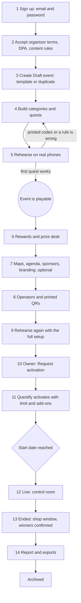

# Organizer Dashboard and Questify Console: Experience Plan

Status: planning draft. Experience only. No colors, fonts, illustration style or brand names are
set here. Wireframes use plain boxes and words, so the visual theme can change without touching
this document.

Sources: SRS 1.10, 1.12, 1.13, 1.14, 1.17, NFR-027, NFR-030; FEATURES Areas 10, 12, 13, 14, Stage 1
review additions, Feature switches; ADR-059, 060, 063, 064, 068, 076, 077, 078, 079, 080, 085.

How to read the wireframes:

- Every wireframe is the **phone layout**, at most 30 characters wide (ADR-085, FR-1746).
- Each one is followed by one line: **Computer:** how it widens.
- `[ Button ]` is a button. `[*Primary*]` is the one primary action of that screen.
- `v` and `>` mark a row that opens (accordion or next screen). `( )` and `(x)` are choices.
- Layout is mirrored for Arabic (section 8). Wireframes show the English direction.
- Phone rule for the whole dashboard: one column, one task per screen, tap targets are whole
  rows, tables become stacked cards, forms are one field per row, the primary action stays
  reachable at the bottom of the screen.

---

## 1. Who and when

| Person | What they can do | When they matter most |
|---|---|---|
| **Owner** (exactly one per organizer account) | Everything an editor can, plus: the team (invite and remove editors, limit an editor to chosen events), Request activation, ownership transfer, deleting the organizer account | Sign-up, before go-live (activation), and any time the team changes |
| **Editor** | Build events, operators (not the award caps: only the owner sets them, ADR-152), exclusions, remove awards, ban players, pause redemption, the live control room, bulk awards, QR regeneration. Cannot: change the team, request activation, transfer ownership, delete the account | Build weeks and the event day. This is the person on the floor with a phone |
| **Questify platform admin** | In the console: activate and suspend organizers and events, set limits and add-ons, edit any organizer's event (support), moderation and reports, content, settings, usage, contact details. One role, every action logged | Activation requests, live-event reports (urgent), support on event day |
| Operator | Not a dashboard user. Works in the player app's staff mode. The dashboard only invites and manages them | Event day |
| Sponsor | No login, no report link (FR-1304) | Never |

There is no read-only seat (FR-1013). Owner and editors are excluded from boards and rank prizes
(FR-1014).

**Sign-in (ADR-078, FR-1725, NFR-030).** Same flow for owners, editors and platform admins:

1. Email and password.
2. A one-time code sent to the email. Wrong code: refused. Repeated failures: rate-limited, with a
   message that says how long to wait.
3. Session opens. It ends after inactivity (section 7, expired session).

First sign-in of an invited editor: open the emailed invite, set a password, enter the email code.

```
+----------------------------+
| Sign in                    |
| Email                      |
| [____________________]     |
| Password                   |
| [____________________]     |
|                            |
| [*Continue*]               |
| Forgot password            |
| New organizer? Sign up     |
+----------------------------+
 Step 2: "Enter the code we
 emailed to a***@x.com"
 [______]  [*Sign in*]
 Send a new code (in 30 s)
```

**Computer:** the same form, centered in a narrow column.

---

## 2. Primary flow: from sign-up to a live event



Numbered steps:

1. **Sign up.** Email and password, then the email code. No approval needed (FR-1401). The person
   becomes the owner of a new organizer account.
2. **Accept three documents** on the sign-up screen: organizer terms, data processing agreement,
   content rules. Versions and time are stored (FR-1726). This is part of step 1's screen flow,
   not a separate trip.
3. **Create a Draft event.** Choose: start from a template (conference, festival, campus,
   corporate) or duplicate an earlier event or start empty. Enter kind (physical, virtual,
   workplace), name, dates, time zone (default Riyadh), venue, public or private, join methods.
   The event is Draft. Its web page, invite links and joining are closed to strangers until
   activation (FR-1737).
4. **Build categories and quests.** Edit what the template gave, or add categories and quests.
   Each quest: type, reward, rules, verification, Arabic and English text.
5. **Rehearse on real phones.** The owner, editors and operators join the Draft event, scan real
   printed codes, try the flow. No one else can join (FR-1721). Everything is wiped at go-live
   (FR-1722).
6. **Rewards and prize desk.** Add rewards and stock. Item rewards need the prize desk (place and
   hours) first (FR-1716). Digital codes are uploaded as a list.
7. **Optional:** maps, agenda, sponsors, logo and banner, switches, renamed words.
8. **Operators and print.** Invite operators, create batch QRs, print the quest QR sheet.
9. **Rehearse again** with rewards, desk and operators.
10. **Request activation** (owner only). It goes to the console queue. Nothing is charged in the
    platform; price and payment are settled outside (FR-1019, FR-1020).
11. **Questify activates** the event and sets the player limit (hard, soft or none) and the
    add-ons. The owner gets an email (FR-1021, FR-1727). Features not unlocked disappear from the
    dashboard (FR-1729).
12. **Live.** The control room opens. Rehearsal data is already wiped.
13. **Ended.** The shop stays open for the shop window (default 3 days). Before the winners reveal,
    the organizer confirms winners (FR-1719).
14. **Report.** Analytics, exports, one-page PDF. Later the event is Archived.

**Step count check.** The "event is playable" moment is the first quest working on a real phone
in rehearsal. With the full path above that is step 5, but steps 3 and 4 each hold several
screens. Two flags:

- **Too many steps before value if rewards come first.** Do not put steps 6 and 7 before
  rehearsal. The plan above already moves rewards, the prize desk, maps, agenda, sponsors,
  branding and renamed words to after the first rehearsal.
- **Shortest path to playable is 4 screens:** sign up (with the three acceptances) → pick a
  template → check the template's quests → "Rehearse now" (shows a join code for the team).
  Suggest the dashboard shows "Rehearse now" as soon as one quest exists.
- **What can move later:** prize desk (needed only when publishing item rewards, not for
  rehearsing a QR quest), branding, switches, words, sponsors, maps, agenda. Activation is
  requested only after the second rehearsal, but the owner may request it at any time; the
  checklist (section 3) shows what is still missing as advice, not as a block, except the
  prize desk rule.

---

## 3. Dashboard navigation map and key screens

### 3.1 Navigation map

Phone: a top bar with the organizer name, a menu button, and the event name when inside an event.
Inside an event, a horizontal strip of section names under the top bar (scrolls sideways). The
menu holds the account-level items.

**Account level** (all events)

| Section | Holds |
|---|---|
| Events | List of events with state. New event (template, duplicate, empty) |
| Team (owner only) | Editors, per-event limits, ownership transfer, delete account |
| Alerts | Each team member's own email alert switches (activated, stock or codes low, new flags, content unpublished, support access, size limit 80% and 100%) |
| Support | The three contact details set by Questify (WhatsApp, email, phone) |
| Account | Name, password, accepted documents and versions, sign out |

**Event level** (strip inside an event)

| Section | Holds |
|---|---|
| Overview | State, checklist to go live, Request activation, rehearsal code |
| Build | Details and time zone; Categories and quests; Rewards and prize desk; Switches; Words and branding; Maps, agenda, sponsors; Join method and rules page; Event day start |
| Run | Control room; Inbox (submissions, tickets, flags); Operators and stations; Winners |
| Insights | Analytics; Exports and PDF report; Survey results; Change log (including support access) |
| Preview | Player-screen preview in Arabic and English; Rehearsal |

An editor limited to some events sees only those events everywhere (FR-1724). Switches and menu
items for add-ons that were not unlocked are not shown at all (FR-1729).

---

### 3.2 Events list

Primary action: **New event**.

```
+----------------------------+
| Events              [Menu] |
| [*+ New event*]            |
| Search events [__________] |
| Filter: All v              |
|----------------------------|
| Riyadh Tech Day            |
| LIVE  Oct 20-22            |
| 1,240 players   >          |
|----------------------------|
| Spring Festival            |
| DRAFT  Not activated       |
| Checklist 4 of 7   >       |
|----------------------------|
| Campus Week 2025           |
| ENDED  Shop open 2 days    |
| Duplicate        >         |
+----------------------------+
```

State label on every row: Draft, Scheduled, Live, Ended, Archived (FR-1017). A Draft row says
"Not activated" or "Activation requested".

**Computer:** a table with columns name, state, dates, players, and a side preview of the selected event.

---

### 3.3 Event overview

Primary action: **Request activation** (owner). An editor sees the same line as plain text:
"Only the owner can request activation" and the primary slot shows **Rehearse now** instead.

```
+----------------------------+
| < Events                   |
| Spring Festival            |
| DRAFT - not activated      |
|----------------------------|
| Before you go live         |
| [x] Details and dates      |
| [x] 3 categories, 12 quests|
| [x] Rehearsed on a phone   |
| [ ] Prize desk set         |
|     (needed for item       |
|      rewards)       >      |
| [ ] Operators invited  >   |
| [ ] Quest QRs printed  >   |
|----------------------------|
| Rehearsal code: SPRING-7Q  |
| Only your team can join.   |
| [ Rehearse now ]           |
|----------------------------|
| [*Request activation*]     |
| Price and payment are      |
| arranged outside Questify. |
+----------------------------+
 Strip: Overview Build Run
        Insights Preview
```

Behavior:

- After the request: the button becomes "Activation requested on 12 Oct" and a "Withdraw request"
  link (confirmation screen).
- After activation: state becomes Scheduled or Live, the page shows the player limit ("Up to 300
  players, warning at 80%") and the unlocked add-ons.
- The checklist only advises. Items that are required: the prize desk if any item reward is
  published (FR-1716).

**Computer:** checklist left, state and activation card right, change log preview below.

---

### 3.4 Quest builder

Two screens. Categories are an accordion, like the player's Quests tab.

**3.4a Categories and quests.** Primary action: **Add quest**.

```
+----------------------------+
| < Build   Quests           |
| [*+ Add quest*]            |
| [ + Add category ]         |
|----------------------------|
| v Welcome       3 quests   |
|   Order: any order         |
|   - Scan the gate QR   50  |
|   - Meet a speaker     80  |
|   - Quiz: Day 1       100  |
|   [ Edit category ]        |
|----------------------------|
| > Chapter 1 (in order)     |
| > Sponsor zone             |
| > Hidden: Treasure         |
+----------------------------+
 Row tap: open quest editor
 Hold + move handle: reorder
```

- Collapsed category shows quest count and a state badge when relevant (opens at a set time,
  unlocks after another category, hidden, limited to an audience).
- A quest row shows title, points, and a small badge for hidden, paused, ended or draft.
- Editing a category: name (Arabic and English), rules, order type (any order or in order), opens
  at, unlocks after, daily or weekly refresh, completion bonus, sponsor, audience limit, hidden.

**Computer:** the accordion on the left, the quest editor opens on the right of it instead of a new screen.

**3.4b Quest editor.** Primary action: **Save quest**.

```
+----------------------------+
| < Quests   New quest       |
| Type                       |
| [ Scan a QR            v ] |
|----------------------------|
| Title (English)            |
| [____________________]     |
| Title (Arabic)             |
| [____________________]     |
| What to do (EN) / (AR)     |
| [____________________]     |
|----------------------------|
| Reward                     |
| Points [ 50 ]              |
| Item reward  [ none v ]    |
|----------------------------|
| Verification (pick 1+)     |
| [x] Player scans quest QR  |
| [ ] Operator scans player  |
| [ ] NFC tag                |
|----------------------------|
| Rules                      |
| Repeat cap per player [1]  |
| Opens [ any time ]         |
| Closes [ end of event ]    |
| Station / location [____]  |
| Estimated time [ 2 min ]   |
| Difficulty [ easy v ]      |
| Sponsor [ none v ]         |
| Status ( ) Show (x) Hide   |
| Pin as Up next ( )         |
|----------------------------|
| Preview (EN | AR)          |
| [*Save quest*]             |
| Delete quest               |
+----------------------------+
```

Fields by quest type (only these appear for the chosen type):

| Quest type | Extra fields shown |
|---|---|
| Scan a QR | Verification methods |
| Challenge (staff confirm) | What the staff check; verification must include operator scan |
| Submit photo or text | What players submit (photo and text only, no video, FR-1006); may a rejected submission be sent again |
| Vote | Options, each text or an uploaded image; one vote per player |
| Quiz | Questions, answers, right answer, optional timer, points per right answer |
| Enter a code | The code, where it will be shown (slide, speaker, push) |
| Meet someone | Daily cap per player |
| Survey | Questions, rating questions, share results with a speaker |
| Location check-in | Area on the map; a QR at the spot always works |
| Mini-game | Which game, the target score |
| Share quest | What to share |
| Passport | The steps (e.g. 5 of 8 booths), any order |

Behavior:

- Every organizer-written field has two inputs, Arabic and English (FR-1008). At least one language
  is required to save; the other may stay empty, and players who use the missing language see the
  other one (user, 2026-10-17).
- Editing or deleting a quest that players completed opens a confirmation screen (section 5).
- Verification methods: at least one must stay ticked. NFC shows "Written from the player app's
  staff mode, not from this page" because the web dashboard cannot write tags.
- A "Print QR" link appears on a saved quest (opens 3.5).

**Computer:** two columns: the form on the left, a live player-screen preview (Arabic and English toggle) on the right.

---

### 3.5 Quest QR and NFC print page

Primary action: **Print or save as PDF** (built in T-104).

```
+----------------------------+
| < Build   Print codes      |
| [*Print or save as PDF*]   |
|----------------------------|
| Size: Small  Large v       |
|----------------------------|
| [QR]  Scan the gate QR     |
|       Welcome              |
|       [ Regenerate ]       |
|----------------------------|
| [QR]  Booth 4 stamp        |
|       Sponsor zone         |
|       [ Regenerate ]       |
|----------------------------|
| NFC: write tags from the   |
| player app, staff mode.    |
+----------------------------+
```

- Print sheet: Small puts several codes on a page, Large one per page; each code has the quest
  title in the event's languages (an English-only event prints English) and its category, which
  stands in for the station name until stations exist (T-205, T-309). Each card also downloads
  as an SVG. Codes are black on white in every theme and never mirrored right to left.
- No separate "Download all (PDF)": the one primary button prints, and the browser's own "Save as
  PDF" gives the file. "Show: All quests" waits until a second type carries a code.
- **Regenerate** opens a confirmation screen: "The printed code stops working at once. Reprint it
  before players scan." (FR-1711). The old code is refused from that moment.
- On a phone, "Print sheet" opens the phone's own print or save-as-PDF option.

**Computer:** a grid of code cards, three or four across, with the print preview beside it.

---

### 3.6 Rewards and stock

Rewards list. Primary action: **Add reward**.

```
+----------------------------+
| < Build   Rewards          |
| [*+ Add reward*]           |
|----------------------------|
| Prize desk                 |
| Hall B, 4-10 pm   [ Edit ] |
| Map pin: set               |
|----------------------------|
| Hoodie        ITEM         |
| 500 pts   Stock 12 of 40   |
| LOW STOCK            >     |
|----------------------------|
| Coffee voucher  CODE       |
| 100 pts   Codes 4 left     |
| LOW CODES            >     |
|----------------------------|
| Meet the speaker  EXP      |
| 800 pts   Stock 3 of 10 >  |
+----------------------------+
```

The prize desk card is always at the top. With no desk set and item rewards present, the card
reads "Set the prize desk before you publish item rewards" and publishing an item reward is
blocked until it is set (FR-1716).

Reward editor. Primary action: **Save reward**.

```
+----------------------------+
| < Rewards   Hoodie         |
| Kind                       |
| (x) Item at the desk       |
| ( ) Digital code           |
| ( ) Experience             |
| Name EN / AR               |
| [____________________]     |
| Picture [ Upload ]         |
| Price [ 500 ] pts          |
| Stock [ 40 ]               |
| Limit per player [ 1 ]     |
| Available from / to        |
| Section [ Merch v ]        |
| Tag [ new v ]              |
| Sponsor [ none v ]         |
| Audience [ everyone v ]    |
|----------------------------|
| Digital code kind only:    |
| Codes uploaded: 36 of 40   |
| [ Upload code list ]       |
| Warn me when under [ 5 ]   |
|----------------------------|
| [*Save reward*]            |
| Delete reward              |
+----------------------------+
```

- Uploading codes: choose a file or paste one code per line. The result screen says "36 codes
  added, 2 duplicates skipped". Codes already given out are never changed.
- Stock edits show the new count and what is currently reserved. Lowering stock below the
  reserved count is refused with the number to fix.
- Rank prizes (when that switch is on): set per rank; handed over like any prize.

**Computer:** the list on the left with the editor on the right; stock shown as a bar per reward.

---

### 3.7 Operators

Primary action: **Invite operator**.

```
+----------------------------+
| < Run   Operators          |
| [*+ Invite operator*]      |
| [ Create batch QRs ]       |
|----------------------------|
| Sara A.       active       |
| Scanner, Prize desk        |
| Assigned: all stations >   |
|----------------------------|
| Omar K.       active       |
| Scanner only               |
| Assigned: Booth 4  >       |
|----------------------------|
| sam@x.com     invited      |
| Waiting to accept   >      |
|----------------------------|
| Batch: 50 Scanner QRs      |
| 31 claimed, 19 open  >     |
+----------------------------+
```

Invite operator (phone number or email, then a personal single-use QR or a link):

```
+----------------------------+
| < Operators   Invite       |
| Phone or email             |
| [____________________]     |
| Preset                     |
| (x) Scanner                |
| ( ) Prize desk             |
| ( ) Moderator              |
| ( ) Custom                 |
| Can also play the event?   |
| ( ) No  ( ) Yes            |
| [*Send invite*]            |
+----------------------------+
```

Operator detail: ability switches (scan quests, award by hand, hand over prizes, review
submissions, answer the help desk, write NFC tags, show a rotating QR), assignment (all, or chosen
quests and booths), award caps (per award, per operator per day), "Remove operator" (confirmation
screen; takes effect at once).

Batch QRs:

```
+----------------------------+
| < Operators   Batch QRs    |
| How many  [ 50 ]           |
| Preset    [ Scanner v ]    |
| Assigned  [ all v ]        |
| Single-use. Each one makes |
| one operator when claimed. |
| [*Create QRs*]             |
+----------------------------+
```

Result: a print sheet of QRs, with a claimed or open status per code afterwards.

**Computer:** list on the left, selected operator's abilities on the right; the batch result is a printable grid.

---

### 3.8 Live control room

Primary action: **Launch flash quest**. One screen, the event-day home. Counters on top, scan
feed in the middle, actions in a fixed bar.

```
+----------------------------+
| Riyadh Tech Day  LIVE      |
| Online 842  Inbox 7        |
| Flags 2   Low stock 1      |
|----------------------------|
| [*Launch flash quest*]     |
| [ Boost ] [ Announce ]     |
| [ Live poll ] [ More v ]   |
|----------------------------|
| Scan feed       Filter v   |
| 14:02 Scan gate    @falcon |
| 14:02 Quiz Day 1   @nora   |
| 14:01 Booth 4      @omar   |
| Rate now: 38 per minute    |
|----------------------------|
| Quests         Done  Rate  |
| Scan gate      610   49%  |
| Quiz Day 1     240   19%  |
| Booth 4  PAUSED  52   4%   |
+----------------------------+
 More: Pause a quest, Skip a
 broken step, Award by hand,
 Award to a group
```

Actions (all open a short form, then a confirmation screen where they affect players):

| Action | What the form asks |
|---|---|
| Launch flash quest | Which quest, how long, push message in Arabic and English |
| Boost | Multiplier or bonus, which scope, how long |
| Announce | Message in Arabic and English, send as push and in-app |
| Live poll | Question, options, duration |
| Pause a quest | Which quest; players see it as paused |
| Skip a broken step | Which in-order category and step; players move on |
| Award by hand | Find the player by username or phone, points or quest, required reason; within owner caps |
| Award to a group | An uploaded or pasted list, or everyone who completed a quest (sessions with T-505); points; required reason; outside the daily caps, an editor inside the per-award cap (FR-1712) |

Counters are tappable and open the Inbox or the stock list. On a phone the feed shows two lines
per row; the per-quest table becomes stacked cards. The feed updates without a page reload
(FR-1024). When the connection drops, a bar says "Offline. Showing data from 14:02" with a
Retry button; actions are disabled until the connection is back (the product is online-only).

**Computer:** three panels at once: counters and actions on the left, scan feed in the center, quest table on the right.

---

### 3.9 Inbox

Primary action: **Review next**. One list for submissions, help-desk tickets and flags, with a
type filter.

```
+----------------------------+
| < Run   Inbox              |
| [*Review next*]            |
| ( All 7 )( Submissions 4 ) |
| ( Tickets 1 )( Flags 2 )   |
|----------------------------|
| SUBMISSION  2 min ago      |
| Photo: "Find the lion"     |
| @falcon                >   |
|----------------------------|
| TICKET  10 min ago         |
| "My code did not work"     |
| @nora                  >   |
|----------------------------|
| FLAG  15 min ago           |
| Same device, 2 accounts    |
| @omar, @sam            >   |
+----------------------------+
```

Detail screens:

- **Submission:** the photo or text, quest, player, Approve, Reject (with a reason the player
  sees), Report to Questify. If resubmission is allowed on the quest the reject screen says so.
- **Ticket:** the player's message, a reply box, Mark solved.
- **Flag:** what was detected, the player, their recent completions, and actions: Dismiss, Pause
  redemption for this player, Remove an award, Ban from this event. Each action uses a confirmation
  screen.

**Computer:** list on the left, detail on the right; arrow keys step to the next item.

---

### 3.10 Winners confirmation

Primary action: **Confirm winners**. Available when the event has ended or the finale is near,
only if rank prizes are on.

```
+----------------------------+
| < Run   Winners            |
| Before the reveal, check   |
| the top ranks.             |
|----------------------------|
| 1  @falcon     4,820 pts   |
|    Prize: Tablet  OK       |
| 2  @nora       4,610 pts   |
|    Prize: Headphones  OK   |
| 3  @omar       4,590 pts   |
|    1 OPEN FLAG      >      |
|    Same device, 2 accounts |
|    [ Review flag ]         |
| 4  @sam        4,100 pts   |
|    Prize: Voucher  OK      |
|----------------------------|
| Confirming freezes the     |
| prize ranking.             |
| [*Confirm winners*]        |
+----------------------------+
```

- A rank with an open flag shows the flag inline and cannot be skipped: the organizer reviews it
  (dismiss), or bans the player first, then confirms (FR-1719).
- Confirm opens a confirmation screen: "The prize ranking freezes. Points that arrive later do
  not change it. Winners receive a push naming their prize and the prize desk hours."
- After confirming: "Winners confirmed on 22 Oct, 18:05" and a Reveal control (when the finale
  runs) and the winners list for the prize desk.

**Computer:** ranks in a table with flag details in a side panel.

---

### 3.11 Analytics overview

Primary action: **Export**.

```
+----------------------------+
| < Insights   Analytics     |
| [*Export*]                 |
| Period: Whole event v      |
| Sponsor: All v             |
|----------------------------|
| Players joined      1,240  |
| Active now            842  |
| Activation rate       68%  |
| Returning             310  |
| Players over time          |
| [ simple line chart ]      |
|----------------------------|
| Joined by                  |
| Code 410  QR 520  Link 200 |
| List 90   Invite 20        |
|----------------------------|
| Quests        >            |
| Rewards and points  >      |
| Surveys       >            |
| Change log    >            |
+----------------------------+
```

- Quests: completion rate, category funnels, where players stop, most and least popular.
- Rewards and points: points earned and spent, redemptions per reward, stock left, unclaimed
  reservations.
- Surveys: answers and rating averages per session or quest; "Share with speaker" shares only
  that session.
- Export opens a choice: players (only the fields the join card disclosed), completions,
  redemptions, submissions, survey answers, or the one-page PDF report. Output is a spreadsheet
  file.
- There is no time-spent figure and no heatmap (FR-1203).

**Computer:** four figure tiles across the top, two charts side by side below.

---

### 3.12 Team (owner only)

Primary action: **Invite editor**. An editor who opens this address sees "Only the owner can
manage the team."

```
+----------------------------+
| < Account   Team           |
| [*+ Invite editor*]        |
|----------------------------|
| You (owner)                |
| nader@x.com                |
| [ Transfer ownership ]     |
|----------------------------|
| Lina M.       editor       |
| All events                 |
| [ Limit to events ]        |
|----------------------------|
| Hassan R.     editor       |
| Only: Spring Festival      |
| [ Change events ]          |
|----------------------------|
| omar@x.com    invited      |
| Expires in 5 days          |
| [ Resend ]  [ Cancel ]     |
|----------------------------|
| Delete organizer account   |
+----------------------------+
```

- The only role offered is editor (FR-1013).
- **Limit to events:** pick events from a checklist; the editor then sees only those (FR-1724).
- **Transfer ownership:** enter the new owner's email. An invitation is sent and expires. When
  accepted, the former owner becomes an editor or leaves (choice on the confirmation screen).
- The owner cannot remove themselves while owner.
- **Delete organizer account:** the most severe confirmation (section 5).

**Computer:** a table with a role, events and last sign-in column.

---

## 4. Questify console wireframes

Opened by platform admins only, same sign-in as the dashboard. Same phone rules. The top bar
shows "Questify console" so an admin who is also an organizer never confuses the two.

Console navigation: Activation queue, Organizers and events, Reports, Content, Platform settings,
Usage, Support contact, Admin log, plus platform numbers on the home screen (FR-1419).
Alerts that need attention (urgent reports, fewer than 7 days of daily questions) show as badges
on the menu.

### 4.1 Activation queue and activate dialog

Primary action: **Open next request** (queue), then **Activate** (dialog).

```
+----------------------------+
| Console   Activation  (3)  |
| [*Open next request*]      |
|----------------------------|
| Spring Festival            |
| Al Noor Events             |
| Requested 2 h ago          |
| Starts 25 Oct          >   |
|----------------------------|
| Tech Day 2                 |
| Cedar Corp                 |
| Requested 1 day ago    >   |
+----------------------------+
```

```
+----------------------------+
| < Queue   Activate event   |
| Spring Festival            |
| Owner: nader@x.com         |
| Rehearsed: yes             |
| Starts 25 Oct 09:00        |
|----------------------------|
| Player limit               |
| ( ) Hard - joining stops   |
|     at the number          |
| (x) Soft - warn at 80%     |
|     and 100%, never block  |
| ( ) None                   |
| Number [ 300 ]             |
|----------------------------|
| Add-ons bought             |
| [x] Big screen             |
| [ ] Kiosks                 |
| [x] NFC                    |
| [ ] Promotional SMS        |
|----------------------------|
| Nothing is charged here.   |
| [*Activate*]               |
| Reject with a note         |
+----------------------------+
```

- Activate opens a confirmation screen listing: event, owner, limit, add-ons, that the owner is
  emailed, that rehearsal data will be wiped at go-live, and that the action is logged.
- The admin can also activate any event with no request, from the event page.
- Reject sends the owner a note; the event stays Draft.

**Computer:** queue on the left, the activate form on the right of the selected request.

### 4.2 Organizers and events list

Primary action: **Open event**.

```
+----------------------------+
| Console   Organizers       |
| Search [________________]  |
| Show: Organizers v         |
|----------------------------|
| Al Noor Events             |
| 4 events, 1 live           |
| Active                  >  |
|----------------------------|
| Cedar Corp                 |
| 2 events                   |
| SUSPENDED               >  |
|----------------------------|
| Review demo tenant         |
| Never ends                 |
| Locked                  >  |
+----------------------------+
```

- Organizer page: events, owner, team, usage, Suspend or Reactivate (with a reason).
- Event page: state, limit, add-ons, **Open as support** (full edit; opens a banner "You are
  editing as Questify support. The organizer will see this." and writes the log), Suspend,
  Change limit and add-ons.
- The review demo event has no Delete and no End.

**Computer:** a table with search and filters, and the detail beside it.

### 4.3 Reports queue

Primary action: **Open top report**. Reports from live events sit at the top, marked URGENT, with
a 1 hour target; others have a 24 hour target.

```
+----------------------------+
| Console   Reports  (6)     |
| [*Open top report*]        |
|----------------------------|
| URGENT  LIVE   12 min left |
| Quest content              |
| Riyadh Tech Day        >   |
|----------------------------|
| URGENT  LIVE   40 min left |
| Username @xyz              |
| Riyadh Tech Day        >   |
|----------------------------|
| Player report   20 h left  |
| Campus Week            >   |
+----------------------------+
```

Report detail: what was reported, who reported, the event team's note if any, the content.
Actions: Dismiss, Unpublish the content (organizer is emailed and sees it in the change log),
Ban the player from the platform (required reason, never automatic; the player sees the appeal
email address), Open the event.

**Computer:** list on the left, report detail on the right.

### 4.4 Content

Primary action: **Add daily question** (on the Daily questions tab). Tabs scroll sideways:
Daily questions, Templates, Questify quests, Level titles, XP table.

```
+----------------------------+
| Console   Content          |
| Daily  Templates  Quests   |
| Levels  XP                 |
|----------------------------|
| WARNING: only 5 days of    |
| daily questions queued.    |
| Add at least 2 more.       |
| [*+ Add daily question*]   |
|----------------------------|
| Mon 20 Oct                 |
| "Which city hosts..."      |
|                        >   |
| Tue 21 Oct                 |
| "What is the..."       >   |
| Wed 22 Oct   EMPTY         |
| No challenge this day  >   |
+----------------------------+
```

- The warning shows when fewer than 7 days are queued (FR-1733). A day with no question shows no
  challenge to players; the streak still counts other activity.
- Templates: conference, festival, campus, corporate; each holds categories, quests, rewards in
  Arabic and English. Editing a template does not change events already made from it. The edit
  screen says so.
- Questify quests, achievements, items and the gem shop: lists with the same editor pattern as
  the quest builder.
- Level titles and XP table: one row per level, title in Arabic and English, XP needed. Saving
  opens a confirmation screen if players already hold those levels.

**Computer:** tabs across the top, a table of rows with an edit panel beside it.

### 4.5 Platform settings

Primary action: **Save settings**.

```
+----------------------------+
| Console   Settings         |
| Standard XP per quest      |
| [ 10 ]  (first time only)  |
|----------------------------|
| XP by difficulty           |
| (x) Off  ( ) On            |
| When On: Easy [10]         |
| Medium [25] Hard [50]      |
|----------------------------|
| XP on repeats              |
| ( ) Off  (x) On            |
|----------------------------|
| Players can change         |
| their username             |
| ( ) Off  (x) On            |
|----------------------------|
| Daily streak               |
| ( ) Off  (x) On            |
|----------------------------|
| Minimum app version        |
| [ 1.2.0 ]                  |
|----------------------------|
| [*Save settings*]          |
+----------------------------+
```

Saving opens a confirmation screen that says which players are affected (for example "Usernames
become locked for all players"). Raising the minimum app version says "Players on older versions
will be asked to update before they continue." Feature switches that ship in the app (daily
challenge, share quests, Questify invitations) sit on this screen as well.

**Computer:** two columns of grouped settings.

### 4.6 Usage view

Primary action: **Open event usage** (read-only screen otherwise).

```
+----------------------------+
| Console   Usage            |
| Organizer [ Al Noor v ]    |
| Period [ This month v ]    |
|----------------------------|
| Totals                     |
| Login SMS         2,140    |
| Promo SMS           800    |
| Promo email       1,500    |
| Push             48,000    |
| Players           1,240    |
| Storage           3.1 GB   |
|----------------------------|
| By event                   |
| Tech Day   1,240 players   |
| SMS 1,900  Push 41,000  >  |
| Spring Fest  0 players  >  |
+----------------------------+
```

**Computer:** totals across the top, a table by event below.

### 4.7 Support contact editor

Primary action: **Save contact details**.

```
+----------------------------+
| Console   Support contact  |
| WhatsApp hotline           |
| [+966 ____________]        |
| Email                      |
| [____________________]     |
| Phone                      |
| [+966 ____________]        |
| Shown in the dashboard and |
| in the player app. Empty   |
| WhatsApp = not shown.      |
| [*Save contact details*]   |
+----------------------------+
```

Saving opens a confirmation screen showing old and new values. Changes appear without an app
release.

**Computer:** the form on the left, a preview of the contact page on the right.

### 4.8 Platform admin log

Primary action: **Filter**. Read-only. No edit or delete exists on any entry.

```
+----------------------------+
| Console   Admin log        |
| [*Filter*]  Admin: All v   |
|----------------------------|
| 22 Oct 14:10               |
| Lina (admin)               |
| Activated Spring Festival  |
| Soft limit 300         >   |
|----------------------------|
| 22 Oct 13:55               |
| Omar (admin)               |
| Edited quest in Tech Day   |
| Points 50 to 60        >   |
+----------------------------+
```

Filters: admin, organizer, event, action type, date. Support edits in organizer events also show
in that organizer's change log (FR-1409).

**Computer:** a table with old and new values in extra columns.

---

## 5. The confirmation-screen pattern (ADR-063)

Rule (FR-1031, FR-1032): before every consequential action the person sees a screen that says
exactly what will happen, in plain words, with the real names and numbers. Nothing happens until
the person confirms. The screen never says only "Are you sure?".

Parts of every confirmation screen:

1. A title naming the action and the thing.
2. "What will happen": a short list with real numbers.
3. "What will not change": what stays safe.
4. Choices, when the action has branches (section below), as radio rows with a one-line result
   each. The safe choice is not pre-selected when the choice changes player points; the person
   must pick.
5. Two buttons: a clear confirm button that repeats the action, and Cancel. Cancel is the default
   focus.
6. A reason field when the action requires one.

Example: deleting a quest that 240 players completed.

```
+----------------------------+
| Delete "Quiz Day 1"?       |
|                            |
| What will happen           |
| - The quest disappears     |
|   for all players.         |
| - 240 players completed it |
|   and earned 100 pts each  |
|   (24,000 pts).            |
|                            |
| What happens to those      |
| points?                    |
| ( ) Keep the points        |
|     Players keep 100 pts   |
|     each. Ranking does not |
|     change.                |
| ( ) Remove the points      |
|     Each player loses 100  |
|     pts. A new entry is    |
|     added to their points  |
|     record. Ranking and    |
|     balances can change.   |
|                            |
| Not undone: rank prizes    |
| already handed over stay   |
| with the winners.          |
|                            |
| [*Delete quest*]           |
| [ Cancel ]                 |
+----------------------------+
```

The confirm button stays disabled until a choice is picked. Every adjustment is a new entry in
the points record, never an overwrite (ADR-063).

**Computer:** the same screen as a centered dialog.

### Actions that must use this pattern

| Action | Where | What the screen must explain | Branch choice |
|---|---|---|---|
| Delete an event | Dashboard | Everything removed: categories, quests, rewards, players' records; cannot be undone | none |
| Delete a category with quests | Quest builder | What happens to its quests (move to another category or delete) and to players' points | Move or delete quests; keep or remove points |
| Delete a quest players completed | Quest builder | Number of players, points involved | Keep or remove points |
| Edit points of a quest with completions | Quest editor, live | Number of players who completed it, points before and after | Future completions only, or also past completions |
| Edit a quest's verification, rules, time window or order in a live event | Quest editor | Who is affected now (for example players midway through) | none |
| Turn a feature switch off in a live event | Switches | What players lose sight of; what happens to points, stock and reservations already made | none |
| Delete a reward | Rewards | Reservations that exist, points returned to players | Cancel reservations and return points (required) |
| Change reward stock below reserved | Rewards | Refused with the number; no screen | none |
| Regenerate a quest QR | QR print page | Old code stops working now; reprint | none |
| Pause a quest | Control room | Players cannot complete it; they see it as paused | none |
| Skip a broken step | Control room | Which step; players moving on; points for the skipped step | Award or not award the skipped step |
| Award by hand | Control room | Player, points, reason; a new entry in the points record | none |
| Award to a group | Control room | Group name and size, total points, reason; outside operator caps | none |
| Remove points or an award | Inbox, player page | Player, points removed, a new entry added | none |
| Ban a player from an event | Inbox | Player loses access to the event; their earlier record stays | Keep or remove their points from the ranking |
| Pause redemption for a player | Inbox | What the player sees | none |
| Launch a flash quest, boost or announcement | Control room | Who receives it; that a push goes to all players who allow pushes | none |
| Remove an operator | Operators | Access ends now; their record stays | none |
| Remove an editor | Team | Access ends now; their change log entries stay | none |
| Limit an editor to events | Team | Which events they will lose sight of | none |
| Transfer ownership | Team | New owner; what the former owner becomes; invitation expires | Former owner becomes editor or leaves |
| Delete organizer account | Team | All events, players' records and team access removed | none; type the account name to confirm |
| Withdraw activation request | Overview | Event stays Draft | none |
| Confirm winners | Winners | Prize ranking freezes; pushes go to winners | none |
| Change event dates or time zone | Details | Times that shift for players; quests with their own windows | none |
| Change the player-facing words | Words and branding | Where the new words will appear, in both languages | none |
| Apply a change set (reviewed items) | Change set | The list of selected items with before and after values | Apply all, or only the selected items |
| Open an event as support | Console | The organizer will see this; the action is logged | none |
| Activate, suspend or reject an event | Console | Owner is emailed; limit and add-ons | none |
| Suspend an organizer | Console | All their events stop; players see "event unavailable" | Reason required |
| Unpublish content | Console | Players stop seeing it; the organizer is emailed | Reason required |
| Ban a player from the platform | Console | The player cannot play anywhere; the appeal email address is shown to them | Reason required |
| Save platform settings, content that players hold (levels, XP) | Console | Players affected and how | none |
| Save support contact details | Console | Old and new values | none |
| Sign out | Dashboard, console | Unsaved changes will be lost, if any | none |

Reversible, low-impact actions (reorder, save a draft, open a form) do not use this pattern.

---

## 6. Required states for every screen

For every screen, five states. "Loading" is always a skeleton of the real layout, never a blank
page, and a screen that takes more than 8 seconds says "Still loading" with a Retry button.
Errors name what failed and give one next step. The `Success` column is the message after the main
action; it stays for a few seconds and is also written to the change log where one applies.

| Screen | Loading | Empty (words and call to action) | Error (words and next step) | Success | Populated |
|---|---|---|---|---|---|
| Sign in | Button shows "Checking" | Not applicable | "Wrong email or password." Try again or Forgot password. Wrong code: "That code is not right." Send a new code. Too many tries: "Wait 10 minutes, then try again." | Opens the Events list (or the last page before the session ended) | Not applicable |
| Events list | Three placeholder rows | "You have no events yet. Create your first event from a template. It takes a few minutes." [New event] | "We could not load your events." [Retry]. If the account is suspended: "Your account is paused. Contact Questify." with the support details | New event appears at the top with a Draft badge | Rows with state, dates, players |
| Event overview | Placeholder checklist | New Draft: "Start with a template. You can rehearse as soon as one quest exists." [Pick a template] | "We could not load this event." [Retry]. Event removed: "This event no longer exists." [Back to events] | "Activation requested. We will email you when it is activated." | Checklist, state, limit, add-ons |
| Quest builder, categories | Placeholder accordion | "No categories yet. Add a category, or start from a template." [Add category] A category with no quests: "No quests here yet." [Add quest] | "We could not save. Your changes are kept on this screen." [Try again]. Missing language: names the field | "Category saved" | Accordion with quest rows |
| Quest editor | Placeholder fields | Not applicable (new quest shows an empty form with the type picker first) | Field errors under each field, with a list at the top on a phone. "Another editor changed this quest" (section 7) | "Quest saved." With [Print QR] and [Preview] | Filled form |
| Quest QR and NFC print page | Placeholder cards | "No quests with codes yet. Add a quest that uses a QR." [Add quest] | "We could not make the codes." [Retry]. After regenerate fails: "The old code still works. Try again." | "New code made. The old code no longer works. Print it again." | Cards per quest |
| Rewards and stock | Placeholder cards | "No rewards yet. Add a reward so players have something to work toward." [Add reward]. No desk and item rewards exist: "Set the prize desk first." [Set desk] | Code upload fails: "The file was not read. Use one code per line." [Choose another file]. Stock below reserved: "12 are reserved. Set 12 or more." | "Reward saved." "36 codes added, 2 duplicates skipped." | Cards with stock and low badges |
| Operators | Placeholder rows | "No operators yet. Invite staff to scan players at stations." [Invite operator] | Invite fails: "That email or number is not valid." Batch fails: "Could not create QRs." [Retry] | "Invite sent." "50 QRs created." | Rows with ability and assignment |
| Live control room | Placeholder counters and feed | Event live, no scans: "No scans yet. They appear here as they happen." Counters show 0 | "Connection lost. Showing data from 14:02. Actions are off until you are back online." [Retry]. Action fails: "Not sent. Nothing changed." [Try again] | "Flash quest launched. 842 players notified." | Live counters, feed, quest table |
| Inbox | Placeholder rows | "Nothing waiting. New submissions, tickets and flags appear here." | "We could not load the inbox." [Retry]. Approve fails: "Not approved. The player has not been told." [Retry] | "Approved. 50 points added." Next item opens | List by type with counts |
| Winners confirmation | Placeholder ranks | Rank prizes off: "Rank prizes are off for this event." [Open switches]. No players: "No players ranked yet." | "We could not load the ranking." [Retry] | "Winners confirmed. The prize ranking is frozen." | Ranks with flags |
| Analytics overview | Placeholder tiles | "No players yet. Figures appear when players join." Shows the join code and invite link to share | "We could not load the figures." [Retry]. Export fails: "The file was not made." [Try again] | "Export ready" with a download button | Tiles, chart, breakdown |
| Team | Placeholder rows | Only the owner: "You are the only one on this account. Invite an editor to help." [Invite editor] | Invite to an address that is already on a team: "That email already has an account here." | "Invite sent." "Ownership invitation sent. It expires in 7 days." | Rows with role and events |
| Console: activation queue | Placeholder rows | "No requests waiting." | "We could not load the queue." [Retry] | "Activated. The owner has been emailed." | Rows by age |
| Console: organizers and events | Placeholder rows | Search found nothing: "No match. Check the name or email." | "We could not load." [Retry] | "Organizer suspended" or "Reactivated" | Rows with state |
| Console: reports | Placeholder rows | "No reports. Good." | "We could not load reports." [Retry] | "Content unpublished. The organizer has been emailed." | Rows, urgent first |
| Console: content | Placeholder rows | Daily questions: "No questions queued. Add 7 days of questions." Warning shows below 7 | Save fails: "Not saved." [Try again] | "Question added. 8 days queued." | Rows by date |
| Console: platform settings | Placeholder fields | Not applicable (values always exist) | "Not saved." [Try again] | "Settings saved." | Filled form |
| Console: usage | Placeholder tiles | "No usage yet for this period." | "We could not load usage." [Retry] | Not applicable (read-only) | Totals and rows |
| Console: support contact | Placeholder fields | WhatsApp empty: stays valid, preview says "Not shown" | "Not saved." [Try again]. Invalid number: names the field | "Saved. Players see it now." | Filled form |
| Console: admin log | Placeholder rows | "No entries match this filter." [Clear filter] | "We could not load the log." [Retry] | Not applicable (read-only) | Rows by time |

### Cases that apply to many screens

| Case | What the person sees and can do |
|---|---|
| **Event not yet activated** | A line at the top of every event screen: "Not activated yet. Only your team can rehearse. The event page and invite links are closed to everyone else." with [Request activation] for the owner, or "Ask the owner to request activation" for an editor. The player-facing event page says "This event is not open yet." Quest, reward and operator screens work fully. Control room shows: "The control room opens when the event is live." and [Rehearse now]. Analytics show rehearsal figures marked "Rehearsal, wiped at go-live" |
| **Activation requested** | The line reads "Activation requested on 12 Oct. We will email you." All building screens still work. |
| **Limit reached (hard)** | Overview and control room show "Player limit reached: 300 of 300. Joining is closed." with the support contact details and a note to ask Questify to raise the limit. Players who try to join see "This event is full." Existing players are not affected. Email alert at 80% and at 100% |
| **Limit reached (soft)** | Same banner wording but "Joining stays open. Ask Questify to raise your limit." No block |
| **Limit near (80%)** | A banner on Overview and the control room: "240 of 300 players joined." |
| **Add-on not unlocked** | The switch or menu item is not shown at all. If the organizer asks, Support explains. (FR-1729) |
| **Event ended** | Overview: "Ended. Shop open until 25 Oct." Build screens warn that edits affect a finished event. Control room is replaced by the winners and report links |
| **Suspended** | Banner: "This event is paused by Questify. Contact support." Editing disabled. Support details shown |
| **Offline or weak signal** | A bar on top: "No connection. Your changes were not saved." The page keeps what was typed; actions retry on request. Nothing is saved silently in a half state |
| **Not allowed (editor opens an owner-only page)** | "Only the owner can do this." with the owner's name and a link to the dashboard home |

---

## 7. Edge cases

| Case | What happens and what the person sees |
|---|---|
| **Editor limited to some events** | The Events list and every menu show only those events. A link to another event gives "You do not have access to this event. Ask the owner." Exports and the change log of other events cannot be reached. When the owner changes the limit, the editor sees it on the next page load; an open page of a removed event shows "You no longer have access" on the next save |
| **Hard limit reached** | See section 6. The control room shows it as a counter; the owner and editors get the 80% and 100% emails if subscribed. Players already in keep playing. An organizer cannot raise the limit; only Questify can |
| **Rehearsal data wiped at go-live** | A confirmation-style notice on Overview two hours before the start and again on the day: "At go-live, all rehearsal scans, points and reservations are erased and stock is restored. Players start at zero." The rehearsal people stay joined as team members. After go-live a note in the change log: "Rehearsal data erased" with counts |
| **Support editing an event** | While a platform admin is in the event, the organizer sees a banner on any event page they have open: "Questify support is viewing or editing this event." After it, the change log shows entries tagged "Questify support" with name, what changed and the time. The email alert "support opened the event" goes to subscribed members. The organizer cannot remove the log entries |
| **Expired session** | After inactivity the next action shows a screen: "You were signed out because you were away." [Sign in]. Unsaved form text is kept in the browser and restored after sign-in on the same screen, with a note "We restored what you typed. Check it, then save." If the session ends during a live control-room action, the action is not sent and nothing changes. Sign-in takes the person back to the same page |
| **Two editors editing the same quest** | Last save wins (user, 2026-10-17). The change log records who saved what and when (F-198), so an overwritten version can be found and restored by hand. A small "Lina is editing this now" note shows on the quest row when someone else has it open, so editors can avoid it |
| **Editor tries owner-only action** | Button not shown; if reached by link, the not-allowed message |
| **Ownership invitation expires** | The invited person sees "This invitation expired. Ask for a new one." The owner sees "Expired" with Resend |
| **Owner leaves, managed event** | Questify built the event inside the client's account, then invites the client as owner. Until accepted, Questify admin is the acting owner for that event. After transfer, support access stays logged as usual |
| **Activation rejected** | The owner sees the note and the event stays Draft; they can fix and request again |
| **Event in the past dates** | Saving dates earlier than today for a new event warns; end before start is refused and names the field |
| **Two organizers' codes collide** | Not possible: codes are unique across the platform; a collision on creation retries silently |
| **Wide table on a phone** | The scan feed, quest table and ranks become stacked rows with the main figure on the right of the first line; nothing needs sideways scrolling except the section strip |

---

## 8. Copy rules

**Renameable words.** The organizer renames "player" and "operator" (and, if allowed,
"quest" and "category") once per event, in one place: Build, Words. Each rename holds singular
and plural in Arabic and English (ADR-058, NFR-014).

- In this plan and in the dashboard's templates the words appear as the tokens `{player}`,
  `{operator}`, `{quest}`, `{category}` (and their plurals). The dashboard shows the event's
  chosen words wherever it names them to the organizer, for example "{quest} editor" reads
  "Mission editor" when quest is renamed to Mission.
- Screens that talk about an event use that event's words. Account-level screens and the console
  use the default words.
- The words screen shows a live sample sentence per word in both languages so the organizer sees
  how it reads before saving.
- Confirmation screens use the event's words too ("240 {player_plural} completed it").

**Arabic and English.**

- Every field an organizer writes has two inputs (Arabic and English): quest titles and
  descriptions, category names, rewards, announcements, push messages, sponsor names, poll
  options, the rules page, join card text. Save needs at least one language; the other is
  optional (user, 2026-10-17).
- Inputs are labeled in both directions. An Arabic input is right-to-left whatever the
  dashboard's own language. Mixed text (a name with Latin letters inside Arabic) shows in correct order.
- The dashboard's own interface is Arabic or English and follows the person's setting, defaulting
  to the browser language. A switch lives in the menu.
- Numbers use Western digits (0 to 9) in both languages (ADR-018). Times are shown in the
  event's time zone, labelled (FR-1728).
- Preview shows the player screens in Arabic and English side by side or by toggle.

**What mirrors in Arabic (RTL).**

- Mirrors: reading order, the menu button and back arrow positions, the section strip direction,
  list rows (leading element on the right), progress bars and sliders, accordion arrows, chevrons
  that point to "next", input alignment.
- Does not mirror: the QR codes themselves, charts' time axis (time runs left to right in both),
  phone numbers and email addresses (always left-to-right inside), media controls, and logos.
- Wireframes in this file show the English direction. Each is checked in both directions
  (NFR-011).

**Plain-word rules for all dashboard text.**

- Short sentences. Name the thing and the number: "240 players" not "many players".
- Buttons are verbs naming the result: "Delete quest", "Save reward", "Request activation".
- Errors say what failed, what is safe, and what to do next.
- No prices, invoices or payment words anywhere in the dashboard (FR-1020). The activation note
  says price and payment are arranged outside.
- Arabic microcopy follows the project's Arabic UX writing guidance; simple standard Arabic, not
  dialect.

---

## 9. Assumptions to confirm

- A1. (Decided) At least one of Arabic or English is required; the other is optional.
- A2. "Event is playable" means the first quest works on a real phone in rehearsal, and "Rehearse now" appears as soon as one quest exists.
- A3. The activation request can be sent at any time; the checklist advises but only the prize desk rule blocks publishing item rewards.
- A4. Phone navigation uses a top bar plus a sideways-scrolling section strip inside an event.
- A5. Reject on an activation request (with a note to the owner) exists in the console.
- A6. (Decided) Two editors: last save wins, with the change log as the safety net.
- A7. An unsaved form is kept in the browser and restored after a session expires.
- A8. A rejected activation or a suspended organizer keeps the event data; nothing is deleted.
- A9. The branding screen offers logo, banner and one accent choice from a curated list (ADR-085), with no colors or fonts specified in this plan; FR-1023 lists logo and banner only, so the accent choice needs confirming.
- A10. When an in-order step is skipped in the control room, the organizer chooses whether players get its points.
- A11. A banned-from-event player's points can be kept in or removed from the ranking, chosen on the confirmation screen.
- A12. The console can reject an activation request and ask for a changed date; it cannot delete an organizer's event.
- A13. Templates edited in the console do not change events already made from them.
- A14. The control room is available only while the event is Live; Scheduled events show "Rehearse now" instead.
- A15. Quest print sheets use the phone's own print or save-as-PDF function rather than a separate print service.
