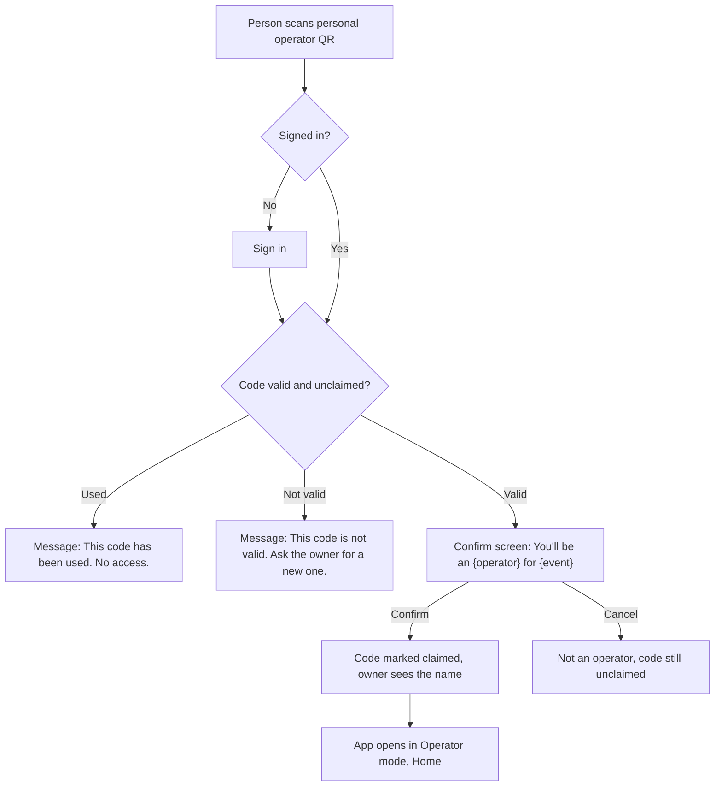

# Operator Mode: UX plan

Experience only. No colors, fonts, art or brand names. The visual theme can change without
changing anything here. Sources: SRS 1.3, 1.5, 1.9, 1.17; FEATURES Areas 3, 5, 9; ADR-029, 040, 041,
042, 049, 057, 058, 080, 083, 085.

Words in braces, such as {player} and {operator}, are the event's renamed words (ADR-058).
Wireframes are at most 30 characters wide.

---

## 1. Who and when

- {operator}s are event staff on a busy floor: one hand free, noise, a queue in front of them.
- A scan must take seconds, and the screen must make a wrong action hard to do.
- Speed first, then no mistakes: big targets, one main action per screen, results readable from an arm's length away.

---

## 2. Mode switch and entry

### 2.1 Invite by phone or email (FR-901)

1. The owner adds the person's phone or email in the dashboard.
2. The person gets an SMS or email invite with a link.
3. They open the link, install or open the app, and sign in.
4. They land on a confirm screen: "You'll be an {operator} for {event name}". They tap Confirm or Not now.
5. On Confirm, the app opens in Operator mode, on Home.

Assumption: step 4 reuses the same confirm screen as the QR flow (see Assumptions).

### 2.2 Personal operator QR (FR-902 to FR-904)

1. The owner generates a QR for one named person. It is long and single-use.
2. The person scans it with their phone camera or the app's scanner, and signs in if needed.
3. The app checks the code.
4. Valid: the confirm screen shows "You'll be an {operator} for {event name}" with Confirm and Cancel.
5. Confirm: they become an {operator}; the code is now used; the owner sees who claimed it.
6. Cancel: they are not an {operator}; the code stays unclaimed.
7. Already used: the app says "This code has been used." and gives no access.



### 2.3 Operator and Player switch (FR-906, FR-907)

1. Only {operator}s the owner allowed to play see "Switch to {player} mode" in Tools.
2. Tap it. A confirm screen says: "You will see the {player} app. Scans will count as {player} scans."
3. Confirm. The {player} home and {player} bottom bar replace the {operator} ones.
4. To go back, the {player} side has "Switch to {operator} mode" in the same place a {player} finds event settings.
5. {operator}s who are not allowed to play never see the switch, and cannot complete quests as a {player}.
6. In {player} mode the scanner is a {player} scanner. It never awards on behalf of anyone.
7. The current mode is always named on screen (a label at the top: "{operator} mode" or "{player} mode").

### 2.4 Rehearsal (ADR-080)

Before go-live, the team uses the same operator screens on a Draft or Scheduled event. A strip at the
top reads "Rehearsal: everything is erased at go-live." Nothing else changes.

---

## 3. Operator bottom bar

```
 Home  Prize   (O)  Inbox  Tools
       desk   Scan
```

Order: Home, Prize desk, Scan (large round center button), Inbox (count badge), Tools.
The Scan button opens Station mode for the picked station. Same position as the {player} Scan button.
The {operator} bar and icons differ from the {player} bar, so the two modes are never confused.

### 3.1 Home

Primary action: **Start scanning** (opens Station mode at the picked station).

```
+----------------------------+
| {operator} mode      Event |
+----------------------------+
| Your station               |
| [ Quest: Treasure Hunt  v ]|
|                            |
| Today at this station      |
|  Done today        40      |
|  Last hour          6      |
|  Waiting items      3      |
|                            |
| [      START SCANNING     ]|
|                            |
+----------------------------+
| Home Prize  (O) Inbox Tools|
+----------------------------+
```

Notes:
- The station picker lists quests and booths. Pick once; it is remembered (FR-923).
- An {operator} limited to one booth sees that booth already picked, and the picker is locked to it (FR-909, FR-921).
- No station picked: the numbers block is replaced by "Pick your station to see today's numbers." and the button reads "Pick a station" (FR-928).
- "Waiting items" opens Inbox.
- Quests that do not use the {operator}-scans-{player} method are listed dimmed with "This quest uses another method" (FR-302).

### 3.2 Station mode (Scan, center button)

Primary action: **Hold the camera on the {player}'s My QR.** There is no scan button; the camera is always on.

Camera screen:

```
+----------------------------+
| Treasure Hunt     [Change] |
|                            |
|                            |
|        +----------+        |
|        |          |        |
|        |  camera  |        |
|        |          |        |
|        +----------+        |
|                            |
|   Point at {player}'s code |
|                            |
| Done today 40   Practice:off|
+----------------------------+
```

Behavior:
- The camera runs all the time. After each result the scanner is ready again within one second (FR-924).
- Within 300 ms of a scan the screen shows a short "Scanned, checking..." beat with a sound and a buzz (ADR-083). The result follows when the server answers.
- Change opens the station picker as a sheet. It never blocks scanning of the current station until a new one is chosen.
- Live camera only. No gallery picker (FR-303).
- The scanner reads {player} My QR and the {player}'s wallet pass code (ADR-091). A printed quest QR is not a {player} code; see Edge cases. The result screen always shows the @username so the {operator} can compare it with the person.

Result screens (each fills the whole screen, with a sound and a buzz; they stay until the next scan or a tap):

```
 SUCCESS (green)    ALREADY DONE (orange)   FAILED (red)
+--------------+   +----------------+   +----------------------+
|              |   |                |   |                      |
|     OK       |   |   ALREADY      |   |   NOT COUNTED        |
|  +100        |   |   COMPLETED    |   |   Code expired.      |
|  Sara_88     |   |   Sara_88      |   |   Ask {player} to    |
|  Treasure    |   |   Done at 14:02|   |   reopen My QR.      |
|  Hunt        |   |   No points    |   |                      |
|              |   |                |   |                      |
| tap or wait  |   | tap or wait    |   | [   Scan again    ]  |
+--------------+   +----------------+   +----------------------+
```

- Every result (green, orange and red) stays on screen until the {operator} scans the next code or taps anywhere, so a result is never missed (user, 2026-10-17). The camera is already live behind it, so the next scan replaces it at once.
- Color is never the only signal: each result also has its own word, icon shape, sound and buzz pattern.

### 3.3 Prize desk

Primary action: **Scan the {player}'s My QR**, then **Handed over** on each item.
This screen never awards points (FR-926).

Step 1, ready to scan:

```
+----------------------------+
| Prize desk                 |
| Open until 18:00           |
|        +----------+        |
|        |  camera  |        |
|        +----------+        |
|   Point at {player}'s code |
|   Or find by name/phone    |
+----------------------------+
| Home Prize  (O) Inbox Tools|
+----------------------------+
```

Step 2, items found:

```
+----------------------------+
| Sara_88               [x]  |
| 2 items waiting            |
+----------------------------+
| Water bottle               |
| Reserved 13:10             |
| [ HANDED OVER ] [ Cancel ] |
+----------------------------+
| VIP lounge (experience)    |
| [ CONFIRM ]     [ Cancel ] |
+----------------------------+
```

Notes:
- Items: shop items, rank prizes and quest item rewards all show here (FR-521, FR-522). Experience rewards show Confirm instead of Handed over (FR-509).
- Handed over asks nothing extra: one tap, then the row shows "Handed over - Undo" for 10 seconds, then it locks and Cancel is gone (FR-513; user, 2026-10-17).
- Cancel opens a confirm screen: "Cancel this reservation? {player} gets the points back." with Cancel reservation and Keep (FR-513, F-196).
- Nothing waiting: "Nothing to hand over for Sara_88." with Scan next.
- Paused {player} state (FR-518, FR-1604: a pause blocks both new redemptions and handover of existing reservations):

```
+----------------------------+
| Sara_88                    |
| Redeeming is paused for    |
| this {player}.             |
| Handover is blocked and so |
| are new redemptions (FR-   |
| 1604). Ask the owner.      |
|                            |
| [ Scan next ]              |
+----------------------------+
```

- Desk-closed state:

```
+----------------------------+
| Prize desk                 |
| The desk is closed.        |
| It opens 10:00 to 18:00.   |
| You can still look up a    |
| {player}'s items.          |
| Handing over is off until  |
| the desk opens.            |
| [ Look up a {player} ]     |
+----------------------------+
```

### 3.4 Inbox

Primary action: **Open the first waiting item** (the list is ordered oldest first so the longest wait is on top).

List:

```
+----------------------------+
| Inbox (5)                  |
| [All] [Review] [Tickets]   |
+----------------------------+
| Photo   Sara_88   12 min   |
| Find the lion              |
+----------------------------+
| Ticket  Omar_7    8 min    |
| QR missing at booth 5      |
+----------------------------+
| Text    Lina_3    3 min    |
| Name a hero                |
+----------------------------+
| Home Prize  (O) Inbox Tools|
+----------------------------+
```

The tab badge shows the total of submissions and tickets (FR-927). Submissions the {operator} may not review are not listed (FR-324, FR-927).

Review detail, primary action **Approve**:

```
+----------------------------+
| < Review         Sara_88   |
| Find the lion              |
| 150 points pending         |
|                            |
|  +----------------------+  |
|  |   photo or text      |  |
|  +----------------------+  |
|                            |
| [        APPROVE        ]  |
| [ Reject... ]              |
+----------------------------+
```

- Approve: points land in score and balance; the next item opens (FR-325).
- Reject: a reason sheet opens with a required text field and a Confirm reject button. Confirm stays off until a reason is written (FR-325).
- If the quest lets the {player} resend (ADR-085), the reject sheet says so.
- After either action the app shows the next waiting item. When none are left, it shows the empty state.

Ticket detail, primary action **Send reply**:

```
+----------------------------+
| < Ticket         Omar_7    |
| Booth 5 QR is missing      |
| Linked: Treasure Hunt      |
| [photo]                    |
| ----------------------     |
| Write a reply...           |
| [ SEND REPLY ]             |
| [ Mark solved ]            |
+----------------------------+
```

- Send reply sends a push to the {player} (FR-338).
- Mark solved moves the ticket out of the waiting list.
- When a ticket is opened, it shows "Being answered by {operator name}" to other {operator}s (see Edge cases).

### 3.5 Tools

Primary action: **Manual award** (the most used and most risky tool; it is first).
The list is short, every row is one tap.

```
+----------------------------+
| Tools                      |
+----------------------------+
| > Manual award             |
| > Show rotating QR         |
| > Write NFC tag            |
| > Practice mode        off |
| > Switch to {player} mode  |
+----------------------------+
| Home Prize  (O) Inbox Tools|
+----------------------------+
```

Manual award (FR-308 to FR-310):

```
+----------------------------+
| < Manual award             |
| Find {player}              |
| [ username or phone      ] |
| Sara_88                    |
| Award: ( ) a quest         |
|        ( ) points          |
| Quest: [ Treasure Hunt  v ]|
| Reason (required)          |
| [                        ] |
| Limit: 200 per award       |
| Left today: 450 of 500     |
| [ AWARD ]                  |
+----------------------------+
```

- Award stays off until a {player}, a quest or amount, and a reason are all filled in.
- The cap that applies is always visible on the form. Over a cap: "This is over the limit of 200 per award. Enter 200 or less." Over the daily cap: "You have 50 left today." (FR-310)
- Before sending, a confirm screen repeats: who, what, how many, reason. Confirm award or Go back (F-196).
- No match: "No {player} found. Check the spelling or the number." Nothing is awarded.

Show rotating QR: opens a full-screen code for the picked quest, with the quest name above it. It changes every 30 to 60 seconds, and a small timer shows when it will change. Screen stays awake. One action: Close.

Write NFC tag: pick a quest with NFC on, tap "Hold a tag to the back of your phone", then the screen shows "Tag written for {quest}" or a clear failure (see Edge cases).

Practice mode: a switch. While on, every screen shows a strip "Practice: nothing is saved". Scans show the real result screens but award and record nothing (FR-929). The scan screen footer in 3.2 shows the state.

Switch to {player} mode: shown only to allowed {operator}s (see 2.3).

---

## 4. Required states

"Next step" is what the screen tells the {operator} to do.

| Screen | Loading | Empty | Error | Success | Populated |
|---|---|---|---|---|---|
| **Home** | Station and numbers show as empty bars for under 2 s. The Start button is off until station data arrives. | No station picked: "Pick your station to see today's numbers." Button reads "Pick a station". No stations exist: "No stations are set up yet. Ask the owner to add a quest or booth." | No signal: "No signal. Numbers cannot load. Move closer to Wi-Fi, then tap Retry." Start scanning stays off. | After picking: station name shows in the picker; Start is on. | Station, done today, last hour, waiting items, Start scanning. |
| **Station scan** | Camera opening: "Starting camera..." After a scan: "Scanned, checking..." beat, then the result. | Not applicable: the camera is the screen. If no station: the screen sends the {operator} to Home to pick one. | No signal: "No signal: this device cannot scan right now. Move closer to Wi-Fi, then tap Retry. Do not award or promise points until the scan works." Camera blocked: "Camera is off. Open settings and allow the camera, then come back." Server error: red result "Could not check. Scan again." | Green result: points, {player} name, quest. | Camera live with station name and today's count. |
| **Prize desk** | After a scan: "Looking up {player}'s items..." | Nothing waiting: "Nothing to hand over for {player}. Tap Scan next." | No signal: "No signal: this device cannot reach the desk list. Move closer to Wi-Fi, then tap Retry. Do not hand over prizes until the scan works." Expired code: "Code expired. Ask {player} to reopen My QR." | Row shows "Handed over" with time and the next item stays on screen. | List of waiting items, each with its action. |
| **Inbox** | List shows empty rows for under 2 s. | "All clear. Nothing is waiting. New items appear here by themselves." No review ability: Review tab says "Reviewing is turned off for you." Tickets still show. | No signal: "No signal. The inbox cannot update. Move closer to Wi-Fi, then tap Retry. What you see may be old." Approve or reply failed: "Not saved. Tap Try again. The item is still waiting." | Approve: "Approved. +150 to {player}" and the next item opens. Reply: "Reply sent." | Mixed list with badge count; review and ticket details. |
| **Tools** | Rows show at once; each tool checks the network when opened. | An {operator} with all abilities off sees: "No tools are on for you. Ask the owner." | A tool that needs the network and cannot reach it says: "No signal. {Tool name} cannot work right now. Move closer to Wi-Fi, then tap Retry." Manual award refused: shows the cap or the missing field. | Manual award: "Awarded 50 to Sara_88. Reason saved." NFC: "Tag written." | The five rows (fewer if abilities are off). |

Rules for no signal (the app is online-only, ADR-029 and ADR-083):
- There is no offline queue. A scan that cannot reach the server is never "saved for later".
- The top of every operator screen shows a thin strip "No signal" as soon as the connection drops, before the {operator} scans.
- While there is no signal, the scan and Handed over actions are off and say why.
- When signal comes back, the strip says "Back online" for a moment and the actions turn on. Nothing that happened offline is replayed.

---

## 5. Edge cases that must be designed

| Case | What the {operator} sees | Next step |
|---|---|---|
| **Wrong event** ({player} is not in this event, or the code is for another event) | Red. "Not in this event. This {player} has not joined {event}." | Tell the {player} to join with the event code, then scan again. |
| **Already completed** (single completion, or repeat cap reached) | Orange. "Already completed." Shows when. No points. | Scan the next {player}. |
| **Quest closed** (paused by the owner, outside its time window, or deleted) | Red. "This quest is closed." Shows the reason: paused, not open yet (opens at ...), or ended. | Pick another station on Home, or ask the owner. |
| **{player} banned** | Red. "This {player} is banned from the event. Nothing was awarded." No reason details shown (the owner knows them). | Send the {player} to the owner or the help desk. No argument at the station. |
| **{player} paused (redeeming)** | At a station: the scan works as normal, because pausing only affects redeeming (FR-518, FR-1604). At the prize desk: shown as in 3.3. | At the desk, follow the screen; otherwise send the {player} to the owner. |
| **Unreadable code** (blurry, cut off, not a Questify code, screenshot of an old My QR) | Red. Blurry: "Cannot read this code. Hold steady, closer, with the brightness up." Not ours: "This is not a {player} code." Expired: "Code expired. Ask {player} to reopen My QR." | Scan again, or use manual find by username or phone on the Prize desk and in Tools. |
| **Quest uses another method** (operator scan is not enabled on it, FR-302) | Red. "This quest does not use {operator} scans. It uses: {method}." | Tell the {player} how to do it, or pick another station. |
| **NFC not supported on this phone** | In Tools, Write NFC tag opens an explanation: "This phone cannot write NFC tags. Use a phone with NFC, or show the quest's QR instead." Button: Show rotating QR. | Hand the job to a phone with NFC. |
| **NFC write failed** | "Tag not written. Hold the tag flat against the back of the phone and try again." Retry button. | Retry; if it still fails, use a new tag. |
| **{operator} limited to some booths** | Home shows only their booths; a single booth is preselected and locked. Scans of other quests are not possible from this device. | If they need another booth, ask the owner. |
| **Ability turned off** | The action buttons for that ability are hidden (no Handed over, no Approve, no Award). The Tools row (or Prize desk page) stays as a quiet line "Turned off for you". Tapping it shows: "The owner turned off {ability name} for you. Ask the owner if you need it." No button, only OK. | Ask the owner. |
| **{operator} removed while working** | The next scan returns red: "You are no longer an {operator} for this event." The app then moves to the Questify home (FR-905). Points are not awarded. | Ask the owner. |
| **Two {operator}s on the same ticket** | When one opens a ticket, others see "Being answered by {name}" on the row. If both try to send, the second send is refused: "{name} already replied. Read the reply, then add yours or leave it." The reply is not lost; it stays in the box. | Read the new reply, then send again or close. |
| **Two {operator}s on the same submission** | The first Approve or Reject wins. The second sees: "{name} already approved this at 14:05." and the next item opens. | Nothing to do. |
| **Two {operator}s on the same prize** | The first Handed over wins. The second sees: "Already handed over by {name} at 14:05." | Nothing to do; do not hand over a second item. |
| **{player} cancelled or the reservation expired meanwhile** | The row changes to "Cancelled" or "Returned (not collected)" and the action buttons are removed. | Tell the {player}. |
| **Double scan of the same {player} in a row** | Orange "Already completed" on the second scan. No double points. | Scan the next {player}. |

---

## 6. Copy rules

- The words "{player}" and "{operator}" are renameable per event, in Arabic and English, singular and plural (ADR-058). Every string uses placeholders for all four forms. No string hard-codes "player" or "operator". "Quest" and "category" can be renamed too (FR-942), so write {quest} the same way.
- When the Questify home is on screen (outside the event), the default words apply.
- Short sentences, one action per sentence, the verb first on buttons: "Scan again", "Hand over", "Approve", "Retry".
- Every error says what happened, then what to do next. No codes or technical words.
- Numbers use Western digits (0 to 9) in both languages (ADR-018).
- Arabic and English both work in left-to-right and right-to-left layouts. In right-to-left, the layout mirrors: the bottom bar order, the back arrow, the swipe direction on lists and sheets, and the direction of progress bars. The camera view, the QR code, photos and digits do not mirror.
- Arabic copy for operator screens uses the project's Arabic microcopy guidance (the `ux-araby` skill).
- Text must be readable at arm's length: result screens use very short words (for example "Done", "Already done", "Not counted") with the longer reason below.
- Sound, buzz, word and icon shape together tell the result; none relies on color alone.

---

## 7. Assumptions to confirm

- Invite-by-phone or email lands on the same confirm screen as the personal QR.
- A "ability turned off" shows a quiet "Turned off for you" line that explains the reason when tapped; action buttons (Handed over, Approve, Award) are hidden. The Switch to {player} mode row is hidden entirely when not allowed (FR-922).
- A paused {player} cannot collect reserved items either (FR-1604); the owner or an editor resumes the player first. The screen says so and shows who to ask.
- A {player} with an open flag is treated the same way at the desk while the hold is on (ADR-100, FR-1815): "Held, ask the owner". A banned {player} gets no awards at stations. At the desk their reserved items are held: the screen says "Held, ask the owner" and nothing is handed over until the owner releases it (confirmed by the user).
- At a station, a paused {player} still earns points normally.
- All results stay until the next scan or a tap (confirmed by the user).
- The "Scanned, checking..." beat from ADR-083 also applies on {operator} devices.
- Prize desk offers a find-by-name-or-phone fallback when a code cannot be read.
- Handed over has a 10-second Undo (confirmed by the user); after that, only the owner can fix it through the points record.
- Inbox is ordered oldest first, and an opened ticket or submission is marked as "being answered" for other {operator}s.
- The "Being answered by" lock is advisory: the server also refuses a second final action.
- Tools is a menu, so its single primary action is the first row, Manual award.
- The desk's opening hours decide the desk-closed state; look-up stays on, handover stays off.
- An {operator} removed mid-shift is returned to the Questify home on the next action.
