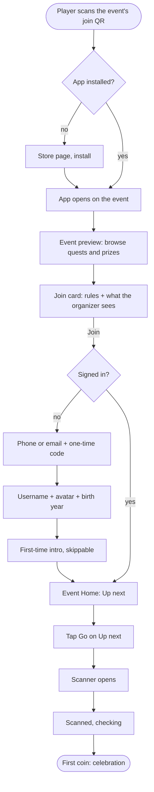

# UX — Player app

> The player's experience at planning level: flows, screens, wireframes, states.
> **Theme-agnostic.** No colors, fonts, illustration style or brand visuals appear here; the visual
> theme may change completely (user, 2026-10-17). Wireframes show structure only.
> Draft 2026-10-17 (Stage 4). Layout choices below were made by the user from alternatives.

## 1. Layout decisions (user, 2026-10-17)

| Screen | Decision | Alternatives not chosen |
|---|---|---|
| Event Home | **One vertical stack, "Up next" first**, then progress, ranking card, happening now, announcements | Progress-hero first; card feed |
| Quests tab | **Accordion list** of categories (collapsed = points and counts) with a List / Map toggle | Category tiles then list |
| Quest details | **Bottom sheet** over the quest list | Full screen |
| Ranking | **Card on Home, full screen on tap**; 11 rows, no scroll (ADR-052) | Mini top-3 on Home |
| Center button | **Camera full screen**, with a Scan | My QR toggle | A two-choice menu first |
| Rewards tab | **Balance on top, grid of rewards** | Big-row list |
| Profile tab | **Identity on top, sections as rows** | Segmented tabs |
| Joining | **Browse first; sign-in at the Join tap** on the join card (ADR-089, refines ADR-031) | Sign in before the preview; sign-in at the first quest |

Bottom bar inside an event: Home, Quests, ● (center), Rewards, Profile (ADR-053). Outside an event
(Questify home): Home, Explore, ●, Shop, Profile.

The quest-details bottom sheet has less room than a full screen. It therefore shows only the
essentials (title, reward, how to complete it, the one action) and a "Details" row that expands
steps, tips and the map pin inside the same sheet.

## 2. Primary flow — from a poster to the first coin

Target: under 3 minutes from the first scan to the first coin, install included (the activation metric, `METRICS.md`; ADR-098).



Steps:
1. The player scans the join QR (or opens an invite link or types the code).
2. If the app is missing, the store opens; after install the app opens on the event (Q-070 covers
   the iPhone path).
3. The event preview shows banner, quests and prizes. Nothing is asked yet (ADR-031).
4. The join card shows the rules and what the organizer will receive, with one Join button.
5. Tapping Join asks for an account, because the consent on the join card needs one: phone or
   email code, then username, avatar and birth year (returning players skip the last part).
6. The first-time intro plays (four cards, Skip), only if it hasn't been shown on this install
   (ADR-096). Then Home opens with **Up next**: one suggested quest and a Go button.
7. Go opens the scanner, the player scans, the first coin lands.

Steps 4 to 7 are the only ones between the preview and the value moment: well under the guide's
five-to-seven limit. The account form comes after the player has seen the event and decided to
join, not before (ADR-089). **Up next** is the quest the organizer pinned as the current focus;
otherwise the open quest with the best points for the time it takes.

## 3. Secondary flows

### 3.1 Sign-in and recovery
1. Enter a +966 phone or an email address.
2. Receive a code (SMS with autofill, or email); enter it.
3. Returning player: signed in (no username step). New player: username, avatar, birth year.
4. A wrong code three times asks for a new one. A lost number or email: sign in with the second
   identifier if one was added (FR-139); otherwise the contact page (WhatsApp, email, phone).

### 3.2 Completing each quest type (shared pattern)
Every quest opens the same bottom sheet: title, reward, "how", **one primary action** named after
its verification method.

| Quest type | Primary action in the sheet | Result |
|---|---|---|
| Scan QR | Open scanner | Scan, beat, celebration |
| Tap NFC | Open scanner (NFC ready) | Tap, beat, celebration |
| Challenge | Show My QR to staff | Staff scan, celebration |
| Photo or text | Take photo / write | Pending: "waiting for review" |
| Quiz | Start quiz | Question screens, then result |
| Vote | Choose an option | Vote recorded |
| Enter a code | Enter code | Beat, celebration |
| Meet someone | Open scanner (My QR on the other phone) | Both players celebrate |
| Survey | Start | Thanks screen |
| Location check-in | Check in here | Location asked first time, with an explanation |
| Mini-game | Play | Result vs target |
| Share | Share | Share sheet, then reward |

### 3.3 Redeeming a reward
1. Rewards tab → tap a reward → confirmation sheet (price, stock, pickup desk and hours).
2. Confirm → points leave the balance, the stock is held.
3. A reservation appears in "My reservations" with a countdown.
4. At the desk (ADR-150, the owner's choice): **Collect first**: tap Collect on the reservation, which opens My QR
   ("Collecting: Hoodie · 4:59"); the operator scans and hands it over. **Desk offer**: open My QR; the operator scans
   and taps Hand over; tap Accept on My QR. Either way the reservation then reads "Picked up" ("Confirmed" for an
   experience). The reservation and the confirmation sheet show the desk's place and hours (FR-1716).
5. Digital reward: the code appears in the app at once and stays in history.

### 3.4 After the event
Event ended → shop window (default 3 days) → balance closes. Score, rank, passport stamp and a
shareable recap stay. A banner on Home says when the shop closes (a date and time in the event's zone, never a
countdown) and, when the prize desk's hours end first, when items and experiences stop (digital rewards stay until
the close). Once closed the balance reads "Closed", the goal card goes, and the Rewards tab says when the shop closed
and what stays (the points, the rank and the stamp); My rewards stays, and cancelling a hold warns that returned
points can't be redeemed. "Your recap" on Home opens the card (the event, rank, quests done, up to 3 souvenirs;
"Thanks for joining" for none; the rank says it comes with the results until they are revealed). Share makes an image
on the phone and opens the share sheet, with no link and no text, or sends one fixed line on a build without the
sharing modules (T-410b).

### 3.5 Leaving an event, deleting an account
Profile → Settings → Leave event (confirmation explains what stays with the organizer) or Delete
account (confirmation lists what is deleted and what is anonymized). Both use the confirmation
pattern (ADR-063).

## 4. Screens, one primary action each

| # | Screen | Purpose | Primary action |
|---|---|---|---|
| P1 | Event preview | See what the event offers before joining | Join |
| P2 | Join card | Understand the rules and the data shared | Join |
| P3 | Sign-in | Prove the phone or email | Continue |
| P4 | Profile setup | Choose username, avatar, birth year | Done |
| P5 | Event Home | Know what to do next | Go (Up next) |
| P6 | Quests (list) | Find a quest | Open a quest |
| P7 | Quests (map) | Find where things are | Open a pin |
| P8 | Quest sheet | Understand and start one quest | The quest's action |
| P9 | Scanner / My QR | Prove presence | Scan |
| P10 | Celebration | Feel the reward | Claim / continue |
| P11 | Ranking | See where I stand | (view; back) |
| P12 | Rewards | Spend points | Redeem |
| P13 | Reservation | Collect a prize | Show My QR |
| P14 | Profile | See my identity and progress | Open a section |
| P15 | Passport / Achievements / Locker | Browse and equip | Equip |
| P16 | Notifications | Read what I missed | Open an item |
| P17 | Settings and legal | Change language, mutes, privacy, leave, delete | Change a setting |
| P18 | Event info / agenda / announcements | Practical information | (view) |
| P19 | Help desk | Report a problem or ask a question | Send |
| P20 | Questify Home | My events, daily challenge, streak | Open an event |
| P21 | Explore | Find public events | Open an event |
| P22 | Questify shop | Spend gems | Buy |
| P23 | Update required | Update the app to continue | Update |
| P24 | Wallet pass | Keep the event pass in my wallet | Add to Wallet |
| P25 | First-time intro | Understand Questify in about 15 seconds | Next / Skip |

Screens that look like they do two jobs and were split: Quests list and map (P6, P7, one toggle),
and Passport / Achievements / Locker (P15, three rows from Profile, one screen each).

## 5. Wireframes

Drawn at phone width. `[ ]` is a button, `▸` opens something, `●` is the center button.

### P1 Event preview
```
┌──────────────────────────┐
│ ‹            [share]     │
│ EVENT BANNER             │
│ Name · dates · place     │
│ 8,420 players            │
├──────────────────────────┤
│ What you can do          │
│ ▸ Quests (24)  ▸ Prizes  │
│ Top prizes: [img][img]   │
├──────────────────────────┤
│ [        Join         ]  │
└──────────────────────────┘
```

### P2 Join card
```
┌──────────────────────────┐
│ ‹  Join "Event name"     │
├──────────────────────────┤
│ How it works             │
│ · Earn points by quests  │
│ · Prizes from organizer  │
│ Rules ▸ (full text)      │
├──────────────────────────┤
│ The organizer will see   │
│ · your username, points  │
│ · answers you submit     │
│ · Company (asked below)  │
│ Company: [__________]    │
├──────────────────────────┤
│ [        Join         ]  │
└──────────────────────────┘
```

### P5 Event Home (chosen: option A)
```
┌──────────────────────────┐
│ [Event pill ▾]   [@me]   │
├──────────────────────────┤
│ EVENT BANNER      ⏱ 2h   │
├──────────────────────────┤
│ UP NEXT                  │
│ Scan booth 7  +50   [Go] │
├──────────────────────────┤
│ YOUR PROGRESS            │
│ 1,250 pts  ▓▓▓▓░░ L3     │
│ Goal: hoodie 120 to go   │
├──────────────────────────┤
│ RANKING   you #14      ▸ │
├──────────────────────────┤
│ HAPPENING NOW   ▸ ▸ ▸    │
│ ANNOUNCEMENTS            │
├──────────────────────────┤
│Home Quests ● Rewards Prof│
└──────────────────────────┘
```

### P6 Quests list (chosen: accordion)
```
┌──────────────────────────┐
│ Quests      [List|Map]   │
├──────────────────────────┤
│ ▾ Heritage Zone          │
│   2,000/10,000 · 3/10    │
│   ○ Scan fort gate   +50 │
│   ● Quiz: history    +80 │
│   ◌ Locked: chapter 2    │
├──────────────────────────┤
│ ▸ Food Court             │
│   0/3,000 · 0/6          │
├──────────────────────────┤
│ ▸ Sponsor Lounge         │
│   500/2,500 · 1/5        │
├──────────────────────────┤
│Home Quests ● Rewards Prof│
└──────────────────────────┘
```
Legend: ○ open, ● done, ◌ locked. A locked quest says what unlocks it. A category with an
in-order rule shows numbers 1, 2, 3. A category with a completion bonus shows "+500 bonus".

### P8 Quest sheet (chosen: bottom sheet)
```
┌──────────────────────────┐
│ Quests list (dimmed)     │
│ ▾ Heritage Zone          │
├══════════════════════════┤
│ Scan fort gate      +50  │
│ East gate · 2 min · XP   │
│ [    Open scanner     ]  │
│ Details ▾                │
│  Steps ● ○ ○             │
│  Tip: look near the sign │
│  [map pin: East gate]    │
└──────────────────────────┘
```
For a staffed challenge the button reads "Show My QR to staff". When several methods are enabled,
the other one is a text link under the button.

### P9 Scanner / My QR (chosen: camera first)
```
┌──────────────────────────┐
│ ✕            [flash]     │
│     ┌─────────────┐      │
│     │  viewfinder │      │
│     └─────────────┘      │
│  Point at a quest QR     │
│  or tap an NFC tag       │
│                          │
│   [ Scan | My QR ]       │
└──────────────────────────┘
```
My QR view: a large code, a ring showing the 30-second refresh, "Show this to staff", and the
username below.

### P10 Celebration
```
Step 1 (≤ 300 ms)          Step 2 (on confirmation)
┌───────────────────┐      ┌───────────────────┐
│   Scanned!        │      │      +50          │
│   checking…       │  →   │  Fort gate done   │
│                   │      │  Heritage 4/10    │
└───────────────────┘      │  [   Continue   ] │
                           └───────────────────┘
```
Bigger moments (category complete, level up, community goal) reuse the same frame with more
content; rules for scale are in ADR-083 and FR-407.

### P11 Ranking (chosen: card on Home, full screen on tap)
```
┌──────────────────────────┐
│ ‹ Ranking [Overall|Today]│
├──────────────────────────┤
│ 1  @falcon        4,100  │
│ 2  @noura         3,980  │
│ 3  @sami          3,720  │
│ …                        │
│ 10 @layla         2,310  │
├──────────────────────────┤
│▶14 @you (highlighted)    │
│        1,250             │
└──────────────────────────┘
```
Eleven rows, no scrolling. The Today tab appears only on multi-day events.

### P12 Rewards (chosen: balance + grid)
```
┌──────────────────────────┐
│ Rewards   Balance 1,250  │
│ Goal: hoodie 120 to go   │
│ [All][Merch][Food][Exp.] │
├──────────────────────────┤
│ ┌────────┐  ┌────────┐   │
│ │ Hoodie │  │ Coffee │   │
│ │ 1,370  │  │  300   │   │
│ │12 left │  │ Redeem │   │
│ └────────┘  └────────┘   │
├──────────────────────────┤
│ My reservations (2)    ▸ │
└──────────────────────────┘
```

### P13 Reservation
```
┌──────────────────────────┐
│ ‹ Hoodie (M)             │
│ Reserved · expires 6:40pm│
│ Collect at: Prize desk,  │
│ Hall B · open 4–10 pm    │
│ [    Show My QR       ]  │
│ Cancel reservation       │
└──────────────────────────┘
```

### P14 Profile (chosen: identity + rows)
```
┌──────────────────────────┐
│   (avatar + frame)       │
│   @falcon · Pathfinder   │
│   Level 7  ▓▓▓░░         │
│   Streak 3 · Gems 40     │
├──────────────────────────┤
│ Event Passport         ▸ │
│ Achievements           ▸ │
│ Locker (frames, titles)▸ │
│ Activity history       ▸ │
│ Notifications          ▸ │
│ Settings & legal       ▸ │
└──────────────────────────┘
```

### P20 Questify Home
```
┌──────────────────────────┐
│ [@me]   Streak 3         │
├──────────────────────────┤
│ MY EVENTS                │
│ ● Live: Event name     ▸ │
│ ◌ Soon: Expo, 14 Mar   ▸ │
│ ✓ Past: Campus day     ▸ │
├──────────────────────────┤
│ DAILY CHALLENGE          │
│ 3 questions     [Start]  │
├──────────────────────────┤
│ QUESTIFY QUESTS          │
│ Attend 3 events  1/3     │
├──────────────────────────┤
│Home Explore ● Shop Prof  │
└──────────────────────────┘
```

### P25 First-time intro (added 2026-10-17, ADR-096)
```
Language                     Card 1 of 4
┌────────────────────────┐   ┌────────────────────────┐
│ Choose your language   │   │ [scene: poster → scan] │
│ [ العربية ] [ English ]│   │ Join an event          │
│                        │   │ Scan its QR and you're │
│ [ Continue ]           │   │ in.                    │
└────────────────────────┘   │ ● ○ ○ ○        [Skip]  │
                             └────────────────────────┘
Cards 2–4: do quests · earn points and climb · win prizes and grow.
Last card: [ Scan an event QR ]  [ Explore events ]
```
Full-screen scenes with the mascot and motion; the style is decided in the design stage. It asks
for no permission. A player who arrives from a join QR sees the event preview and joins first, then
this intro, then Home (ADR-096).

### P24 Wallet pass (added 2026-10-17, ADR-091)
```
In the app (Profile / after join)     The pass in the wallet
┌──────────────────────────┐          ┌──────────────────────────┐
│ Your event pass          │          │ [event logo]  Event name │
│ Keep it in your wallet.  │          │ 20–22 Oct                │
│ It is stored in your     │          │ @falcon   Level 7        │
│ Apple/Google account and │          │ Score 4,100   Rank #14   │
│ holds no phone or email. │          │ Balance 1,250            │
│ [ Add to Wallet ]        │          │ [  QR  (fixed code)  ]   │
└──────────────────────────┘          │ Updated 14:02            │
                                      └──────────────────────────┘
```
Questify's frame, with the event's logo and name filled in. The code identifies the player to
operators; the numbers refresh when the phone allows it.

## 6. Required states per screen

"Empty" and "Error" are written out; the app is online-only (ADR-029), so every error has a retry
and says why.

| Screen | Loading | Empty | Error | Success | Populated |
|---|---|---|---|---|---|
| P1 Preview | Banner placeholder, rows fill in | Event has no quests yet: "The organizer is still setting this up. Check back soon." with the event info and the Join button still available | Can't load: "We couldn't open this event. Check your connection." [Retry] | – | Normal view |
| P2 Join card | Rules text placeholder | No rules written: the generated rules still show | Join failed: "You're not connected. Tap Join again." Hard limit reached: "This event is full." with the organizer's contact | Home opens with Up next | Normal view |
| P3 Sign-in | Sending code spinner | – | Wrong code: "That code isn't right. 2 tries left." Too many: "Request a new code." No signal: "No connection. Try again." | Signed in | – |
| P4 Profile | – | – | Username taken: "@falcon is taken. Try @falcon_7." Under 13: a kind refusal, no account created | Home | – |
| P5 Home | Section placeholders | Nothing open yet: "No quests are open right now. Next one opens at 4 pm." with the countdown | Can't refresh: "Showing the last update from 2 min ago." [Retry] | Pull-to-refresh done | Normal view |
| P6 Quests | Category rows placeholders | No categories: "No quests yet. Check Announcements." | "Couldn't load quests." [Retry] | – | Normal view |
| P7 Map | Map picture placeholder | No map: the toggle is hidden | "Couldn't load the map." [Retry] | – | Map with pins |
| P8 Quest sheet | Sheet skeleton | – | Quest closed: "This quest ended at 3 pm." Already done: "You already earned this." | – | Normal view |
| P9 Scanner | Camera starting | – | Camera denied: "Allow the camera to scan, or ask staff to scan your My QR." [Open My QR]. Unreadable: "Couldn't read that code. Move closer." Wrong event: "This code is for another event." No NFC: "This phone can't read NFC. Use the QR code." | Beat then P10 | Live viewfinder |
| P10 Celebration | "Scanned, checking…" | – | Server rejected: "That scan didn't count: <reason>." No celebration shown | Full celebration | – |
| P11 Ranking | Row placeholders | Nobody has points yet: "Be the first on the board." | "Couldn't load the ranking." [Retry] | – | 11 rows |
| P12 Rewards | Grid placeholders | No rewards: "The shop opens soon." | Out of stock: "Just ran out." Not enough points: "You need 120 more points." [Earn points → Quests] | Reservation made (P13) | Grid |
| P13 Reservation | – | – | Expired: "Your reservation expired; the points came back." Paused: "Redemption is paused for your account. Ask staff." | Handed over: "Collected" | Normal view |
| P14 Profile | Skeleton | New player: level 1, empty passport: "Join your first event to earn a stamp." | "Couldn't load your profile." [Retry] | Equipped item | Normal view |
| P16 Notifications | – | "Nothing new." | Retry | – | List |
| P17 Settings | – | – | Change failed: retry | Setting saved | Normal view |
| P19 Help desk | – | No tickets: "Report a problem or ask a question." | Send failed: draft kept, [Retry] | "Sent. We'll reply here and notify you." | Ticket list |
| P20 Questify Home | Placeholders | No events: "Scan an event's QR or browse Explore." | Retry | – | Normal view |
| P21 Explore | Placeholders | "No public events yet." | Retry | – | List |
| P22 Shop | Placeholders | "The shop is empty." | "Not enough gems." | Item unlocked | Grid |
| P23 Update | – | – | – | – | "A newer version is needed to play this event." [Update] |
| P25 Intro | Scenes loading: the first card shows at once | – | – | Last card: Scan / Explore | Four cards |
| P24 Wallet pass | Button shows a spinner | – | "Couldn't add the pass. Try again." Wallet unavailable on this phone: the button is hidden | "In your wallet" | Pass in the wallet; numbers may be a few minutes old ("Updated 14:02") |

## 7. Edge cases to design

- **Weak signal:** every screen has the same banner ("No connection") and keeps the last data;
  actions stay disabled until the connection returns (no offline queue).
- **Two events live:** the app opens the most recently used (FR-1610); the event pill switches.
- **Operator who may also play:** the pill offers "Switch to Operator mode".
- **Banned or paused player:** actions show the reason and the contact page.
- **Hidden category, locked quest, time-limited quest:** each shows what unlocks or when it opens.
- **Renamed words:** "quest", "category", "player" can be renamed per event (ADR-058); wireframes
  use the defaults.

## 8. Right-to-left and Arabic

- The whole layout mirrors: the bottom bar order, back arrows, progress bars, swipe directions and
  the "fly to balance" path.
- Numbers stay Western digits (ADR-018).
- Icons with direction (arrows, ▸) flip; icons without (camera, QR) do not.
- Copy is written for Arabic first, then English (PD-25).

## 9. Hand-off

Visual design (colors, type, components, illustration, motion) is a separate, later step and the
current adventure theme may be replaced. This plan has no dependency on it. Components that must
exist whatever the theme: bottom bar with center button, accordion, bottom sheet, grid card,
progress bar, ranking row, coin counter, celebration frame, banner, toggle, chip.
